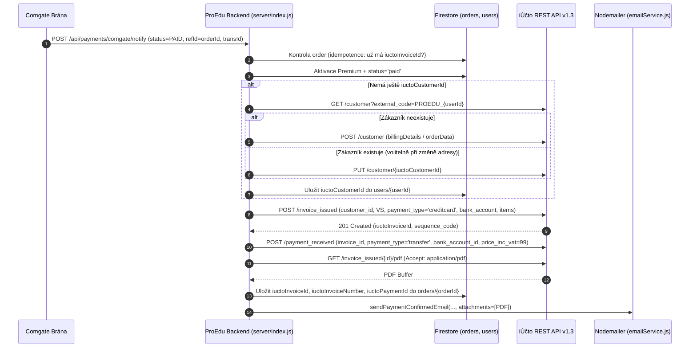

# Technický výzkum iÚčto REST API pro automatizaci fakturace (Comgate → iÚčto) v ProEdu

Tento dokument shrnuje hloubkový technický výzkum oficiálního veřejného **REST API účetního systému iÚčto** (verze `1.3`) proti primárním zdrojům ([developers.iucto.cz](https://developers.iucto.cz/), [iucto.cz/funkce/api](https://www.iucto.cz/funkce/api/), [iucto.cz/cenik](https://www.iucto.cz/cenik/)). Výzkum je zaměřen na konkrétní potřeby backendu aplikace **ProEdu** ([server/index.js](file:///C:/PROJEKTY/PRO%20EDU/APPKA/ProEdu/server/index.js)) při automatickém vystavování a odesílání faktur po úspěšných platbách přes platební bránu **Comgate** (jednorázové/iniciační platby i opakované měsíční platby `99 Kč/měsíc`).

> **Poznámka k přesnosti a ověření:** Každé technické tvrzení je opřeno o primární zdroje iÚčto. Oblasti, které nebyly v dostupných veřejných podkladech jednoznačně specifikovány nebo závisí na konkrétním nastavení účetní jednotky v iÚčtu, jsou v textu výslovně označeny jako **Nutné ověřit v OpenAPI / administraci iÚčto**.

---

## 1. Tarify iÚčto, omezení tarifu Start a dostupnost API

Dostupnost API, denní/měsíční limity požadavků i podpora vlastního SMTP se zásadně liší podle zvoleného tarifu iÚčto.

* **Primární zdroje:** [iÚčto – API rozhraní](https://www.iucto.cz/funkce/api/), [iÚčto – Ceník](https://www.iucto.cz/cenik/), [iÚčto Developers – Limity a kvóty](https://developers.iucto.cz/limity)

### 1.1 Přehled tarifů a jejich API limitů

| Tarif | Určení | Orientační cena bez DPH *(nutné ověřit na iucto.cz/cenik)* | Limit dokladů | Limit API požadavků | Vlastní SMTP (odesílání z vlastní domény) |
| :--- | :--- | :--- | :--- | :--- | :--- |
| **Start** | 14denní zkušební (trial) tarif zdarma | Zdarma (14 dnů) | **Max. 100 zaúčtovaných dokladů** celkem | **2 000 požadavků / den** | Ne *(výchozí adresa iÚčta)* |
| **Fakturace** | Pouze online fakturace bez plného účetnictví | cca 189 Kč/měs. (cca 158 Kč/měs. při roční platbě) | Neomezeně | **3 000 požadavků / měsíc** | **Ne** |
| **Sólo** | OSVČ – daňová evidence / vlastní evidence | cca 357 Kč/měs. (cca 298 Kč/měs. při roční platbě) | Neomezeně | **API není k dispozici (0)** | **Ne** |
| **Firma** | Firmy, s.r.o., automatizace, přímé banky | cca 595 Kč/měs. (cca 496 Kč/měs. při roční platbě) | Neomezeně | **5 000 požadavků / den** | **Ano** (vlastní SMTP / Gmail / Seznam) |
| **Max** | Větší firmy, neomezené přístupy | cca 714 Kč/měs. (cca 595 Kč/měs. při roční platbě) | Neomezeně | **10 000 požadavků / den** | **Ano** |

### 1.2 Detailní omezení tarifu Start (pro vývoj a testování)

Protože iÚčto **nemá samostatné sandboxové prostředí**, testování API integrace typicky probíhá proti nově založené zkušební firmě v tarifu **Start** ([developers.iucto.cz/zaciname](https://developers.iucto.cz/zaciname)). Tarif Start má tato tvrdá omezení ([iucto.cz/cenik](https://www.iucto.cz/cenik/)):

1. **Časový limit 14 dní:** Zkušební verze běží 14 dní od založení (nevyžaduje kartu a automaticky se neprodlužuje).
2. **Tvrdý limit 100 dokladů:** Limit se **nenuluje** s novým měsícem ani rokem.
   * **Počítají se:**
     * **Platby** (vydané i přijaté, bankovní i pokladní) – započítávají se **ihned po založení**, i když nejsou zaúčtované.
     * **Faktury** (vydané i přijaté) – započítávají se po zaúčtování.
     * **Dobropisy** (vydané i přijaté) – započítávají se po zaúčtování.
   * **Nepočítají se:** Zálohové faktury, objednávky, nabídky, poptávky, předpisy nákladů a interní doklady.
   * Po vyčerpání 100 dokladů systém zablokuje zakládání nových faktur, záloh, dobropisů i plateb.
3. **Další omezení Startu:** 1 firma, max. 1 současný přístup (další přihlášení odhlásí předchozí relaci), max. 5 AI vytěžených dokladů, účetní období omezeno na aktuální kalendářní rok.

### 1.3 Dopad výběru tarifu na ProEdu

* **Pozor na tarif `Sólo`:** Přestože je dražší než `Fakturace`, **nemá dostupné API**. Pro automatizaci ProEdu je tedy nepoužitelný.
* **Tarif `Fakturace` (3 000 API volání / měsíc):** Při efektivním návrhu (~4–5 API volání na 1 zaplacenou objednávku: vyhledání/založení zákazníka + vytvoření faktury + vytvoření platby + stažení PDF; případně bez vyhledávání díky uložení `iuctoCustomerId` v Firestore) vystačí 3 000 req/měsíc zhruba na **600–750 objednávek měsíčně** včetně opakovaných stržení. Nevýhodou je absence vlastního SMTP v iÚčtu (což ale snadno obejdeme stažením PDF z iÚčta a odesláním přes vlastní Nodemailer v ProEdu).
* **Tarif `Firma` (5 000 API volání / den):** Nutný v případě, že ProEdu potřebuje plné účetnictví/daňovou evidenci s API, přímé bankovní napojení (Fio/KB/ČS/Moneta/RB), vlastní SMTP přímo z iÚčta nebo vyšší objem API volání.

---

## 2. Základní technické parametry API (verze 1.3)

* **Primární zdroje:** [developers.iucto.cz/zaciname](https://developers.iucto.cz/zaciname), [developers.iucto.cz/spec/openapi.yaml](https://developers.iucto.cz/spec/openapi.yaml), [developers.iucto.cz/limity](https://developers.iucto.cz/limity)

### 2.1 Base URL, formát a OpenAPI specifikace

* **Base URL:** `https://online.iucto.cz/api/1.3/`
* **Aktuální verze API:** `1.3`
* **Protokol:** Výhradně **HTTPS** (REST).
* **Formát komunikace:**
  * Odpovědi (`GET`, `POST`, `PUT`): formát **`HAL+JSON`** (kolekce jsou v poli `_embedded.<resource>`).
  * Těla požadavků (`POST`, `PUT`): čistý **JSON** s hlavičkou `Content-Type: application/json`. Prázdné tělo u `POST`/`PUT` server odmítne chybou `400`.
  * Formát dat (datum): `YYYY-MM-DD` (např. `"2026-11-13"`).
* **OpenAPI 3.1 specifikace:** Veřejně dostupná na `https://developers.iucto.cz/spec/openapi.yaml` (případně `openapi.json`), obsahuje **161 operací**.
* **CORS:** API **nepodporuje CORS hlavičky** – nelze jej volat přímo z frontendu (React/Vite). Veškerá komunikace musí jít přes backend ([server/index.js](file:///C:/PROJEKTY/PRO%20EDU/APPKA/ProEdu/server/index.js)), což plně odpovídá i bezpečnostním pravidlům ProEdu.

### 2.2 Autentizace

* **Mechanismus:** Jediná HTTP hlavička **`X-Auth-Key: <IUCTO_API_KEY>`** (bez OAuth2).
* **Generování klíče:** V aplikaci iÚčto v cestě *Nastavení → Nastavení API* (případně *Nastavení → Automatizace → API*).
* **Oprávnění:** API klíč je vázán na konkrétního uživatele a jednu firmu; dědí oprávnění tohoto uživatele.
* **Ověření funkčnosti:**
  ```bash
  curl -s https://online.iucto.cz/api/1.3/company_profile \
    -H "X-Auth-Key: $IUCTO_API_KEY"
  ```
  Vrátí `200 OK` s profilem firmy (IČO, DIČ, plátcovství DPH aj.), nebo `401 Unauthorized` při neplatném klíči.

### 2.3 HTTP stavové kódy a specifika rate limitů

* **`200 OK` / `201 Created` / `204 No Content`:** Úspěšné operace čtení, vytvoření nebo smazání.
* **`400 Bad Request`:** Chyba validace dat nebo struktury (chybějící povinné pole, prázdné tělo, nevalidní formát data, `vat_payer: true` bez `vatid`, neplatný `payment_type` na platbě apod.).
* **`401 Unauthorized`:** Chybějící nebo neplatný `X-Auth-Key`, případně klíč patřící jiné firmě.
* **`402 Payment Required`:** **Zásadní specifikum iÚčta!** API **nikdy nevrací `429 Too Many Requests`**. Při vyčerpání denní/měsíční kvóty nebo při volání modulu nedostupného v daném tarifu vrátí HTTP **`402`** s textovou zprávou o aktuálním čerpání. API rovněž neposílá hlavičky `X-RateLimit-*` ani `Retry-After` – sledování a backoff si musí řešit aplikace sama.
* **`404 Not Found`:** Záznam s daným ID neexistuje.
* **Stránkování seznamů (`GET`):** Query parametry `page` a `pageSize` (např. `?page=1&pageSize=200`).

---

## 3. Knihovny, SDK a nástroje

* **Primární zdroje:** [GitHub iucto/iucto-api-php-sdk](https://github.com/iucto/iucto-api-php-sdk), [npm @iucto.cz/iucto-mcp-server](https://www.npmjs.com/package/@iucto.cz/iucto-mcp-server), [developers.iucto.cz](https://developers.iucto.cz/)

* **Oficiální PHP SDK:** `composer require iucto/iucto-api-php-sdk` (není relevantní pro Node.js backend ProEdu).
* **Oficiální JS / Node.js REST SDK:** **Neexistuje** na npm žádný oficiální Node.js REST klient pro aplikaci.
* **Oficiální MCP server (pro AI asistenty):** Na npm existuje `@iucto.cz/iucto-mcp-server` (určený pro Claude Desktop / AI nástroje, nikoliv jako produkční SDK do Express backendu).
* **Doporučení pro ProEdu (`server/index.js`):** Použít tenký vlastní klient postavený na nativním Node.js **`fetch`** (který už `server/index.js` používá pro Comgate REST API v2.0), případně z `https://developers.iucto.cz/spec/openapi.yaml` vygenerovat JSDoc/TypeScript definice pro vývojovou kontrolu.

---

## 4. Konkrétní endpointy pro automatizaci Comgate → iÚčto

Všechny níže uvedené endpointy jsou relativní k `https://online.iucto.cz/api/1.3/`.

### 4.1 Profil firmy a číselníky (inicializace a cachování)

Dokumentace ([developers.iucto.cz](https://developers.iucto.cz/)) doporučuje načíst číselníky při startu serveru / s dlouhou cache, aby se šetřila API kvóta:

| Endpoint | Účel | Poznámka |
| :--- | :--- | :--- |
| `GET /company_profile` | Profil firmy (plátce/neplátce DPH, IČO, DIČ) | Určuje, zda posílat `date_vat` a sazby DPH |
| `GET /bank_account` | Seznam bankovních účtů a jejich ID | Potřebné ID pro `bank_account` na faktuře a `payment_received` |
| `GET /payment_type` | Číselník způsobů úhrady | Vrací: `transfer`, `cash`, `cashondelivery`, `reciprocity`, `creditcard` |
| `GET /vat_chart` | Seznam účtů DPH (`vat_chart_id`) | Pro zaúčtování položek dokladu |
| `GET /accountentry_type?doctype=FV` | Typy účetních položek pro vydané faktury | Pro `accountentrytype_id` na položkách dokladu |
| `GET /vat_type?doctype=FV` | Typy DPH pro vydané faktury | Pro `vattype_id` na položkách dokladu |
| Číselník sazeb DPH | Platné sazby DPH dle `date + country` | *Přesný název endpointu (např. `/vat_rate` vs `/vat_rates`) nutno ověřit v `openapi.yaml`* |

> **Fiktivní bankovní účet pro Comgate:** V nápovědě iÚčta pro napojení Comgate ([iucto.cz](https://www.iucto.cz/)) se pro bránu doporučuje založit v *Nastavení → Firma a uživatelé → Bankovní účty* samostatný (tzv. fiktivní) bankovní účet typu **`<jiná banka>`** v měně CZK. Jeho ID získané přes `GET /bank_account` je vhodné použít pro párování plateb z Comgate.

---

### 4.2 Zákazníci / odběratelé (`/customer`)

* **Primární zdroj:** [developers.iucto.cz](https://developers.iucto.cz/)

#### Dostupné endpointy
* `GET /customer` – stránkovaný seznam zákazníků s filtry:
  * `?external_code=PROEDU_<uid>` – **doporučený primární klíč** pro párování uživatelů e-shopu/SaaS (max. 50 znaků).
  * `?comid=<ICO>` – vyhledání podle IČO (max. 20 znaků; nevhodné jako jediný klíč pro fyzické osoby bez IČO, jakými je většina studentů v ProEdu).
  * **Důležité omezení:** Na rozdíl od endpointu dodavatelů (`GET /supplier`, kde jsou zdokumentovány filtry `name`, `comid`, `email`), dokumentace `GET /customer` filtry podle `email` ani `name` neuvádí. *(Nutné ověřit v `openapi.yaml`, zda novější revize `email` nepřidala; do té doby spoléhat na `external_code` a ukládat vrácené `iuctoCustomerId` do Firestore dokumentu `users/{uid}`.)*
* `GET /customer/:id` – detail zákazníka.
* `POST /customer` – vytvoření zákazníka.
* `PUT /customer/:id` – **úplná aktualizace (nahrazení)** zákazníka (ne `PATCH`!).
* `DELETE /customer/:id` – smazání (pouze pokud nemá navázané faktury ani platby).

#### Příklad payloadu `POST /customer`
```json
{
  "name": "Jan Novák",
  "email": "student@student.cz",
  "external_code": "PROEDU_uid123",
  "comid": "12345679",
  "vat_payer": false,
  "usual_maturity": 14,
  "preferred_payment_method": "creditcard",
  "invoice_language": "cs",
  "address": {
    "street": "Stodolní 123",
    "city": "Ostrava",
    "postalcode": "702 00",
    "country": "CZ"
  }
}
```
* **Pravidlo DPH:** Pokud je `"vat_payer": true`, pole `"vatid"` (DIČ, např. `"CZ12345679"`) je **povinné**, jinak API vrátí `400 Bad Request`.
* **Pole `address.country`:** Očekává ISO dvoupísmenný kód země (např. `"CZ"`), nikoliv řetězec `"Česká republika"` (v `server/index.js` je nutné provést mapování!).

---

### 4.3 Vydané faktury (`/invoice_issued`)

* **Primární zdroj:** [developers.iucto.cz](https://developers.iucto.cz/)

#### Dostupné endpointy
* `GET /invoice_issued` – seznam vydaných faktur (podporuje filtry např. `paid`, `sequence_code`, `page`, `pageSize`).
* `GET /invoice_issued/:id` – detail faktury (`InvoiceIssuedDetail`, obsahuje např. `to_be_paid`, `share_link`, `price_inc_vat`).
* `POST /invoice_issued` – vytvoření vydané faktury (`InvoiceIssuedParams`).
* `PUT /invoice_issued/:id` – aktualizace faktury *(pozor: nelze poslat surový výstup z `GET`, vnořené objekty se posílají jako ID)*.
* `DELETE /invoice_issued/:id` – smazání faktury.
* `GET /invoice_issued/:id/pdf` – stažení binárního PDF (`Accept: application/pdf`).
* `POST /invoice_issued/:id/email` – odeslání faktury e-mailem z iÚčta.

#### Klíčová pole `POST /invoice_issued` (`InvoiceIssuedParams`)
* **`customer_id`** *(integer, povinné)* – ID zákazníka v iÚčtu.
* **`sequence_code`** *(string, max. 45, volitelné)* – číslo dokladu. Pokud se **vynechá**, iÚčto vygeneruje číslo automaticky podle nastavené číselné řady.
* **`variable_symbol`** *(string, max. 10 znaků)* – variabilní symbol (ProEdu v `server/index.js` generuje 9místný VS ze `String(Date.now()).slice(-9)`, což limit bezpečně splňuje).
* **`date`** *(string `YYYY-MM-DD`, povinné)* – datum vystavení.
* **`date_vat`** *(string `YYYY-MM-DD`, podmíněně povinné)* – datum zdanitelného plnění (DUZP). **Vyplňuje se pouze u plátců DPH; u neplátce DPH se nesmí posílat!**
* **`maturity_date`** *(string `YYYY-MM-DD`, povinné)* – datum splatnosti (u již zaplacené kartové platby typicky stejné jako `date`).
* **`currency`** *(string, povinné)* – měna dokladu, např. `"CZK"`.
* **`payment_type`** *(string, povinné)* – povolené hodnoty na faktuře: `transfer`, `cash`, `cashondelivery`, `reciprocity`, **`creditcard`**.
* **`bank_account`** *(integer, podmíněně povinné)* – ID bankovního účtu. **Povinné** při `payment_type: "transfer"` i **`"creditcard"`**! *(Nutné ověřit v `openapi.yaml`, zda je pole na `invoice_issued` pojmenováno `bank_account` a nikoli `bank_account_id` – v příkladech dokumentace `InvoiceIssuedParams` se uvádí `bank_account`.)*
* **`rounding_type`** *(string, volitelné)* – způsob zaokrouhlení: `"none"`, `"round"`, `"up"`, `"down"`. Pokud se neuvede, použije se výchozí nastavení firmy.
* **`description`** *(string, volitelné)* – poznámka / popis na dokladu.
* **`items`** *(array, povinné, min. 1 položka)*:
  * `text` *(string, povinné, max. 255 znaků)* – název položky (např. `"ProEdu Premium – měsíční předplatné"`).
  * `amount` *(number, povinné)* – množství (např. `1`).
  * `price` *(number, povinné)* – jednotková cena.
  * `unit` *(string, volitelné)* – např. `"měs."` nebo `"ks"`.
  * `unit_price_inc_vat` *(boolean)* – `true`, pokud je `price` včetně DPH (`99`), `false`, pokud bez DPH.
  * `vat` *(number)* – sazba DPH v % (např. `21`, nebo `0` pro neplátce).
  * **Zaúčtování položek (důležité!):** Všechny položky musí mít určeno zaúčtování buď dvojicí **`accountentrytype_id` + `vattype_id`** (má prioritu), nebo **`chart_account_id` + `vat_chart_id`** (tyto dva přístupy se nesmí kombinovat). Konkrétní ID je nutné jednorázově načíst z číselníků účtu (`GET /accountentry_type?doctype=FV`, `GET /vat_type?doctype=FV`, `GET /vat_chart`).

#### Specifika pro plátce DPH vs. neplátce DPH
Podle dokumentace platí pro **neplátce DPH** tato pravidla:
1. V payloadu **neuvádět `date_vat`**.
2. Na položkách v `items[]` posílat **`"vat": 0`** (pole nevynechávat).
3. Vynechat daňová pole na položkách (`vat_total`, `vattype_id`, `vat_chart_id`, případně `unit_price_inc_vat`).
*(Pozn.: Nutné otestovat přímo proti cílovému profilu firmy v iÚčtu podle toho, zda je provozovatel ProEdu plátce či neplátce DPH.)*

---

### 4.4 Zálohové faktury (`/proforma_invoice_issued`) vs. ostrá faktura po platbě kartou

* **Primární zdroj:** [developers.iucto.cz](https://developers.iucto.cz/)

iÚčto nabízí pro zálohové faktury vydané samostatný endpoint **`/proforma_invoice_issued`** (včetně `/proforma_invoice_issued/:id/email`, stažení PDF a vazby `proforma_invoice_id` v platbách).

* **Doporučený scénář pro Comgate platbu kartou / Apple Pay / Google Pay v ProEdu:**
  Vzhledem k tomu, že při online platbě kartou přes Comgate proběhne autorizace okamžitě během několika sekund a aplikace dostane webhook `status: 'PAID'`, **nedává smysl vystavovat předem zálohovou fakturu** pro každé nedokončené kliknutí na tlačítko „Zaplatit“ (zbytečně by se tím zaplňovalo účetnictví opuštěnými zálohami).
  * **Správný postup:** Vystavit **až ostrou vydanou fakturu (`POST /invoice_issued`)** ve chvíli, kdy backend obdrží potvrzení `PAID` (v `/api/payments/comgate/notify` nebo při úspěšném `/api/payments/comgate/charge-recurring`), a ihned k ní zaevidovat úhradu (`POST /payment_received`).
  * *Poznámka:* Ve veřejné dokumentaci nebyl nalezen explicitní endpoint pro jednokrokovou konverzi `proforma_invoice_issued` na konečný daňový doklad `invoice_issued` přes API *(nutné ověřit v `openapi.yaml` pro případ budoucího znovuzavedení zpožděného bankovního převodu)*.

---

### 4.5 Evidence úhrady a spárování platby (`/payment_received`)

* **Primární zdroje:** [developers.iucto.cz](https://developers.iucto.cz/), [iÚčto nápověda – Comgate](https://www.iucto.cz/), [Comgate nápověda – iÚčto](https://www.comgate.eu/)

Zde se skrývá **nejdůležitější technické omezení**, které je nutné znát před implementací:

1. **Rozdíl povolených `payment_type` mezi fakturou a platbou:**
   * Na faktuře (`invoice_issued`) lze použít `creditcard`.
   * Na přijaté platbě (`POST /payment_received`) API povoluje **pouze hodnoty `"transfer"` a `"cash"`!** Pokud na `POST /payment_received` pošlete `"creditcard"`, server vrátí **`400 Bad Request`**.
   * **Důsledek pro Comgate:** Platby z platební brány Comgate se v iÚčtu účtují jako bezhotovostní pohyb na vyhrazeném (fiktivním) bankovním účtu brány, proto se při vytváření přijaté platby přes `POST /payment_received` posílá **`"payment_type": "transfer"`** spolu s ID tohoto bankovního účtu.
2. **Endpoint a klíčová pole `POST /payment_received`:**
   ```json
   {
     "date": "2026-11-13",
     "bank_account_id": 456,
     "invoice_id": 12345,
     "variable_symbol": "123456789",
     "payment_type": "transfer",
     "price_inc_vat": 99.00
   }
   ```
   * `invoice_id` *(integer)* – ID vydané faktury, kterou platba hradí. Platbu lze spárovat **nejvýše na jeden doklad** (`invoice_id`, `proforma_invoice_id` a `creditnote_received_id` se vzájemně vylučují).
   * `price_inc_vat` *(number)* – uhrazená částka včetně DPH v měně účtu.
   * `date` *(date `YYYY-MM-DD`, povinné)* – datum úhrady (musí spadat do otevřeného účetního období).
   * **Poznámka k názvu pole bankovního účtu:** V dokumentaci se u `PaymentReceivedParams` v různých částech uvádí `bank_account_id` i `bank_account` (ID). *Před implementací je nutné ověřit přesný název pole v `openapi.yaml`.*
   * **Poznámka ke stavu úhrady:** *Je nutné v testovací firmě ověřit, zda `POST /payment_received` s `invoice_id` automaticky ihned vynuluje `to_be_paid` na faktuře a zaúčtuje platbu, nebo zda platba vyžaduje dodatečné zaúčtování v iÚčtu.*
3. **Pozor na duplicitu při importu výpisů z Comgate:**
   iÚčto nativně podporuje ruční import CSV / ABO / GPC výpisů z Comgate (v sekci *Platby → Banka – importy*, které páruje podle VS a částky). **Pokud bude backend ProEdu zakládat platby automaticky přes `POST /payment_received`, nesmí účetní zároveň importovat tentýž výpis z Comgate ručně** (jinak vzniknou duplicitní úhrady), případně je nutné zvolit jen jeden mechanismus (API `POST /payment_received` pro okamžitou evidenci vs. dávkový import výpisu z Comgate zohledňující i poplatky brány).

---

### 4.6 Dobropisy / opravné daňové doklady (`/creditnote_issued`)

* **Primární zdroj:** [developers.iucto.cz](https://developers.iucto.cz/)

Pro případ vrácení platby (refundu v Comgate) nebo storna objednávky slouží endpoint **`/creditnote_issued`**:

* **Endpointy:** `GET /creditnote_issued`, `GET /creditnote_issued/:id`, `POST /creditnote_issued`, `PUT /creditnote_issued/:id`, `DELETE /creditnote_issued/:id`, `PUT /creditnote_issued/:id/share`, `POST /creditnote_issued/:id/email`.
* **Klíčové rozdíly oproti `invoice_issued` (`CreditnoteIssuedParams`):**
  1. **`invoice_issued_id`** *(integer)* – ID původní vydané faktury, kterou dobropis opravuje.
  2. **`description`** *(string, **POVINNÉ**)* – na rozdíl od běžné faktury je poznámka povinná a musí obsahovat **důvod opravy** (např. `"Storno objednávky / vrácení platby ProEdu Premium"`).
  3. **Dopočítané částky (`price`, `price_inc_vat`, `to_be_paid`):** V těle `POST`/`PUT` se neposílají, dopočítává je server.
  4. **Znaménko položek v `items[]`:** *Zda se v `items[]` u dobropisu posílá kladná nebo záporná cena/množství, není z veřejných výňatků jednoznačné – nutno ověřit v `openapi.yaml` / testovací firmě.*
  5. **PDF u dobropisů:** Pro `creditnote_issued` **není v API 1.3 zdokumentován** přímý binární endpoint `/creditnote_issued/{id}/pdf` (jako existuje u `invoice_issued`). PDF lze doručit dvěma oficiálními cestami:
     * `POST /creditnote_issued/:id/email` s `"attach_pdf": true`, nebo
     * `PUT /creditnote_issued/:id/share` (vygeneruje veřejný `share_link`, přes který si klient doklad zobrazí a stáhne PDF).
     *(Pro případné nahrávání externích příloh existuje také `POST /creditnote_issued/{id}/attachment` do 5 MB.)*

---

### 4.7 Stažení PDF a odeslání faktury e-mailem

* **Primární zdroje:** [developers.iucto.cz](https://developers.iucto.cz/), [iÚčto – Ceník](https://www.iucto.cz/cenik/)

#### Varianta A: Odeslání přímo přes iÚčto API (`POST /invoice_issued/:id/email`)
```json
{
  "message": "Dobrý den, v příloze zasíláme daňový doklad za předplatné ProEdu Premium.",
  "recipient": ["student@student.cz"],
  "hidden_copy": [],
  "attach_pdf": true,
  "attach_delivery_note_pdf": false
}
```
* **Odpověď (`200 OK`):** `{ "send": true }`
* **Nevýhoda pro ProEdu:** V tarifech `Start` a `Fakturace` **nelze nastavit vlastní SMTP**. E-mail tak odchází ze systémové adresy iÚčta bez vizuálního brandingu ProEdu, což může u uživatelů snižovat důvěryhodnost nebo padat do spamu, a navíc nelze PDF přiložit přímo do stávajícího potvrzovacího e-mailu ProEdu.

#### Varianta B (Doporučená pro ProEdu): Stažení PDF z iÚčta + odeslání vlastním Nodemailerem
1. Stáhnout PDF binárně z iÚčta:
   ```http
   GET https://online.iucto.cz/api/1.3/invoice_issued/:id/pdf
   X-Auth-Key: <IUCTO_API_KEY>
   Accept: application/pdf
   ```
   Vrátí binární obsah (`application/pdf`, `200 OK`).
2. Předat `Buffer` PDF jako přílohu (`attachments: [{ filename: 'faktura-proedu.pdf', content: pdfBuffer }]`) do stávající funkce `sendEmail` / `sendPaymentConfirmedEmail` / `sendRecurringChargeSuccessEmail` v [server/services/emailService.js](file:///C:/PROJEKTY/PRO%20EDU/APPKA/ProEdu/server/services/emailService.js).
* **Výhody:** Student dostane **jeden přehledný e-mail** s potvrzením aktivace/prodloužení Premium i přiloženou fakturou v PDF z vlastní domény (`SMTP_FROM="ProEdu <info@pro-edu.eu>"`), a to i na levném tarifu **`Fakturace`** bez nutnosti platit tarif `Firma` jen kvůli SMTP.

---

### 4.8 Webhooky v iÚčtu

* **Primární zdroj:** [developers.iucto.cz/webhooky](https://developers.iucto.cz/webhooky)

* **Princip:** iÚčto posílá odchozí HTTP `POST` na nastavenou URL při událostech `created`, `edited`, `deleted`, `paid` (u `paid` posílá objekt dokladu i platby).
* **Nastavení:** Pouze ručně v webovém UI (*Nastavení → Automatizace → Nastavení API → Webhooky*), nelze registrovat přes API.
* **Bezpečnostní omezení:** iÚčto k webhookům **nepřikládá žádný HMAC podpis ani tajný klíč**. Dokumentace proto výslovně doporučuje nepřebírat data z těla webhooku naslepo, ale brát z něj jen ID a následně stav ověřit přes `GET` volání do API.
* **Relevance pro ProEdu:** Při platbách přes Comgate má ProEdu zdroj pravdy v Comgate webhooku (`/api/payments/comgate/notify`), takže webhooky z iÚčta pro karetní platby nepotřebuje. Užitečné by byly pouze v případě, kdyby se v budoucnu vrátil bankovní převod a párování probíhalo v iÚčtu přes Fio banku.

---

## 5. Návrh architektury a mapování pro ProEdu

Níže je návrh bezpečného toku dat pro současnou implementaci v [server/index.js](file:///C:/PROJEKTY/PRO%20EDU/APPKA/ProEdu/server/index.js) (kde již existují endpointy `/api/orders/create`, `/api/payments/comgate/notify`, `/api/payments/comgate/charge-recurring` a `/api/subscription/billing`).



### 5.1 Mapování dat ProEdu → iÚčto

V `server/index.js` již existují fakturační struktury v `orderData` (ř. 1702–1724) a `users/{uid}.billingDetails` (ř. 2370–2379, kde je připraven i komentář `TODO (iÚčto API)`):

| Pole v ProEdu (`orders` / `billingDetails`) | Pole v iÚčto API | Poznámka / transformace |
| :--- | :--- | :--- |
| `userId` | `customer.external_code` | Prefixovat např. `PROEDU_${userId}` (max 50 znaků) |
| `clientName` | `customer.name` | Jméno a příjmení / název firmy |
| `invoiceEmail` | `customer.email` | Max 100 znaků |
| `billingAddress.street` | `customer.address.street` | Ulice a číslo |
| `billingAddress.city` | `customer.address.city` | Město |
| `billingAddress.zip` | `customer.address.postalcode` | PSČ |
| `billingAddress.country` | `customer.address.country` | Mapovat `"Česká republika"` → `"CZ"` (ISO-2 kód!) |
| `billingDetails.ico` | `customer.comid` | Volitelné (pouze pokud je vyplněno, max 20 znaků) |
| `billingDetails.dic` | `customer.vatid` + `vat_payer: true` | Pokud je vyplněné DIČ, nastavit `vat_payer: true`, jinak `false` |
| `variableSymbol` (9 číslic) | `invoice_issued.variable_symbol` | Max 10 znaků (`String(Date.now()).slice(-9)` vyhovuje) |
| `amount` (`99`) | `invoice_issued.items[0].price` + `payment_received.price_inc_vat` | V `CZK`, `amount: 1` |
| `paidAt` (datum) | `invoice_issued.date`, `maturity_date`, `payment_received.date` | Formát `YYYY-MM-DD` v časové zóně `Europe/Prague` |
| `orderId` | `invoice_issued.description` | Např. `"Objednávka ProEdu #${orderId} (Comgate ${transId})"` |

### 5.2 Bezpečnostní a provozní zásady (dle pravidel ProEdu)

1. **Tajné klíče pouze na serveru:** Nová proměnná `IUCTO_API_KEY` (a případně `IUCTO_COMGATE_BANK_ACCOUNT_ID`) smí být **výhradně v serverovém `.env`** (nikdy s prefixem `VITE_`, nikdy v `src/`).
2. **Idempotence proti duplicitním fakturám:** Comgate může poslat webhook opakovaně (retry). Před zavoláním `POST /invoice_issued` musí server zkontrolovat `order.iuctoInvoiceId` v Firestore (a ideálně použít transakci / stavový zámek), aby nevznikly dvě ostré faktury na jednu platbu.
3. **Asynchronní tolerance chyb (neblokovat aktivaci Premium):** Pokud iÚčto API dočasně selže (výpadek sítě nebo `402`), aktivace Premium v ProEdu a odpověď `code=0&message=OK` pro Comgate musí proběhnout vždy; neúspěšné vystavení faktury se označí v dokumentu objednávky (`iuctoSyncStatus: 'failed'`, `iuctoError`) pro pozdější automatický či ruční retry z učitelského dashboardu.
4. **Nezapisovat z klienta:** Klient nesmí mít možnost vytvářet ani měnit `iuctoInvoiceId`, `iuctoCustomerId` ani fakturační statusy v `orders` / `users` (vynuceno ve `firestore.rules`).

---

## 6. Body k ověření před implementací (Neověřené / závislé na účtu)

Než se začne psát integrační modul `server/services/iuctoService.js`, je nutné z `https://developers.iucto.cz/spec/openapi.yaml` a ze skutečného iÚčto účtu majitele ProEdu ověřit následující položky:

1. **Režim DPH majitele účtu:** Zda je provozovatel ProEdu plátce DPH (`vat_payer: true` + `date_vat` + `vat: 21`) nebo neplátce (`vat: 0`, bez `date_vat`).
2. **ID účetních číselníků:** Načíst konkrétní ID z produkčního účtu přes `GET /bank_account` (ID fiktivního účtu pro Comgate), `GET /accountentry_type?doctype=FV`, `GET /vat_type?doctype=FV` a `GET /vat_chart`.
3. **Přesný název pole bankovního účtu na `payment_received` a `invoice_issued`:** Ověřit v `openapi.yaml`, zda tělo `POST /payment_received` vyžaduje `bank_account_id` nebo `bank_account`, a zda `POST /invoice_issued` vyžaduje `bank_account`.
4. **Chování `POST /payment_received` vůči stavu faktury:** Ověřit na zkušební firmě (tarif Start), zda založení `payment_received` s `invoice_id` automaticky nastaví fakturu jako uhrazenou (`to_be_paid = 0`) bez dalšího kroku.
5. **Přesný endpoint číselníku sazeb DPH** (a případně query filtry `GET /customer` pro `email` v aktuální verzi `openapi.yaml`).
6. **Znaménko položek u dobropisů (`POST /creditnote_issued`):** Ověřit v `openapi.yaml`, zda se jednotková cena/množství v `items[]` posílá kladně či záporně.
7. **Aktuální ceník a strategie rozesílky / výpisů:** Ověřit aktuální ceny tarifů `Fakturace` vs. `Firma` na `https://www.iucto.cz/cenik/` a dohodnout se s účetní, zda se platby budou evidovat přes API `POST /payment_received`, nebo dávkovým importem Comgate výpisů (kvůli provizím Comgate a zamezení duplicit).

---

## 7. Primární zdroje

* [iÚčto – Oficiální stránka funkce REST API](https://www.iucto.cz/funkce/api/)
* [iÚčto – Ceník tarifů a limity dokladů / API](https://www.iucto.cz/cenik/)
* [iÚčto Developers – Hlavní portál dokumentace](https://developers.iucto.cz/)
* [iÚčto Developers – Začínáme s API](https://developers.iucto.cz/zaciname)
* [iÚčto Developers – Webhooky](https://developers.iucto.cz/webhooky)
* [iÚčto Developers – Limity a kvóty](https://developers.iucto.cz/limity)
* [iÚčto Developers – OpenAPI 3.1 specifikace (YAML)](https://developers.iucto.cz/spec/openapi.yaml)
* [GitHub – Oficiální PHP SDK (`iucto/iucto-api-php-sdk`)](https://github.com/iucto/iucto-api-php-sdk)
* [npm – Oficiální iÚčto MCP Server (`@iucto.cz/iucto-mcp-server`)](https://www.npmjs.com/package/@iucto.cz/iucto-mcp-server)
