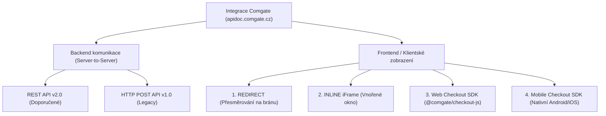

# Výzkum a porovnání možností integrace platební brány Comgate pro ProEdu

Tento dokument představuje hloubkovou analýzu všech variant integrace platební brány **Comgate** na základě oficiální primární dokumentace na [apidoc.comgate.cz](https://apidoc.comgate.cz/). Cílem je zhodnotit dostupné technologie (**REST API v2.0**, **Web Checkout SDK**, **Redirect**, **Inline iFrame**) s ohledem na specifika aplikace ProEdu (měsíční předplatné 99 Kč/měsíc, webová aplikace a mobilní aplikace v Capacitor WebView).

---

## 1. Přehled integračních možností Comgate

Podle oficiální dokumentace Comgate nabízí brána následující základní cesty integrace:



---

## 2. Detailní rozbor jednotlivých variant

### Varianta 1: REST API v2.0 + Standardní Přesměrování (REDIRECT)
* **Primární zdroj:** [Comgate REST API v2.0 Documentation](https://apidoc.comgate.cz/) / [Metody integrace](https://help.comgate.eu/docs/moznosti-integrace)

#### Jak to funguje:
1. Uživatel ve formuláři objednávky (Paywall modalu) klikne na „Zaplatit kartou / online“.
2. Frontend odešle požadavek na backend server (`POST /api/orders/create`).
3. Server vytvoří platbu přes REST API v2.0:
   `POST https://payments.comgate.cz/v2.0/payment.json` s hlavičkou `Authorization: Basic base64(merchant:secret)`.
   Pro účely měsíčního předplatného předá parametr `"initRecurring": true`.
4. Comgate vrátí `transId` a odkaz `redirect`:
   ```json
   {
     "code": 0,
     "message": "OK",
     "transId": "AB12-CD34-EF56",
     "redirect": "https://pay1.comgate.cz/init?id=AB12-CD34-EF56"
   }
   ```
5. Klient je přesměrován na zabezpečenou stránku Comgate (`redirect`), kde si vybere preferovanou metodu (karta, Apple Pay, Google Pay, bankovní tlačítko).
6. Po zaplacení je plátce přesměrován zpět na web (`returnUrl` / např. `/student/dashboard?payment=success`).
7. Comgate server pošle asynchronní webhook na `/api/payments/comgate/notify` s potvrzením `PAID`.

#### Výhody:
* **100% spolehlivost na všech zařízeních:** Funguje na desktopu, mobilních prohlížečích (Safari, Chrome) i uvnitř mobilních aplikací (Capacitor WebView / Android APK).
* **Všechny platební metody v ceně:** Karta, Apple Pay, Google Pay i zrychlená bankovní tlačítka (Česká spořitelna, ČSOB, KB, Raiffeisenbank apod.) a QR kód bez jakéhokoliv dalšího nastavování.
* **Žádná certifikace Apple Pay:** Comgate je certifikovaným partnerem Apple, takže ověření domény a certifikáty řeší platební brána na své doméně.
* **Nulová zátěž na PCI-DSS:** Žádná citlivá data platebních karet neprochází vaším frontendem ani serverem.
* **Plná podpora předplatného (`initRecurring`):** První platba automaticky uloží kartu pro budoucí stržení.

#### Nevýhody:
* Uživatel na okamžik opustí doménu aplikace a je přesměrován na platební bránu `pay1.comgate.cz` (po platbě se však ihned vrací zpět).

---

### Varianta 2: REST API v2.0 + Vnořené okno (INLINE iFrame)
* **Primární zdroj:** [Comgate Inline platební brána](https://apidoc.comgate.cz/)

#### Jak to funguje:
* Backend založí transakci identicky jako u varianty 1.
* Na frontendu se platební brána otevře ve vnořeném okně (iframe) nebo ve vyskakovacím modálním okně nad aplikací, takže uživatel zůstává vizuálně na webu `proeducator.eu`.

#### Výhody:
* Uživatel neodchází ze stránky, brána se zobrazí jako overlay nad vaším webem.
* Podporuje všechny platební metody.

#### Nevýhody a úskalí:
* **Komplikace u bankovních tlačítek a Apple Pay:** Dokumentace Comgate výslovně uvádí, že u bankovních tlačítek a Apple Pay musí brána z bezpečnostních důvodů „vyskočit“ z iframe ven (top-level redirection), což může v single-page aplikaci (React/Vite) vést k nekonzistentnímu stavu.
* **Pravidla CSP a iframe restrikce:** Vyžaduje speciální konfiguraci hlaviček Content Security Policy (`allow="payment"`).

---

### Varianta 3: Web Checkout SDK (`@comgate/checkout-js`)
* **Primární zdroj:** [Comgate Web Checkout SDK](https://apidoc.comgate.cz/) / [NPM @comgate/checkout-js](https://www.npmjs.com/package/@comgate/checkout-js)

#### Jak to funguje:
1. Jedná se o JavaScriptovou klientskou knihovnu (`@comgate/checkout-js`), která vykreslí formulář pro zadání karty, tlačítko Apple Pay a Google Pay přímo do vybraných HTML kontejnerů (`div`) ve vašem vlastním checkoutu.
2. **Pozor:** I při použití Web Checkout SDK **musí existovat backendové REST API**! Platba se nejprve musí založit na serveru (získá se `transactionId` a bezpečnostní tokeny), které se předají funkci `useCheckout()`:
   ```javascript
   import { useCheckout } from '@comgate/checkout-js';

   useCheckout({
     checkoutId: '0c31-4b34-8ce4-xxxxxxxxxxxx',
     transactionId: orderResult.comgateTransId,
     containers: {
       card: '#comgate-card-container',
       applepay: '#comgate-applepay-container',
       googlepay: '#comgate-googlepay-container',
     },
     onPaid: (result) => { /* aktivace prémiového účtu */ },
     onError: (error) => { /* zobrazení chyby */ }
   });
   ```

#### Výhody:
* **Maximálně integrované UX:** Zákazník nikam neodchází, pole pro číslo karty a CVC jsou přímo součástí vašeho formuláře (i když běží v izolovaných micro-iframech kvůli PCI-DSS).

#### Zásadní omezení a rizika pro ProEdu:
1. **⚠️ Nefunguje v mobilních WebViews / Capacitor:**
   Oficiální dokumentace Comgate výslovně varuje:
   > *„The Web Checkout SDK cannot be run inside an iframe or native mobile WebView, as correct behavior cannot be guaranteed.“*
   Jelikož ProEdu obsahuje podporu pro mobilní aplikaci přes **Capacitor** (`@capacitor/android`), Web Checkout SDK by v mobilní aplikaci nefungovalo nebo by padalo!
2. **Absence bankovních převodů:**
   Web Checkout SDK podporuje **pouze platební karty, Apple Pay a Google Pay**. Zákazníci, kteří preferují zrychlené bankovní převody českých bank (QR kód, platba přes bankovní aplikaci), tuto možnost v SDK nemají.
3. **Nutnost registrace domény pro Apple Pay:**
   Pro fungování Apple Pay musíte stáhnout ověřovací soubor z Comgate (`/v2.0/appleDomainAssociation`) a umístit jej na přesnou URL `https://www.proeducator.eu/.well-known/apple-developer-merchantid-domain-association`. Pokud se změní doména nebo subdoména, Apple Pay přestane fungovat.
4. **Závislost na externích skriptech (CSP):**
   Musí se povolit stahování a běh skriptů z `https://checkout.comgate.cz/sdk/*` a komunikace na `https://payments.comgate.cz/*`.

---

### Varianta 4: Mobile Checkout SDK
* **Primární zdroj:** [Comgate Mobile Checkout SDK](https://apidoc.comgate.cz/)
* Určeno výhradně pro plně nativní aplikace v Kotlin/Java (Android) a Swift/Objective-C (iOS).
* Pro hybridní aplikaci postavenou na Reactu a Capacitoru není vhodné bez psaní vlastního nativního Capacitor pluginu.

---

## 3. Srovnávací matice řešení

| Kritérium | REST API v2.0 + REDIRECT | REST API v2.0 + INLINE iFrame | Web Checkout SDK (`checkout-js`) |
| :--- | :---: | :---: | :---: |
| **Podpora platebních karet** |  Ano |  Ano |  Ano |
| **Apple Pay & Google Pay** |  Ano (automaticky) |  Ano (s přeskokem) |  Ano (vyžaduje ověření domény) |
| **Bankovní tlačítka českých bank** |  Ano (všechny banky) |  Ano | ❌ Ne (pouze karty & wallets) |
| **Platba QR kódem na bráně** |  Ano |  Ano | ❌ Ne |
| **Opakované platby (`initRecurring`)** |  Ano (100% nativní) |  Ano | ⚠️ Založení přes API, složitější flow |
| **Kompatibilita s Capacitor (Android WebView)** |  **100% kompatibilní** | ⚠️ Možné problémy s vyskočením | ❌ **Oficiálně nepodporováno** |
| **Apple Pay domain association soubor** | ❌ Není potřeba (řeší Comgate) | ❌ Není potřeba | ⚠️ Povinné na `.well-known` |
| **Implementační složitost** |  Nízká (backend API + redirect) |  Střední (iframe lifecycle) | 🔴 Vysoká (frontend SDK + backend API + CSP) |
| **Zabezpečení a PCI-DSS audit** |  Zajišťuje Comgate (SAQ A) |  Zajišťuje Comgate (SAQ A) |  Zajišťuje Comgate (SAQ A-EP) |

---

## 4. Doporučené řešení pro ProEdu

Na základě technických požadavků aplikace ProEdu doporučujeme následující architekturu:

### **Doporučená volba: Moderní REST API v2.0 + REDIRECT (Hosted Payment Page)**

#### Proč je to nejlepší volba pro ProEdu:
1. **Předplatné (Opakované platby 99 Kč / měsíc):**
   Model předplatného vyžaduje, aby první platba spolehlivě provedla 3D Secure autorizaci a uložila token karty (`initRecurring: true`). Standardní redirect brána Comgate má tento proces maximálně vyladěný a certifikovaný všemi bankami.
2. **Podpora mobilní aplikace (Capacitor):**
   Vzhledem k tomu, že máte v projektu `@capacitor/android`, redirect brána funguje bez jakýchkoliv úprav jak na desktopovém webu, tak v mobilním zobrazení a v Capacitoru (přes `Browser.open` nebo systémový prohlížeč). Web Checkout SDK by v WebView selhalo.
3. **Maximální konverze a komfort pro české zákazníky:**
   Kromě platební karty (kterou někteří studenti nebo rodiče nemusí chtít zadávat) nabízí brána Comgate možnost zrychleného převodu všech českých bank a okamžitou platbu QR kódem.
4. **Čisté oddělení vrstev (Rule #1 & Rule #13):**
   Tajný klíč `COMGATE_SECRET` a citlivé operace zůstávají výhradně na serveru (`server/index.js`). Klient obdrží pouze bezpečnou platební URL.

---

## 5. Jak přejít z aktuálního stavu (v1.0) na moderní REST API v2.0

V současném souboru `server/index.js` je připravena integrace na starší protokol v1.0 (`https://webpay.comgate.cz/v1.0/create` s `application/x-www-form-urlencoded`).

Při přechodu do ostrého provozu se doporučuje aktualizovat backend na **REST API v2.0**:

### 1. Založení iniciační platby předplatného (`POST /v2.0/payment.json`)
```javascript
// Volání z server/index.js
const authHeader = 'Basic ' + Buffer.from(`${COMGATE_MERCHANT_ID}:${COMGATE_SECRET}`).toString('base64');

const response = await fetch('https://payments.comgate.cz/v2.0/payment.json', {
  method: 'POST',
  headers: {
    'Authorization': authHeader,
    'Content-Type': 'application/json'
  },
  body: JSON.stringify({
    merchant: COMGATE_MERCHANT_ID,
    test: COMGATE_TEST_MODE === 'true',
    price: 9900, // 99.00 CZK v haléřích
    curr: 'CZK',
    label: 'ProEdu Premium',
    refId: orderId,
    email: clientEmail,
    fullName: clientName,
    initRecurring: true, // Klíčové pro měsíční předplatné!
    prepareOnly: true,
    method: 'ALL'
  })
});

const data = await response.json();
// data.redirect obsahuje URL adresu platební brány
// data.transId obsahuje ID transakce pro uložení do Firestore
```

### 2. Automatické stržení dalšího měsíce předplatného (`POST /v2.0/recurring`)
Po 30 dnech server automaticky (např. přes Cloud Scheduler nebo Cron) zavolá:
```javascript
const response = await fetch('https://payments.comgate.cz/v2.0/recurring', {
  method: 'POST',
  headers: {
    'Authorization': authHeader,
    'Content-Type': 'application/json'
  },
  body: JSON.stringify({
    merchant: COMGATE_MERCHANT_ID,
    initTransId: originalTransId, // TransId první platby
    price: 9900,
    curr: 'CZK',
    label: 'ProEdu Premium - měsíční předplatné',
    refId: `${orderId}_sub_${Date.now()}`
  })
});
```

---

## 6. Závěr a doporučený postup

1. **Jako základní a hlavní metodu použijte REST API v2.0 s přesměrováním (Redirect).**
2. **Knihovnu `@comgate/checkout-js` (Web Checkout SDK) v této fázi nedoporučujeme aktivovat jako primární:**
   * Nepodporuje mobilní WebViews (Capacitor).
   * Omezuje platební metody pouze na karty.
   * Přináší zbytečnou administrativní režii s Apple Pay domain association soubory.
3. Až budete mít podepsanou ostrou smlouvu s Comgate, stačí pouze v `server/.env` vyplnit ostré `COMGATE_MERCHANT_ID` a `COMGATE_SECRET` a nastavit webhook URL v administraci Comgate.
