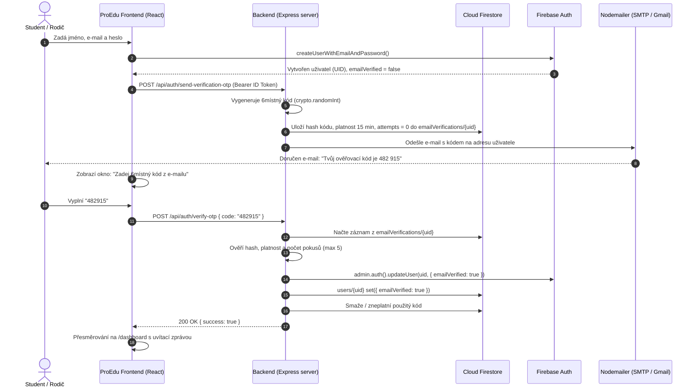

# Technický a architektonický výzkum: E-mailová komunikace a ověření registrace kódem (OTP) pro ProEdu

> **Datum zpracování:** 9. listopadu 2026  
> **Projekt:** ProEdu (Vzdělávací webová platforma pro přípravu na zkoušky Cermat)  
> **Technologický stack:** React 19, TypeScript, Tailwind CSS, Express backend (`server/index.js`), Firebase Auth, Cloud Firestore  
> **Cíl dokumentu:** Detailní analýza možností odesílání transakčních e-mailů (v ekosystému Google Cloud / Firebase / Express), návrh bezpečného dokončení registrace pomocí 6místného ověřovacího kódu (OTP) a příprava e-mailové infrastruktury pro platební bránu Comgate a QR platby v souladu s bezpečnostními pravidly `.agents/rules/proedu.md`.

---

## Manažerské shrnutí (Executive Summary)

Uživatel položil klíčový požadavek:
> *"Potřeboval bych vylepšit registraci a připravit také emailovou komunikaci dopředu kvůli platební bráně a informacím, které budu zasílat emailem. Jako první bych potřeboval, aby se registrace dokončovala například pomocí vygenerování kódu a zaslání na zadaný email. Je možné tyto emailové funkce nějak dělat přes Firebase/Google Cloud, abych nemusel řešit nějaký složitý externí systém? Podívej se po mailingových možnostech a navrhni mi, jak toto řešit."*

### Klíčové závěry výzkumu:

1. **Možnosti čistého Firebase Auth („out-of-the-box“):**
   - Firebase Auth nativně podporuje ověření e-mailu (`sendEmailVerification`), ale **výhradně formou klikacího URL odkazu** (tzv. *Out-of-band Email Action Link*).
   - Firebase Auth **neumí** sám o sobě vygenerovat ani odeslat 6místný číselný OTP kód.
   - Přes Firebase Auth **nelze** odesílat žádné libovolné e-maily (potvrzení objednávky, QR kód pro platbu, notifikace o spárování platby Comgate, změna hesla ve vlastním brandingu apod.).
   - *Závěr:* Čistý Firebase Auth na tyto požadavky nestačí.

2. **Google Cloud a odesílání e-mailů:**
   - Google Cloud Platform (GCP) **nemá vlastní nativní službu typu AWS SES**. Google záměrně blokuje odchozí SMTP port 25 z Compute Engine a doporučuje buď SMTP relay přes Google Workspace / Gmail, nebo partnerské služby (SendGrid, Mailjet, Mailgun).
   - *Primární zdroj:* [Google Cloud Compute Engine – Sending email from an instance](https://cloud.google.com/compute/docs/tutorials/sending-mail)

3. **Nejjednodušší a nejefektivnější řešení pro ProEdu (žádný složitý externí systém):**
   - Vzhledem k tomu, že ProEdu již provozuje vlastní Node.js / Express backend (`server/index.js`), je nejlepší a nejčistší cestou vytvořit **vlastní lehkou e-mailovou službu (`server/services/emailService.js`) postavenou na knihovně `nodemailer`**.
   - Pro odesílání stačí v `.env` nastavit přístup k existujícímu Google/Gmail účtu přes **Google App Password (Heslo aplikace)** nebo jakékoliv běžné doménové SMTP (např. od hostingu `info@proedu.cz`).
   - Tím získáme **100% kontrolu nad HTML šablonami, 6místnými OTP kódy i platebními e-maily** bez nutnosti platit a konfigurovat složité externí CRM platformy.

4. **Architektura 6místného OTP kódu:**
   - Kód je generován kryptograficky bezpečně na backendu (`crypto.randomInt(100000, 999999)`).
   - V databázi se ukládá hash kódu, čas expirace (10–15 minut) a počítadlo pokusů (ochrana proti brute-force útokům dle standardů OWASP).
   - Po úspěšném zadání kódu backend přes Firebase Admin SDK nastaví uživateli `auth.updateUser(uid, { emailVerified: true })` a aktualizuje příznak v profilu.
   - Uživatelé přihlašující se přes **Google účet (Google OAuth)** mají e-mail ověřený přímo Googlem, takže OTP krok automaticky přeskakují.

---

## 1. Analýza možností odesílání e-mailů

Následující tabulka porovnává 4 reálné architektonické přístupy pro projekt ProEdu:

| Kritérium | Varianta A: Express + Nodemailer (Gmail / SMTP) | Varianta B: Firebase Extension (Trigger Email) | Varianta C: Transakční API (Resend / Brevo) | Varianta D: Čistý Firebase Auth |
| :--- | :--- | :--- | :--- | :--- |
| **Generování 6místného OTP kódu** |  Plně podporováno (vlastní generování) |  Vyžaduje vlastní Cloud Function pro kód |  Plně podporováno |  **NE** (jen dlouhý URL odkaz) |
| **Transakční e-maily k objednávkám (Comgate / QR)** |  Okamžitě připraveno v existujícím backendu |  Ano (zápisem do kolekce `mail`) |  Ano (přes REST API / SDK) |  **NE** (neumí uživatelské e-maily) |
| **Potřeba externího systému** | **Žádná** (využije váš stávající e-mail/SMTP) | Vyžaduje Firebase Blaze plán + SMTP server | Vyžaduje registraci a API klíč u třetí strany | Žádná |
| **Náklady** | **0 Kč** (v rámci existujícího e-mailu) | Poplatky za Cloud Functions (haléře) + SMTP | Zdarma v limitu (Resend: 3 000/měsíc, Brevo: 300/den) | 0 Kč |
| **Doručitelnost do spamu (Gmail, Seznam)** | Výborná (pokud jde o firemní Google Workspace nebo doménové SMTP se SPF/DKIM) | Záleží na použitém SMTP | Vynikající (garantované IP pooly a automatický DKIM) | Výborná pro verifikaci |
| **Složitost údržby** | **Minimální** (několik desítek řádků kódu v Node.js) | Střední (konfigurace rozšíření v Firebase konzoli) | Nízká | Žádná |

---

### Detailní rozbor variant

### 1.1 Varianta A (Doporučená): Node.js Backend (`server/index.js`) + Nodemailer
Tento přístup plně využívá stávající infrastrukturu aplikace ProEdu:
1. Do `package.json` se přidá standardní odlehčená knihovna `nodemailer` (cca 50 kB, bez nativních závislostí).
2. Jako transport se v `.env` nakonfiguruje:
   - Buď **Google / Gmail účet** (např. `notifikace@proedu.cz` nebo váš administrátorský Gmail) pomocí standardního mechanismu **Google App Password (Heslo aplikace)**.
   - Nebo **běžný SMTP server vaší domény** (např. Wedos, Forpsi, Český Hosting: `smtp.vase-domena.cz`, port 465/587).
3. **Limity odesílání Google SMTP:**
   - Osobní účet `@gmail.com`: **500 e-mailů za 24 hodin**.
   - Účet Google Workspace: **2 000 e-mailů za 24 hodin**.
   - *Primární zdroj:* [Google Workspace Admin Help – Gmail sending limits in Google Workspace](https://support.google.com/a/answer/166852)
   - Pro potřeby registrací a plateb v ProEdu (desítky až stovky transakcí denně) tyto limity bohatě postačují na celou sezónu.

### 1.2 Varianta B: Firebase Extension `Trigger Email from Firestore`
Rozšíření vyvíjené přímo týmem Firebase ([`firebase/firestore-send-email`](https://github.com/firebase/extensions/tree/master/firestore-send-email)):
- Funguje tak, že při vytvoření dokumentu v kolekci (např. `mail`) Cloud Function na pozadí e-mail odešle a do dokumentu zapíše stav (`DELIVERED`, `ERROR`).
- **Nevýhody pro ProEdu:**
  1. Stejně musíte do rozšíření zadat SMTP přihlašovací údaje (takže externí SMTP server stejně potřebujete).
  2. Vyžaduje Firebase Blaze plán (Pay-as-you-go).
  3. Pro verifikaci registrace kódem by klient musel zapisovat do databáze nebo volat backend, což zbytečně prodlužuje latenci oproti přímému volání z existujícího Express serveru.

### 1.3 Varianta C: Transakční služba (Resend / Brevo)
- **Resend** ([resend.com](https://resend.com)) je moderní vývojářská platforma pro e-maily (3 000 e-mailů/měsíc zdarma, oficiální Node SDK, podpora React email šablon).
- **Brevo** (dříve Sendinblue) nabízí 300 e-mailů denně zdarma navždy.
- Pokud by se v budoucnu objem e-mailů zvýšil nad limit Gmailu (2 000 e-mailů/den), lze v našem navrženém `emailService.js` pouze změnit proměnné v `.env` na Resend/SMTP bez nutnosti přepisovat jedinou řádku aplikační logiky.

---

## 2. Návrh procesu dokončení registrace 6místným kódem (OTP)

Podle bezpečnostních pravidel projektu (`.agents/rules/proedu.md`) nesmí klient provádět neautorizované zásahy do rolí a stavů uživatele, ověřování musí být řízeno backendem a data musí být chráněna před brute-force útoky.

### 2.1 Architektonický diagram toku registrace



### 2.2 Bezpečnostní specifikace dle OWASP a pravidel ProEdu

*Primární zdroj:* [OWASP Authentication Cheat Sheet – OTP & Account Verification](https://cheatsheetseries.owasp.org/cheatsheets/Authentication_Cheat_Sheet.html)

1. **Kryptografické generování kódu:**
   - Nesmí se používat `Math.random()`.
   - V Node.js se použije kryptograficky zabezpečený generátor:
     ```javascript
     import crypto from 'crypto';
     const otpCode = crypto.randomInt(100000, 1000000).toString(); // Např. "739281"
     ```
2. **Uložení a hašování (Rule 1 & Rule 10):**
   - V databázi se neukládá kód v čistém textu, ale jeho SHA-256 hash s bezpečnostním saltem (aby ani administrátor s přístupem do databáze nemohl kód podvrhnout).
   - Kolekce `emailVerifications` bude mít ve `firestore.rules` **úplný zákaz čtení i zápisu z klienta** (`allow read, write: if false;`). Manipulovat s ní může výhradně náš server přes Firebase Admin SDK.
3. **Ochrana proti hádání kódu (Rate limiting & Brute-force):**
   - Kód má omezenou platnost na **15 minut**.
   - Maximální počet neúspěšných pokusů je **5**. Po 5 chybných zadáních je kód zneplatněn a uživatel musí požádat o nový.
   - Mezi žádostmi o nový kód (tlačítko *„Zaslat kód znovu“*) je zaveden cooldown **60 sekund**.
4. **Bypass pro Google OAuth:**
   - Pokud se uživatel zaregistruje kliknutím na *„Přihlásit se účtem Google“*, Firebase Auth vrací `user.emailVerified === true` automaticky (Google již identitu potvrdil).
   - V tomto případě aplikace OTP obrazovku zcela přeskočí a rovnou pustí studenta do aplikace.

---

## 3. Příprava e-mailové komunikace pro platební bránu a předplatné

Aplikace ProEdu již má v `server/index.js` připravené endpointy pro platební bránu Comgate a bankovní převody s QR kódem SPAYD (`/api/orders/create`, `/api/payments/comgate/notify`, `/api/orders/:orderId/confirm-manual`).

Pro profesionální chod platebního procesu je potřeba připravit následující 4 klíčové transakční e-maily:

### 3.1 Přehled transakčních e-mailů

| ID šablony | Spouštěcí událost | Příjemce | Obsah e-mailu |
| :--- | :--- | :--- | :--- |
| `ORDER_CREATED_QR` | Vytvoření objednávky s volbou bankovního převodu | Zákazník | Pokyny k platbě, číslo účtu, variabilní symbol (= ID objednávky), částka a **přiložený QR kód pro platbu v mobilním bankovnictví**. |
| `PAYMENT_CONFIRMED` | Úspěšný webhook z Comgate nebo manuální potvrzení učitelem | Zákazník | Potvrzení o přijetí platby, aktivace balíčku **ProEducator Premium**, datum platnosti a odkaz do aplikace. |
| `PAYMENT_REMINDER` | Objednávka převodem nezaplacená po 3 dnech | Zákazník | Přátelské připomenutí neuhrazené objednávky s opakovaným zobrazením QR kódu. |
| `SUBSCRIPTION_EXPIRING` | 5 dní před koncem platnosti předplatného | Zákazník | Upozornění na blížící se konec platnosti s instrukcemi pro snadné prodloužení. |
| `ADMIN_NEW_ORDER` | Vznik nové objednávky převodem | Učitel / Správce | Notifikace pro administrátora o nové platbě čekající na spárování. |

### 3.2 Datový model pro historii e-mailů (Audit Log)
Dle pravidla č. 11 a č. 18 (`.agents/rules/proedu.md`) ukládáme záznamy o odeslaných e-mailech do serverem spravované kolekce `emailLogs`:
```typescript
interface EmailLog {
  id: string;
  userId?: string;
  to: string;
  subject: string;
  template: 'OTP_VERIFICATION' | 'ORDER_CREATED_QR' | 'PAYMENT_CONFIRMED' | 'SUBSCRIPTION_EXPIRING';
  status: 'sent' | 'failed';
  errorMessage?: string;
  sentAt: FirebaseFirestore.Timestamp;
}
```
Pravidla ve `firestore.rules`:
```javascript
match /emailLogs/{logId} {
  allow read: if isAdmin();
  allow write: if false; // Zapisuje pouze server přes Admin SDK
}
```

---

## 4. Doporučený plán realizace po krocích

1. **Krok 1 – Backendová e-mailová služba:**
   - Instalace balíčku `nodemailer` do projektu.
   - Vytvoření modulu `server/services/emailService.js` s podporou SMTP konfigurace z `.env` a responzivními HTML šablonami (v barvách a stylu ProEdu).
   - Přidání konfiguračních proměnných do `.env.example`:
     ```env
     SMTP_HOST="smtp.gmail.com"
     SMTP_PORT=465
     SMTP_SECURE="true"
     SMTP_USER="vas-email@gmail.com"
     SMTP_PASS="xxxx xxxx xxxx xxxx" # Google App Password
     SMTP_FROM="ProEdu <notifikace@proedu.cz>"
     ```

2. **Krok 2 – API endpointy pro ověřovací kód (OTP):**
   - `POST /api/auth/send-verification-otp` (vygeneruje kód, pošle e-mail, uloží hash do Firestore).
   - `POST /api/auth/verify-otp` (zkontroluje kód, označí e-mail za ověřený přes Firebase Admin SDK).

3. **Krok 3 – Úprava frontendu (AuthModal & Login):**
   - Po vyplnění registračního formuláře zobrazit elegantní stav pro zadání 6místného kódu s odpočítáváním (cooldown na znovuzaslání).
   - Automatické rozpoznání Google účtu (okamžitý vstup bez OTP).

4. **Krok 4 – Napojení e-mailů na objednávky a Comgate:**
   - Ve webhooku `/api/payments/comgate/notify` a v ručním schválení `/api/orders/:orderId/confirm-manual` automaticky odeslat děkovný e-mail s potvrzením Premium.
   - V `/api/orders/create` při volbě převodu odeslat e-mail s platebními údaji a QR kódem.

---

## 5. Zdroje a reference

1. [Google Workspace Admin Help – Gmail sending limits](https://support.google.com/a/answer/166852)
2. [Google Cloud Documentation – Sending Email from Compute Engine](https://cloud.google.com/compute/docs/tutorials/sending-mail)
3. [Firebase Documentation – Manage Users (Email Verification)](https://firebase.google.com/docs/auth/admin/manage-users#update_a_user)
4. [Firebase Extensions – Trigger Email from Firestore GitHub Repository](https://github.com/firebase/extensions/tree/master/firestore-send-email)
5. [OWASP Cheat Sheet Series – Authentication & Verification Cheat Sheet](https://cheatsheetseries.owasp.org/cheatsheets/Authentication_Cheat_Sheet.html)
6. [Nodemailer Official Documentation](https://nodemailer.com/about/)
7. [Resend Documentation & Email API](https://resend.com/docs)
