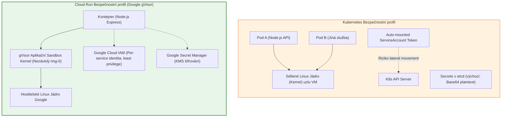

# Hloubkový architektonický výzkum: Kontejnerizace a Kubernetes pro platformu ProEdu

**Autor:** Architektonický tým ProEdu  
**Datum:** Listopad 2026  
**Status:** Schváleno / Strategické doporučení  
**Oblast:** Infrastruktura, DevOps, Spolehlivost, Bezpečnost, TCO (Total Cost of Ownership)  

---

## Exekutivní shrnutí (Executive Summary)

### Formulace otázky
> *„Fungovala by aplikace ProEdu lépe a spolehlivěji, pokud bych využil kontejnerizaci a Kubernetes, případně zda by to bylo lepší na údržbu nebo další aspekty?“*

### Jednoznačný verdikt (BLUF – Bottom Line Up Front)
**Přechod aplikace ProEdu na Kubernetes (např. Google Kubernetes Engine – GKE) je v současné fázi projektu a při aktuální velikosti týmu zásadní architektonický antipattern a technologický overkill.**

Nasazení Kubernetes by nepřineslo zvýšení spolehlivosti ani zjednodušení údržby – naopak by vedlo k:
1. **Dramatickému nárůstu finančních nákladů (TCO):** Ze současných **0–5 USD/měsíc** (v rámci bezplatného tarifu Google Cloud / Firebase Free Tier) na fixních **150 až 300+ USD/měsíc** (cca 3 500 – 7 200 Kč měsíčně) jen za běh prázdného klastru (idle compute, load balancery, řídicí rovina), i když v noci aplikaci nikdo nepoužívá.
2. **Kritickému nárůstu provozní režie (Operational Toil):** Nutnost řešit čtvrtletní upgrady verzí Kubernetes (životní cyklus N-2 cca 14 měsíců), hlídání změn a deprecations API, správu Ingress kontrolerů, ACME certifikátů (`cert-manager`), síťových pluginů (CNI) a aktualizace Helm chartů namísto vývoje vzdělávacích funkcí.
3. **Zhoršení výkonu a odezvy frontendu:** Nahrazení globální Anycast edge CDN (Firebase Hosting se stovkami uzlů po světě a latencí pod 30 ms) kontejnerem s Nginxem v jednom konkrétním datacentru za Ingress balancérem.
4. **Zvýšení bezpečnostního rizika (Blast Radius):** Výměna plně izolovaného sandboxu **gVisor** (na němž běží Cloud Run) za sdílené linuxové jádro virtuálních strojů a složitou správu RBAC, síťových politik a Base64 tajemství v etcd.

### Doporučená strategie: „Zlatá střední cesta“ (Containerized Serverless)
Pokud ProEdu potřebuje výhody kontejnerizace (100% deterministické sestavení, identické lokální vývojové prostředí, instalace systémových knihoven např. pro generování PDF či AI nástroje), je ideálním řešením **samotná kontejnerizace přes Dockerfile provozovaná na Google Cloud Run**.

Tento přístup přináší veškeré výhody moderních kontejnerů (přenositelnost, standardizace OCI), ale **bez jakékoliv zátěže správy Kubernetes clusteru** – zachovává škálování do nuly, nulové fixní poplatky, plnou správu Googlem a SLA 99,95 %.

```mermaid
flowchart TD
    subgraph Stávající_Stav["1. Stávající stav (Doporučeno pro MVP)"]
        F1["Frontend: Firebase Hosting (Anycast CDN Edge)"]
        B1["Backend: Firebase Functions v2 (Cloud Run Buildpack)"]
        D1["DB: Firestore (Multi-region Serverless)"]
        F1 --- B1 --- D1
    end

    subgraph Zlata_Stredni_Cesta["2. Zlatá střední cesta (Doporučeno pro další růst)"]
        F2["Frontend: Firebase Hosting (Edge CDN)"]
        B2["Backend: Vlastní Dockerfile na Google Cloud Run"]
        D2["DB: Firestore (Multi-region Serverless)"]
        F2 --- B2 --- D2
    end

    subgraph Kubernetes_Overkill["3. Kubernetes / GKE (Technologický Overkill)"]
        K_Ingress["Cloud Load Balancer + NGINX Ingress Controller + cert-manager"]
        K_Nodes["Node Pool (Min. 3x VM e2-standard-2 / e2-medium)"]
        K_Pods["Pods: Frontend Nginx + Backend Express + Prometheus"]
        K_Ingress --> K_Nodes --> K_Pods
    end

    style Stávající_Stav fill:#e8f5e9,stroke:#2e7d32,stroke-width:2px
    style Zlata_Stredni_Cesta fill:#e3f2fd,stroke:#1565c0,stroke-width:2px
    style Kubernetes_Overkill fill:#ffebee,stroke:#c62828,stroke-width:2px
```



---

## 1. Architektonický kontext ProEdu a stávající stav

Aplikace ProEdu je moderní vzdělávací webová platforma navržená podle principů **The Twelve-Factor App** a moderního cloud-native serverless paradigmatu:

* **Frontend:** React 19 Single Page Application (Vite + Tailwind CSS), buildovaný do statického bundlu v adresáři `dist/`.
* **Distribuce frontendu:** Firebase Hosting napojený na globální Google Anycast Content Delivery Network (CDN) s automatickou podporou HTTP/2, HTTP/3 a zero-config TLS certifikací.
* **Backend:** Node.js / Express API zajišťující zabezpečené citlivé operace (aktivace předplatného, integrace platební brány Comgate REST API v2.0, napojení na Gemini AI, validace a autorizace).
* **Běhové prostředí backendu:** Firebase Cloud Functions v2 v regionu `europe-west1` (Frankfurt/Belgie). **Důležitý fakt:** Cloud Functions v2 jsou interně přímo nasazovány jako kontejnery na **Google Cloud Run** přes Eventarc.
* **Datová a autentizační vrstva:** Google Cloud Firestore (multi-region NoSQL databáze) a Firebase Auth. Frontend komunikuje s Firestore přímo přes WebSocket/gRPC SDK s využitím offline cache a real-time snapshotů, přičemž bezpečnost je garantována striktními pravidly `firestore.rules` s document-level ownership (`uid`, `studentId`, `createdBy`) dle směrnice `.agents/rules/proedu.md`.

---

## 2. Hloubková analýza 6 klíčových dimenzí

### Dimenze A: Spolehlivost a dostupnost (Reliability & Availability)

Jedním z častých mýtů je předpoklad, že *„přechod na Kubernetes automaticky zvýší spolehlivost aplikace“*. Při detailním rozboru architektury a SLA se ukazuje opak.

#### 1. Porovnání SLA (Service Level Agreement)
Podle oficiální dokumentace Google Cloud:
* **Google Cloud Run (stávající báze backendu):** SLA činí **99,95 %** měsíční dostupnosti. Služba je plně regionálně distribuovaná napříč všemi zónami v daném regionu (`europe-west1`), aniž by vývojář musel definovat repliky.
* **Firebase Hosting (frontend):** Globální dostupnost garantovaná infrastrukturou Google CDN s automatickým multi-pop failoverem.
* **Google Kubernetes Engine (GKE):**
  * **Zonální cluster (1 zóna):** SLA na řídicí rovinu (Control Plane) je pouze **99,50 %**. Při výpadku zóny je cluster neovladatelný.
  * **Regionální cluster (HA Control plane ve 3 zónách):** SLA je **99,95 %**.
  * **POZOR – SLA garance GKE se vztahuje pouze na Kubernetes API server, nikoliv na samotné Pody!** Pokud v klastru špatně nakonfigurujete `PodDisruptionBudget`, liveness sondy nebo limity paměti, Google za dostupnost aplikace neručí.

#### 2. Single Points of Failure (SPOF) a kaskádové poruchy v Kubernetes
V klastru Kubernetes vzniká řada nových zranitelných míst, která v serverless modelu vůbec neexistují:
* **Ingress Controller a Ingress pody:** Pokud NGINX Ingress vyčerpá file descriptory nebo havaruje v OOMKilled stavu, veškerý provoz aplikace se zastaví.
* **Cert-manager & ACME výzvy:** Certifikáty se v K8s typicky spravují pomocí `cert-manageru` přes Let's Encrypt. Při chybě konfigurace DNS-01/HTTP-01 výzvy, vyčerpání Let's Encrypt rate limitu nebo selhání webhooku `cert-manager-webhook` dojde k expiraci certifikátu a zablokování přístupu studentů do aplikace. (Firebase Hosting i Cloud Run obnovují certifikáty plně autonomně na úrovni Google infrastruktury).
* **CoreDNS výpadky:** V K8s je veškerá interní komunikace závislá na CoreDNS podech. Zátěžové špičky v překladu domén mohou způsobit timeouty mezi frontendovým Nginxem a backendovým Express podem.
* **CNI (Container Network Interface) a Kube-proxy:** Problémy se síťovým pluginem (Calico/Cilium) mohou způsobit tichou ztrátu paketů mezi pody na různých uzlech.

#### 3. Chování při havárii zóny nebo uzlu
* **Cloud Run:** Google transparentně přesměruje příchozí HTTP požadavky do instancí v jiných zónách bez jakéhokoliv zásahu vývojáře.
* **Kubernetes:** Pokud havaruje virtuální uzel (VM node), Kubelet vyčká `node-monitor-grace-period` (výchozí 40 sekund), než uzel označí za `NotReady`. Následně trvá dalších několik minut (`pod-eviction-timeout`), než dojde k přeplánování podů na zdravé uzly. Pokud v klastru není dostatek volné výpočetní kapacity, pod zůstane ve stavu `Pending`, dokud Cluster Autoscaler nespustí nový virtuální server (dalších 2–5 minut).

**Verdikt pro spolehlivost:** ProEdu má se stávajícím serverless modelem vyšší reálnou spolehlivost než s vlastním Kubernetes klastrem, protože eliminuje desítky infrastrukturních bodů selhání.

---

### Dimenze B: Náročnost údržby a provozní režie (Operational Overhead & Toil)

Podle výzkumů **DORA (DevOps Research and Assessment)** a metodiky **Team Topologies** (Skelton & Pais) je klíčovým faktorem úspěchu produktového týmu **udržitelná kognitivní zátěž (Cognitive Load)**.

Tým ProEdu je *Stream-aligned team* – jeho posláním je tvořit výukové moduly, testy, AI generování cvičení a napojení plateb pro studenty a pedagogy. Zavedení Kubernetes nutí tento tým suplovat roli *Platform / Infrastructure teamu*, což vede k obrovskému plýtvání časem (tzv. Operational Toil).

```mermaid
flowchart LR
    subgraph K8s_Toil["Režie Kubernetes (20-40 % kapacity týmu)"]
        direction TB
        T1["Čtvrtletní upgrade K8s (N-2 okno)"]
        T2["Opravy rozbitých Helm chartů a API deprecations"]
        T3["Monitoring Prometheus + Grafana + PV disky"]
        T4["Správa cert-manager, Ingress a DNS"]
        T5["Bezpečnostní záplaty Linux kernelu na nodech"]
    end

    subgraph Business_Focus["Skutečná hodnota pro ProEdu (100 % kapacity)"]
        direction TB
        V1["Nové výukové moduly a testy"]
        V2["AI personalizace přípravy na zkoušky"]
        V3["Fakturační a platební procesy Comgate"]
        V4["Rychlý a bezchybný frontend pro studenty"]
    end

    K8s_Toil -.->|Odebírá čas a pozornost| Business_Focus
```



#### 1. Životní cyklus verzí Kubernetes (Release Lifecycle)
* Kubernetes komunita vydává **3 minoritní verze ročně** (každé 4 měsíce, např. 1.30, 1.31, 1.32).
* Oficiální okno podpory je pouze **N-2 (cca 14 měsíců)**. Jakmile verze dosáhne End of Life (EOL), Google Cloud vynutí automatický upgrade klastru.
* Každý upgrade může obsahovat odstranění zastaralých API (deprecations), např. v minulosti přechod Ingress z `extensions/v1beta1` na `networking.k8s.io/v1`, odstranění `PodSecurityPolicy` ve verzi 1.25, či změny v `batch/v1` u CronJobů. Každý takový upgrade vyžaduje audit všech YAML manifestů, testování ve stagingu a riziko výpadku produkce.

#### 2. Údržba doprovodného ekosystému
Kubernetes sám o sobě nestačí. K jeho provozu je nutné instalovat, konfigurovat a záplatovat:
* Ingress kontroler (např. Nginx Ingress Controller).
* Cert-manager pro obnovu TLS certifikátů.
* Metrics Server a Horizontal Pod Autoscaler.
* CSI drivery pro připojování persistentních disků.
* Správu balíčků přes Helm nebo Kustomize.

#### 3. Observability a monitoring
* **V Kubernetes:** Je nutné nasadit Prometheus Operator, Alertmanager, Grafanu, lokální úložiště pro metriky (Persistent Volumes), konfigurovat retention time, řešit zaplnění disků a ladit exportéry metrik.
* **V Serverless (Firebase / Cloud Run):** Metriky, strukturované logy a chyby jsou okamžitě dostupné v Google Cloud Logging, Cloud Monitoring a Error Reporting bez instalace jediného agenta. Vývojář vidí latence, 5xx chyby i využití CPU na jedno kliknutí.

**Verdikt pro údržbu:** Kubernetes by přinesl enormní režijní zátěž. Tým by namísto rozvoje funkcí ProEdu trávil desítky hodin měsíčně údržbou infrastruktury.

---

### Dimenze C: Finanční náklady a TCO (Total Cost of Ownership)

Ekonomika provozu serverless vs. Kubernetes je pro aplikaci typu ProEdu zcela zásadním argumentem.

#### 1. Náklady na infrastrukturu (Run-rate)

| Položka infrastruktury | Současný stav (Firebase / Serverless) | Kubernetes (GKE Standard HA) | Kubernetes (GKE Autopilot) |
| :--- | :--- | :--- | :--- |
| **Správa klastru (Control Plane fee)** | **0 USD** (plně spravováno Googlem) | **73,00 USD / měsíc** ($0,10/h po vyčerpání 1 zonal kreditu) | **0 až 73 USD / měsíc** (1. klastr v kreditu) |
| **Výpočetní výkon (Compute Nodes)** | **0 až 2 USD / měsíc** (Free tier 2M volání, škálování do 0) | **73,20 USD / měsíc** (Min. 3x `e2-medium` do 3 zón) | **30 až 60 USD / měsíc** (Platba za běžící Pod requesty 24/7) |
| **Load Balancer (Ingress IP & Pravidla)** | **0 USD** (V ceně Firebase Hosting) | **18,25 USD / měsíc** (Forwarding rule) | **18,25 USD / měsíc** |
| **Odchozí síťová brána (Cloud NAT)** | **0 USD** (Není potřeba) | **32,00 USD / měsíc** (Nutné pro privátní nody) | **0 až 32 USD / měsíc** |
| **SSL Certifikáty & TLS termination** | **0 USD** (Automatické Google certifikáty) | **0 USD** (Let's Encrypt režie) | **0 USD** |
| **Hosting statického frontendu (CDN)** | **0 USD** (Firebase Free Tier 10 GB) | Běží v node poolu (spotřebovává RAM/CPU) | Běží v podech |
| **Noční provoz při nulové návštěvnosti** | **0,00 Kč** (Škálováno na 0 instancí) | **Plná cena 24/7** (stroje běží naprázdno) | **Plná cena za pody 24/7** |
| **CELKEM MĚSÍČNĚ (Infrastruktura)** | **cca 0 až 5 USD (~100 Kč)** | **cca 196 až 240+ USD (~4 800 – 6 000 Kč)** | **cca 60 až 150 USD (~1 500 – 3 700 Kč)** |

*Poznámka k bezplatnému limitu Cloud Run:* Google Cloud poskytuje každý měsíc zdarma 2 000 000 požadavků, 360 000 GB-sekund operační paměti a 180 000 vCPU-sekund. ProEdu se při běžném studentském provozu bez problémů vejde do tohoto bezplatného rámce.

#### 2. Lidské náklady (Human Capital Cost)
Infrastruktura je pouze menší částí celkového TCO. Pokud vývojář stráví 15 hodin měsíčně údržbou Kubernetes, řešením rozbitých certifikátů, laděním Ingressu a aplikací záplat:
* Při průměrné hodinové sazbě seniorního vývojáře 1 000 Kč/hod činí náklady na lidskou práci **15 000 Kč měsíčně (180 000 Kč ročně)**.
* V serverless architektuře je tento čas roven prakticky **0 hodinám**.

**Verdikt pro finance:** Přechod na Kubernetes by znamenal zvýšení nákladů na infrastrukturu o více než **4 000 %** a vázání desítek tisíc korun měsíčně v lidské práci.

---

### Dimenze D: Škálování, latence a odezva (Scalability & Latency)

Často panuje představa, že *„Kubernetes je rychlejší, protože pody běží stále, zatímco serverless má cold starts“*. Realita distribuce webových aplikací je podstatně komplexnější.

#### 1. Doručování frontendu (Globální CDN vs. Ingress Pod)
* **Současný stav (Firebase Hosting):** Statické soubory React aplikace (`index.html`, JavaScript bundly, CSS, obrázky) jsou distribuovány na desítky **Google Edge Points of Presence (PoP)** po celém světě včetně uzlů ve střední Evropě. 
  * Student z Prahy, Brna nebo Bratislavy stahuje frontend z nejbližšího Anycast uzlu s latencí **10 až 25 ms**.
  * Výpadek serveru nemá na načtení stránky vliv.
* **Kubernetes:** Frontend by musel běžet jako kontejner s Nginxem uvnitř klastru v regionu `europe-west1` (Belgie).
  * Každý požadavek na stažení HTML/JS musí projít přes Cloud Load Balancer až do belgického datacentra do Nginx podu.
  * Latence stoupá na **40 až 80 ms** a zbytečně zatěžuje CPU a paměť uzlů.

#### 2. Backend: Reakce na masivní špičky a autoscaling
Typický vzorec zátěže ProEdu představují náhlé špičky: např. v 8:00 ráno začíná vyučovací hodina a stovky žáků v celé ČR najednou spustí test.

* **Google Cloud Run / Functions v2:**
  * Reaguje na úrovni HTTP požadavků.
  * Dokáže nastartovat desítky nových instancí kontejneru během **1 až 2 sekund**.
  * Automaticky škáluje od 0 do stovek instancí a po skončení hodiny opět klesne na 0.
* **Kubernetes (HPA + Cluster Autoscaler):**
  * HPA (Horizontal Pod Autoscaler) reaguje se zpožděním (typicky měří průměrné vytížení CPU za posledních 60–180 sekund).
  * Pokud stávající nody nemají dostatek CPU/RAM, pod spadne do stavu `Pending`.
  * Musí zasáhnout Cluster Autoscaler, který požádá Google Cloud o vytvoření nového virtuálního stroje (Compute Engine VM).
  * Spuštění nového VM uzel, instalace Dockeru/containerd, připojení ke klastru a stažení image trvá **2 až 5 minut**. Během této doby uživatelé dostávají chyby `504 Gateway Timeout` nebo zažívají extrémní zpomalení.

#### 3. Jak vyřešit Cold Start v Serverless bez nutnosti stavět Kubernetes
Pokud by ProEdu vadil občasný cold start backendu (cca 1–2 sekundy po delší nečinnosti v noci), řešení v Cloud Run / Functions v2 je triviální a nevyžaduje žádnou infrastrukturu:
V konfiguraci backendu stačí nastavit:
```javascript
// Nastavení minimálního počtu instancí na 1
exports.api = onRequest({
  region: "europe-west1",
  minInstances: 1, // Jedna instance je VŽDY zahřátá
  maxInstances: 50,
  concurrency: 80, // Jedna instance odbaví až 80 souběžných požadavků
}, app);
```
Náklad na jednu trvale běžící instanci Cloud Run činí přibližně **5 až 10 USD měsíčně**, což je zlomek ceny Kubernetes, přičemž zcela eliminuje cold starty a zachovává nulovou údržbu.

---

### Dimenze E: Bezpečnostní profil a pravidla ProEdu (.agents/rules/proedu.md)

Pravidlo číslo 1 v `.agents/rules/proedu.md` striktně stanovuje:
> *„Bezpečnost je priorita nad rychlostí implementace. Každá nová funkce musí být navržena tak, aby byla bezpečná už v první verzi.“*

Při porovnání bezpečnosti Cloud Run a Kubernetes je serverless izolace z principu robustnější.



#### 1. Izolace procesu a ochrana proti útěku z kontejneru (Container Escape)
* **V standardním Kubernetes:** Všechny kontejnery na daném uzlu sdílejí **jedno společné linuxové jádro**. Pokud útočník nalezne zranitelnost v linuxovém jádře (kernel privilege escalation / exploit), získá přístup k celému uzlu a ke všem datům a tajemstvím ostatních podů běžících na stejném serveru.
* **V Google Cloud Run:** Google spouští každý kontejner uvnitř sandboxu **gVisor**. gVisor je proprietární aplikační kernel implementovaný v jazyce Go, který zachycuje systémová volání a vytváří striktní bezpečnostní bariéru mezi kontejnerem a hostitelským operačním systémem. Útěk z gVisor kontejneru je řádově obtížnější než ze standardního Docker/K8s kontejneru.

#### 2. Útoky v ploché síti (Lateral Movement) a Servisní tokeny
* **V Kubernetes:** Výchozí stav klastru je **plochá otevřená síť**. Kterýkoliv pod může komunikovat s kterýmkoliv jiným podem na libovolném portu, pokud nejsou striktně nadefinovány `NetworkPolicy` manifesty. Každý pod má navíc automaticky namountován token servisního účtu (`/var/run/secrets/kubernetes.io/serviceaccount/token`), který může být při zranitelnosti typu SSRF (Server-Side Request Forgery) v Node.js zneužit k dotazování API klastru.
* **V Cloud Run / Firebase:** Mezi instancemi neexistuje žádná sdílená lokální síť. Backend má pouze taková oprávnění k Firestore a Storage, jaká mu explicitně povolí Google Cloud IAM podle **principu nejmenších privilegií (Least Privilege - Pravidlo 16)**. Žádné vnitřní cluster tokeny zde neexistují.

#### 3. Správa tajných klíčů (Secrets Management)
* **Pravidlo 13:** *„Nikdy neukládej tajné klíče do frontendu ani klientského bundlu.“*
* **V Kubernetes:** Objekty typu `Secret` jsou ve výchozím stavu v databázi `etcd` uloženy pouze jako nešifrovaný **Base64 řetězec**. Pro skutečné zabezpečení je nutné konfigurovat KMS obálkové šifrování nebo integrovat HashiCorp Vault.
* **V Cloud Run:** Přímá nativní integrace s **Google Secret Managerem**. Klíče platební brány Comgate (`COMGATE_SECRET`) a Gemini API jsou injectovány přímo do paměti kontejneru při startu bez ukládání na disk.

---

### Dimenze F: Zlatá střední cesta – Kontejnerizace na Google Cloud Run

Zásadní omyl při úvahách o architektuře spočívá ve slučování dvou odlišných konceptů:
$$\text{Kontejnerizace (Docker)} \neq \text{Orchestrace (Kubernetes)}$$

* **Kontejnerizace (Docker/OCI):** Standard pro zabalení aplikace, jejích závislostí, runtime prostředí a systémových knihoven do neměnného obrazu (image).
* **Orchestrace (Kubernetes):** Masivní nástroj pro řízení tisíců kontejnerů na desítkách fyzických serverů.

ProEdu může naplno využít **všechny výhody kontejnerizace bez jediné nevýhody Kubernetes** tím, že backend zabalí do vlastního `Dockerfile` a nasadí jej na **Google Cloud Run**.

#### Výhody vlastního Dockerfile na Cloud Run pro ProEdu:
1. **Deterministické sestavení:** Konec problémů typu „na mém počítači to funguje, ale v cloudu ne“.
2. **Podpora systémových knihoven:** Pokud bude ProEdu potřebovat generovat certifikáty pro žáky v PDF přes Headless Chromium / Puppeteer, nebo zpracovávat matematické vzorce pomocí Python/LaTeX nástrojů, ve standardním Cloud Functions Buildpacku je to komplikované. V `Dockerfile` stačí přidat `RUN apt-get update && apt-get install -y chromium`.
3. **Plná přenositelnost:** Stejný kontejner lze spustit lokálně přes `docker compose`, v CI/CD pipeline, na Cloud Run, a pokud by to v budoucnu bylo opravdu nutné, bez jediné změny i v Kubernetes.
4. **Snadné propojení s Firebase Hosting:** Firebase Hosting umožňuje jednoduché směrování API požadavků přímo na Cloud Run službu v souboru `firebase.json`:
   ```json
   {
     "hosting": {
       "rewrites": [
         {
           "source": "/api/**",
           "run": {
             "serviceId": "proedu-backend",
             "region": "europe-west1"
           }
         },
         {
           "source": "**",
           "destination": "/index.html"
         }
       ]
     }
   }
   ```

#### Praktický příklad produkčního multi-stage Dockerfile pro ProEdu backend:
```dockerfile
# 1. Fáze buildu závislostí
FROM node:22-alpine AS dependencies
WORKDIR /app
COPY server/package*.json ./
RUN npm ci --only=production

# 2. Finální produkční obraz
FROM node:22-alpine AS runner
WORKDIR /app

# Bezpečnost: Aplikace neběží pod rootem
USER node

# Zkopírování pouze nutných souborů
COPY --chown=node:node --from=dependencies /app/node_modules ./node_modules
COPY --chown=node:node server/ ./

# Cloud Run předává port přes proměnnou PORT (výchozí 8080)
ENV PORT=8080
ENV NODE_ENV=production
EXPOSE 8080

CMD ["node", "index.js"]
```

---

## 3. Komplexní srovnávací matice

| Kritérium hodnocení | Současný stav (Firebase Functions v2) | Zlatá střední cesta (Docker na Cloud Run) | Kubernetes (GKE Standard / Autopilot) |
| :--- | :--- | :--- | :--- |
| **Spolehlivost a SLA** | **99,95 %** (Multi-zone auto HA) | **99,95 %** (Multi-zone auto HA) | **99,50 % až 99,95 %** (Závisí na konfiguraci) |
| **Provozní údržba** | **Téměř nulová** (Spravováno Googlem) | **Minimální** (Pouze údržba Dockerfile) | **Extrémní** (Upgrady K8s 3x ročně, Ingress, certifikáty) |
| **Měsíční fixní náklady** | **0 až 5 USD** (Škálování do 0) | **0 až 5 USD** (Škálování do 0) | **150 až 300+ USD** (Fixní běh 24/7) |
| **Rychlost škálování** | Během **1–2 sekund** | Během **1–2 sekund** | **2–5 minut** (Při potřebě nového VM uzlu) |
| **Doručování frontendu** | **Globální Anycast CDN** (<25 ms) | **Globální Anycast CDN** (<25 ms) | Lokální Nginx pod v Belgii (40–80 ms) |
| **Cold Starts** | 1–2 s (Lze vypnout přes `minInstances: 1`) | 1–2 s (Lze vypnout přes `minInstances: 1`) | Žádné (za cenu placení 24/7 běhu VM) |
| **Bezpečnostní izolace** | **gVisor Sandbox** + IAM | **gVisor Sandbox** + IAM | Sdílený Linux kernel + nutnost RBAC & NetworkPolicy |
| **Správa certifikátů** | **Plně automatická** (Zero-touch) | **Plně automatická** (Zero-touch) | Nutnost udržovat `cert-manager` a ACME |
| **Lokální vývoj a parita** | Firebase Emulators | **100% Docker parita** (`docker compose`) | Minikube / Kind (Velmi náročné na RAM) |
| **Vhodnost pro tým ProEdu** | **Vysoká (Současný ideál)** | **Nejvyšší (Doporučená evoluce)** | **Zcela nevhodné (Antipattern)** |

---

## 4. Kdy dává Kubernetes smysl a proč tomu tak u ProEdu není?

Aby byl tento architektonický výzkum objektivní, je nutné uvést, pro jaké scénáře byl Kubernetes stvořen a kdy je jeho nasazení racionální:

1. **Velikost systému:** Desítky až stovky heterogenních mikroslužeb komunikujících přes gRPC service mesh (Istio/Linkerd). *ProEdu má jedno konsolidované, přehledné Express API.*
2. **Dedikovaný tým:** Přítomnost samostatného týmu 3–5 SRE / Platform inženýrů, kteří nedělají nic jiného než správu infrastruktury, monitoringu a klastrů. *ProEdu má agilní produktový tým soustředěný na výuku.*
3. **Specifické síťové protokoly:** Požadavek na běh custom TCP/UDP protokolů mimo HTTP/gRPC (např. proprietární herní servery, WebRTC media gateway, VPN tunely). *ProEdu komunikuje výhradně přes standardní HTTPS / WSS / gRPC.*
4. **On-premise a hybridní cloud:** Nutnost provozovat identický stack ve vlastním datacentru z důvodu specifické státní regulace a zároveň v cloudu. *ProEdu využívá plně cloudové spravované služby Google Cloud / Firebase.*
5. **Využití GPU pro trénování modelů:** Dlouhotrvající distribuované trénování velkých AI modelů na GPU klastrech. *ProEdu využívá hotové Gemini API přes REST volání.*

Protože ProEdu nesplňuje **ani jednu** z těchto podmínek, nasazení Kubernetes by nepřineslo žádný z jeho teoretických benefitů.

---

## 5. Strategická doporučení a akční plán (Actionable Roadmap)

### Fáze 1: Krátkodobý horizont (Současný stav – Není důvod cokoliv měnit)
* Ponechat stávající architekturu: **React 19 na Firebase Hosting + Express API na Cloud Functions v2 / Cloud Run + Firestore**.
* Tato architektura je maximálně spolehlivá, bezpečná a provozně efektivní (měsíční náklady na infrastrukturu se pohybují v jednotkách desítek korun).
* Pokud se v budoucnu projeví potřeba zcela eliminovat cold starty API, stačí v konfiguraci Cloud Function nastavit `minInstances: 1`.

### Fáze 2: Střednědobý horizont (Přechod na Docker na Cloud Run – „Zlatá střední cesta“)
* Přistoupit k této fázi v okamžiku, kdy:
  * Bude potřeba instalovat specifické systémové balíčky (např. pro pokročilý tisk PDF vysvědčení, exporty testů, matematický rendering).
  * Vývojáři budou chtít mít 100% lokální shodu prostředí přes Docker Compose.
* **Kroky implementace:**
  1. Vytvořit produkční `Dockerfile` v adresáři `server/`.
  2. V Google Artifact Registry vytvořit repozitář pro Docker images.
  3. Nastavit GitHub Actions workflow pro automatické sestavení a nasazení na Google Cloud Run.
  4. V `firebase.json` přesměrovat rewrite `/api/**` na vytvořenou službu Cloud Run.

### Fáze 3: Dlouhodobý horizont (Kubernetes)
* **Status: Odloženo na neurčito.**
* K otázce Kubernetes se vrátit teprve ve chvíli, kdy:
  * ProEdu překročí 100 000 aktivních uživatelů denně,
  * Backend bude rozdělen do více než 15 nezávislých mikroslužeb,
  * Projekt bude mít rozpočet na dedikovaného SRE specialistu.

---

## 6. Bibliografie a primární zdroje

1. **Google Cloud Run Documentation & SLA:**  
   * [Cloud Run Service Level Agreement (SLA)](https://cloud.google.com/run/sla) – Uptime garance 99,95 % a podmínky kompenzací.
   * [Cloud Run Architecture & gVisor Sandbox](https://cloud.google.com/run/docs/concepts/container-runtime) – Technické detaily bezpečnostní izolace procesů.
2. **Google Kubernetes Engine (GKE) Documentation:**  
   * [GKE Pricing & Cluster Management Fee](https://cloud.google.com/kubernetes-engine/pricing) – Poplatek $0,10/hod za klastr a kalkulace nodů.
   * [GKE Control Plane SLA](https://cloud.google.com/kubernetes-engine/sla) – Porovnání zonální (99,5 %) vs. regionální (99,95 %) dostupnosti.
3. **Oficiální dokumentace Kubernetes:**  
   * [Kubernetes Release Cycle and Support Window](https://kubernetes.io/releases/) – Životní cyklus verzí a N-2 politika.
   * [Kubernetes Service Account Security & Secrets](https://kubernetes.io/docs/concepts/security/) – Bezpečnostní rizika a doporučené postupy.
4. **DORA & DevOps Research:**  
   * *Accelerate: The Science of Lean Software and DevOps* (Forsgren, Humble, Kim) – Vliv kognitivní zátěže a údržby infrastruktury na rychlost dodávání hodnoty.
   * *Team Topologies* (Skelton, Pais) – Stream-aligned týmy vs. kognitivní zátěž správy Kubernetes.
5. **The Twelve-Factor App:**  
   * [12factor.net](https://12factor.net/) – Principy bezstavových procesů (Factor VI), port bindingu (Factor VII) a dev/prod parity (Factor X).
6. **Projektová pravidla ProEdu:**  
   * `.agents/rules/proedu.md` – Bezpečnost jako priorita, Firestore jako jediný zdroj pravdy, princip nejmenších privilegií (Least Privilege).
