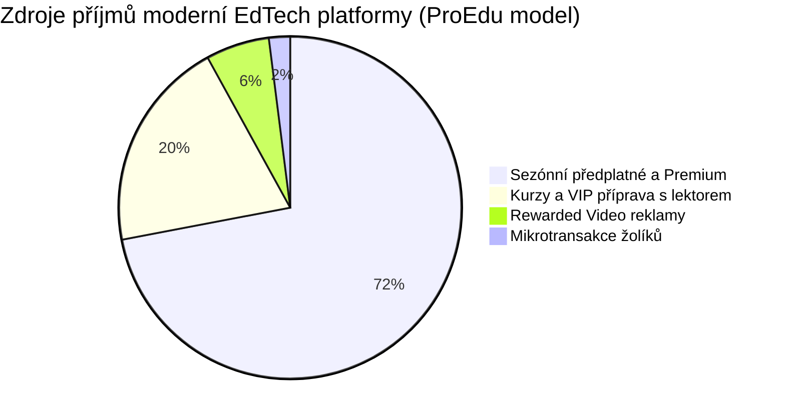

# Komplexní výzkum monetizace, reklamního modelu a platebních systémů pro ProEdu

> **Datum zpracování:** Říjen 2026  
> **Projekt:** ProEdu (Vzdělávací webová platforma pro přípravu na přijímací zkoušky na SŠ – Cermat MA a ČJ)  
> **Technologický stack:** React 19, Vite, TypeScript, Tailwind CSS, Firebase (Auth, Firestore, Cloud Functions, Cloud Storage)  
> **Cíl dokumentu:** Poskytnout detailní a podloženou analýzu monetizačních strategií, technických možností webových videoreklam (Rewarded Ads), platebních bran v ČR, právních regulací nezletilých (GDPR, DSA, COPPA) a navrhnout udržitelný unit-economic model včetně kompletní roadmapy implementace.

---

## Manažerské shrnutí (Executive Summary)

Příprava na přijímací zkoušky na střední školy v České republice (jednotná přijímací zkouška Cermat pro 5., 7. a 9. ročníky ZŠ) představuje vysoce specifický trh se silnou sezónností (vrcholící od listopadu do dubna), vysokou emocionální angažovaností rodičů a specifickou demografickou skupinou (žáci 10–15 let).

### Klíčová zjištění výzkumu:

1. **Reklamy v EdTechu nejsou primárním zdrojem bohatství, ale tzv. „kreativní frikcí“ (Duolingo efekt):**  
   Při reálném českém eCPM pro webové videoreklamy (cca 50–90 Kč za 1 000 dokončených zhlédnutí pro nezletilé publikum) vydělá 1 000 denně aktivních uživatelů (DAU) sledováním videí pouze cca **2 500 až 3 500 Kč měsíčně**. To stěží pokryje náklady na hosting a databázi.  
   Skutečný význam žolíkového limitu (např. 20 žolíků denně) a reklam spočívá v tom, že **vytvářejí jemný tlak na nákup předplatného**. Pouhých **15 platících rodičů** (při 290 Kč/měsíc) vygeneruje vyšší měsíční zisk než 1 000 neplatících studentů sledujících videa.

2. **Google AdSense vs. Moderní webové aplikace:**  
   Klasický Google AdSense soustavně zamítá čisté jednostránkové aplikace (SPA v Reactu) s chybami *„Low-value content“* nebo *„Site under construction“*, protože roboti AdSense neprocházejí JavaScriptový stav ani obsah za přihlášením a vyžadují statické redakční články.  
   **Řešení:** Využít existující strukturu ProEdu (`studyTheory`, `studyTips`, `PracticeSubtopic`) a vygenerovat veřejně přístupné, SEO-indexovatelné studijní přehledy (Knowledge Base) a současně pro herní mechaniku nasadit **Google Ad Placement API (H5 Game Ads)** nebo specializovanou síť pro webové odměňovací video (např. **AppLixir** či **Playwire**).

3. **AdBlock v ČR a prevence zneužití:**  
   V ČR používá AdBlock **35–45 % žáků na desktopu** a **20–25 % na mobilních zařízeních**. Pokud by aplikace nekontrolovala zhlédnutí videa na serveru nebo spoléhala na chybové stavy, studenti by AdBlockem získali neomezený přístup zdarma. Aplikace musí obsahovat detekci AdBlocku a přívětivou duolingovskou zprávu: *„Máš zapnutý AdBlock. Pro dobití žolíků zdarma si web odblokuj, nebo přejdi na ProEdu Premium.“*

4. **České platební brány (Comgate vs. GoPay vs. Stripe vs. ThePay):**  
   - **Stripe** má bezkonkurenční vývojářskou dokumentaci a Stripe Billing, ale nejvyšší poplatky (1,5 % + 6,50 Kč + 0,7 % Billing) a postrádá české bankovní převody a SPAYD QR platby.
   - **Comgate** a **GoPay** nabízejí nejnižší poplatky v ČR (0,69–0,99 %) a podporují **QR platby ČBA (SPAYD)**, které čeští rodiče preferují nejvíce.
   - **Klíčové specifikum:** QR platba neumí rekurentní (opakované měsíční) strhávání. Proto je ideální kombinovaný model: **Karta pro měsíční předplatné** (tokenizace) + **SPAYD QR platba pro Sezónní balíček do dubna a Kurzy**.

5. **Právní regulace a ochrana dětí (Zákon č. 110/2019 Sb. & DSA):**  
   Dle **§ 7 zákona č. 110/2019 Sb.** je věk digitálního souhlasu v ČR **15 let**. Žáci 9. tříd mají 14–15 let, žáci 5. a 7. tříd méně.  
   Dle **čl. 28 nařízení EU Digital Services Act (DSA)** a zásad společnosti Google je **přísně zakázáno profilovat nezletilé a cílit na ně personalizovanou reklamu**. Implementace musí striktně posílat příznaky `TFUA=1` a `TFCD=1`. To sice snižuje eCPM o cca 30–40 %, ale eliminuje riziko likvidačních pokut od ÚOOÚ a zablokování účtu Googlem.

---

## 1. Analýza A: Google AdSense vs. Webové Rewarded video reklamy

### 1.1 Proč Google AdSense zamítá SPA kvízy a webové aplikace?

Mnoho vývojářů moderních React/Vue aplikací naráží na zamítnutí žádosti o AdSense s odůvodněním:
- *„Nízká hodnota obsahu (Low-value content)“*
- *„Web je ve výstavbě nebo špatně navigovatelný (Under construction / Site navigation)“*
- *„Nedostatek původního textového obsahu (Scraped or template content)“*

#### Příčiny tohoto jevu:
1. **Client-Side Rendering (CSR) a limity crawlerů:**  
   Vite + React 19 ve výchozím stavu servíruje prázdné HTML (`<div id="root"></div>`) a skripty. Robot AdSense (*Mediapartners-Google*) na rozdíl od hlavního vyhledávacího robota Googlebot často nespouští náročné JavaScriptové enginy s dostatečným timeoutem. Vidí prázdnou stránku bez textu a automaticky ji vyhodnotí jako „ve výstavbě“.
2. **Obsah za autentizací (Auth Wall):**  
   Jakmile je procvičování nebo studium přístupné až po přihlášení (`/practice`, `/dashboard`), robot AdSense se do něj nedostane. Stránky bez veřejného přístupu AdSense neschválí.
3. **Formátová neshoda s pravidly AdSense:**  
   Pravidla [Google Publisher Policies](https://support.google.com/adsense/answer/10502938) vyžadují bohatý, ucelený redakční obsah (články, odstavce, návody). Interaktivní formulář, testová otázka o dvou větách a 4 tlačítka odpovědí nesplňují minimální textovou délku pro vložení klasických kontextových bannerů.

```
       TYPICKÝ PROBLÉM WEBOVÉ APLIKACE V REACTU:
       
       AdSense Crawler                     Webový prohlížeč bota
             │                                       │
             ▼                                       ▼
    GET https://proedu.cz/              Stáhne prázdné HTML:
             │                          <div id="root"></div>
             │                          <script src="/src/main.tsx"></script>
             ▼                                       │
    Nespuštěn JS engine                              ▼
    Indexováno: 0 slov textu             Výsledek: "Low-value content" /
    Žádné redakční články               "Site under construction" -> ZAMÍTNUTO!
```

#### Řešení problému pro ProEdu (Dvousložková strategie):

1. **Vytvoření veřejné znalostní báze (SEO Studijní přehledy):**  
   ProEdu již v datovém modelu disponuje bohatými daty: v souborech cvičení a subtopicích jsou pole `studyTheory`, `studyTips`, `studySteps` a `sampleProblem`.  
   Tato data lze vyexportovat do veřejně přístupných URL (např. `/teorie/matematika/linearni-rovnice`, `/teorie/cestina/vetny-rozbor`), které jsou předrenderované (pomocí Vite pluginu `vite-plugin-prerender` nebo lehkého SSG).  
   Stránka obsahuje 500–1 000 slov teorie, ukázkový příklad s postupem a schema.org strukturovaná data `LearningResource`. Tyto stránky AdSense schválí bez jakýchkoliv výhrad a navíc přivedou masivní organickou návštěvnost z vyhledávače Google/Seznam při dotazech žáků na školní učivo.
2. **Oddělení domén/zón:**  
   Schválení proběhne na doméně s veřejným obsahem, zatímco v aplikační části (`/app/practice`) se nasadí specializovaný odměňovací model.

---

### 1.2 Přehled a srovnání webových sítí pro Rewarded Video

Odměňovací video (Rewarded Video) je formát, kdy uživatel **dobrovolně zvolí** zhlédnutí 15–30sekundového videa výměnou za herní odměnu (v ProEdu: dobití žolíků pro pokračování v procvičování).

Níže je hloubkové srovnání technologických možností na webu:

| Síť / Technologie | Vhodnost pro Web App | Podpora Rewarded Video | Typ integrace | Min. návštěvnost | Výhody | Nevýhody pro ProEdu |
| :--- | :--- | :--- | :--- | :--- | :--- | :--- |
| **Google Ad Placement API** *(H5 Games Ads)* | **Vysoká** | Ano (`type: 'reward'`) | JavaScript API (`adBreak`) | Bez striktního minima | Oficiální Google řešení, stabilní infrastruktura, vysoká bezpečnost reklam | Nutnost schválení pro H5 Games program v AdSense konzoli |
| **Google Ad Manager (GAM) + GPT** | **Vysoká** | Ano (`defineRewardedSlot`) | Google Publisher Tag (GPT) | Vyžaduje účet GAM | Standard enterprise vydavatelů, podpora Direct Deals a Open Bidding | Chybí nativní Server-Side Verification (SSV) na webu |
| **AppLixir** | **Velmi vysoká** | Ano (nativní web rewarded) | Lehký JS SDK script tag | Žádné minimum (vhodné pro MVP) | Určeno přímo pro HTML5/web apps, jednoduché JavaScript callbacky | Menší lokální český fill rate než přímý Google |
| **Playwire (RAMP)** | **Vysoká (v budoucnu)** | Ano | Header Bidding Wrapper | 100k+ PV / měsíc | Nejvyšší eCPM, **COPPA/GDPR certifikace** pro děti a školy | Striktní limity návštěvnosti pro přijetí webu |
| **AdinPlay (Venatus)** | **Střední** | Ano | Managed JavaScript SDK | Schválení týmem | Silné zázemí v herním segmentu, kvalitní video poptávka | Orientace primárně na browser hry (.io), nutnost manuálního onboardingu |
| **Monetag (PropellerAds)** | **Nevhodné** | Pouze Interstitial/Push | JS skript | Okamžité schválení | 100% fill rate po celém světě | **Nekvalitní reklamy (affiliate, dating, crypto) – přísně nevhodné pro děti!** |
| **Ezoic** | **Nevhodné** | Omezeně | DNS proxy / JS skript | Dříve 10k PV | Zpomaluje načítání SPA aplikace, agresivní rozmisťování prvků | Často rozbije reaktivní DOM v Reactu 19 |

---

### 1.3 Technická specifikace: Google Ad Placement API (H5 Games Ads)

Google představil **Ad Placement API**, které nahrazuje dřívější komplexní IMA SDK pro web. Funguje na principu „deklarace přestávky v aktivitě“ (ad break).

#### Integrace do Reactu:

1. **Načtení skriptu v `index.html`:**
```html
<script 
  async 
  src="https://pagead2.googlesyndication.com/pagead/js/adsbygoogle.js?client=ca-pub-XXXXXXXXXXXXXXXX" 
  crossorigin="anonymous">
</script>
<script>
  window.adsbygoogle = window.adsbygoogle || [];
  window.adBreak = function(o) { adsbygoogle.push(o); };
  window.adConfig = function(o) { adsbygoogle.push(o); };

  // Konfigurace pro nezletilé (GDPR & COPPA compliant)
  adConfig({
    preloadAdBreaks: 'on',
    sound: 'on',
  });
</script>
```

2. **React Service Wrapper (`src/services/rewardedAdService.ts`):**
```typescript
/**
 * Služba pro zprostředkování Rewarded Video reklam přes Google Ad Placement API
 */
declare global {
  interface Window {
    adBreak?: (options: any) => void;
    adConfig?: (options: any) => void;
  }
}

export interface RewardedAdResult {
  rewardEarned: boolean;
  reason?: 'completed' | 'dismissed' | 'no-fill' | 'error' | 'adblock';
}

export async function showRewardedAdBreak(): Promise<RewardedAdResult> {
  return new Promise((resolve) => {
    // 1. Kontrola existence API (detekce AdBlocku nebo výpadku skriptu)
    if (typeof window.adBreak !== 'function') {
      console.warn('[AdService] Google adBreak API není dostupné (možný AdBlock).');
      return resolve({ rewardEarned: false, reason: 'adblock' });
    }

    let rewardGranted = false;

    window.adBreak({
      type: 'reward',
      name: 'refill_jokers',
      beforeAd: () => {
        // Pozastavení zvuků a timerů v cvičení
        console.log('[AdService] Reklama začíná.');
      },
      afterAd: () => {
        // Obnovení stavu cvičení
        console.log('[AdService] Reklama skončila.');
        resolve({
          rewardEarned: rewardGranted,
          reason: rewardGranted ? 'completed' : 'dismissed',
        });
      },
      beforeReward: (showAdFn: () => void) => {
        // Google potvrdil, že má reklamu připravenu k zobrazení
        showAdFn();
      },
      adDismissed: () => {
        console.log('[AdService] Uživatel přeskočil reklamu předčasně.');
        rewardGranted = false;
      },
      adViewed: () => {
        // Uživatel dokoukal požadovanou délku videa
        console.log('[AdService] Zhlédnutí úspěšně dokončeno. Nárok na odměnu.');
        rewardGranted = true;
      },
      adBreakDone: (placementInfo: any) => {
        if (placementInfo?.breakStatus === 'notReady' || placementInfo?.breakStatus === 'error') {
          console.warn('[AdService] Žádná reklama nebyla k dispozici (No-fill).');
          resolve({ rewardEarned: false, reason: 'no-fill' });
        }
      }
    });
  });
}
```

---

### 1.4 Technická alternativa pro rychlé nasazení (MVP): AppLixir Web SDK

Pokud schvalovací proces Google AdSense / H5 trvá týdny, lze jako okamžitou alternativu nasadit **AppLixir**, který je přímo optimalizován pro HTML5 odměňovací videa a nevyžaduje rozsáhlý schvalovací proces.

```html
<!-- Umístění do index.html -->
<div id="applixir-ad-container"></div>
<script src="https://cdn.applixir.com/applixir.app.v6.1.0.js"></script>
```

```typescript
// Volání z React komponenty při kliknutí na "Zhlédnout video (+5 žolíků)"
export function playAppLixirRewarded(onReward: () => void, onError: (err: string) => void) {
  if (typeof (window as any).applixir === 'undefined') {
    onError('adblock');
    return;
  }

  (window as any).applixir.initializeAndOpenPlayer({
    apiKey: "YOUR-APPLIXIR-API-KEY",
    adStatusCallbackFn: (status: string) => {
      switch (status) {
        case 'ad-watched':
          onReward(); // Dokoukáno -> připsat žolíky
          break;
        case 'ad-skipped':
          onError('skipped');
          break;
        case 'no-ad':
          onError('no-fill');
          break;
        default:
          break;
      }
    }
  });
}
```

---

### 1.5 Omezení AdBlocků v ČR a technické řešení

Dle průzkumů trhu v ČR (ResSolution Group / MediaGuru) je penetrace AdBlocku mezi studenty následující:
- **Desktop (Notebooky/PC): 35–45 %** (dominance rozšíření uBlock Origin, AdBlock Plus).
- **Mobilní zařízení: 18–25 %** (zejména prohlížeče Brave, Opera Mobile, AdGuard DNS, blokátory v Safari na iOS).

#### Kritická bezpečnostní chyba, které se vyvarovat:
Častou chybou nezkušených vývojářů je fallback logika typu:
```javascript
// ZÁVAŽNÁ CHYBA: Způsobí, že všichni žáci zapnou AdBlock a mají aplikaci zdarma bez reklam i bez placení!
try {
  await showAd();
  addJokers(5);
} catch (e) {
  addJokers(5); // ŠPATNĚ: Odměna udělena i při zablokování reklamy!
}
```

#### Správná implementace (Detekce + Duolingo-style etická výzva):

1. **Detekce přítomnosti AdBlocku:**  
   Vytvoření klientského testu pomocí falešného skriptu `ads.js` načítaného z lokálního public adresáře nebo testu domény `pagead2.googlesyndication.com`.

```typescript
// src/utils/adblockDetector.ts
export async function checkIsAdBlockActive(): Promise<boolean> {
  // Test 1: Pokus o fetch známého ad requestu
  try {
    const testRequest = new Request(
      'https://pagead2.googlesyndication.com/pagead/js/adsbygoogle.js',
      { method: 'HEAD', mode: 'no-cors' }
    );
    await fetch(testRequest);
    return false; // Skript nebyl zablokován sítí
  } catch (error) {
    return true; // Síťový požadavek byl sestřelen lokálním blokátorem
  }
}
```

2. **UX scénář (Nenásilný, ale neprostupný):**
   - Uživatel má 0 žolíků a klikne na *„Zhlédnout video pro dobití +5 žolíků“*.
   - Systém detekuje AdBlock nebo selhání načtení ad serveru.
   - Zobrazí se vlídné dialogové okno s dvěma volbami:
     > **„Chceš pokračovat v procvičování zdarma?“**  
     > *„ProEdu vyvíjíme pro všechny studenty bezplatně díky krátkým sponzorským videím. Zjistili jsme, že máš zapnutý blokátor reklam (AdBlock).*  
     > *1. Povol reklamy pro doménu `proedu.cz` a získej 5 žolíků.*  
     > *2. Nebo přejdi na **ProEdu Premium**, kde máš neomezené procvičování zcela bez reklam a bez čekání.“*
   - Žolíky se **nikdy nepřipíší**, dokud neproběhne validní událost `adViewed` / `rewardedSlotGranted`.

---

## 2. Finanční realita a Unit Economics v ČR (eCPM Model)

### 2.1 Reálná čísla eCPM na českém trhu

V oblasti online inzerce patří Česká republika mezi trhy kategorie **Tier 2** (střední Evropa). Výdělky z reklamy jsou výrazně nižší než v USA, Velké Británii nebo Německu (Tier 1), avšak vyšší než v Polsku či na Balkáně.

#### Tabulka realistických hodnot eCPM pro český web (rok 2026):

| Reklamní formát | eCPM pro dospělé (Běžný web) | eCPM pro nezletilé (EdTech / DSA bez personalizace) | Průměrný Fill Rate v ČR |
| :--- | :--- | :--- | :--- |
| **Běžný Display Banner (300x250, Leaderboard)** | 12 – 35 Kč (0,50 – 1,40 €) | 8 – 20 Kč (0,30 – 0,80 €) | 80 – 95 % |
| **Interstitial (Celoobrazovková mezi testy)** | 45 – 105 Kč (1,80 – 4,20 €) | 30 – 70 Kč (1,20 – 2,80 €) | 70 – 85 % |
| **Rewarded Video (Odměňovací video 15–30s)** | 85 – 180 Kč (3,40 – 7,20 €) | **50 – 95 Kč (2,00 – 3,80 €)** | **65 – 80 %** |

> [!WARNING] Vliv regulace nezletilých (TFUA / DSA) na eCPM
> Vzhledem k tomu, že žáci 9. tříd a mladší nesmí být sledováni cookies třetích stran a inzerenti nemohou provádět remarketing ani zájmové cílení, inzerce se draží pouze v **kontextových aukcích**. To sráží výsledný eCPM o **35 až 50 %** oproti běžným portálům pro dospělé. Pro realistické finanční plánování ProEdu je nutné počítat s konzervativní hodnotou **eCPM = 65 Kč (cca 2,60 €)** za 1 000 dokončených videí.

---

### 2.2 Matematická kalkulace zisku z reklam pro 1 000, 5 000 a 20 000 uživatelů

Předpoklady modelu:
- Uživatel na Free tieru má denní limit 20 žolíků (cca 5 cvičení).
- Po vyčerpání zhlédne průměrně **1,5 odměňovacího videa denně** (někdo 0, někdo 3).
- **Konzervativní eCPM:** 65 Kč za 1 000 shlédnutí.
- **Reálný Fill Rate:** 75 % (z 100 pokusů se video reálně načte 75×, 25× není inventory).
- **Měsíční sezóna:** 30 dní.

```
+───────────────────────────────────────────────────────────────────────────────────────────+
│                       SIMULACE VÝNOSŮ Z REKLAM (REWARDED VIDEO)                           │
+──────────────────────────┬──────────────────────────┬──────────────────────────┬──────────+
│ Metrika                  │ 1 000 DAU                │ 5 000 DAU                │ 20 000 DAU│
+──────────────────────────┼──────────────────────────┼──────────────────────────┼──────────+
│ MAU (Měsíčně aktivní)    │ ~4 500 uživatelů         │ ~22 500 uživatelů        │ ~90 000  │
│ Poptávaná videa za den   │ 1 500 zhlédnutí          │ 7 500 zhlédnutí          │ 30 000   │
│ Úspěšná zhlédnutí (75%)  │ 1 125 impresí/den        │ 5 625 impresí/den        │ 22 500   │
│ Denní hrubý příjem       │ 73,10 Kč                 │ 365,60 Kč                │ 1 462 Kč │
│ Měsíční příjem z reklam  │ 2 193 Kč                 │ 10 968 Kč                │ 43 875 Kč│
│ Sezónní příjem (5 měs.)  │ 10 965 Kč                │ 54 840 Kč                │ 219 375 Kč│
+──────────────────────────┴──────────────────────────┴──────────────────────────┴──────────+
```

---

### 2.3 Srovnání reklam vs. Předplatné (The Duolingo Effect)

Podívejme se, co se stane, pokud aplikujeme konverzní trychtýř na **Předplatné ProEdu Premium** (cena např. **290 Kč / měsíc** nebo **890 Kč za celou přijímačkovou sezónu**):

```
+───────────────────────────────────────────────────────────────────────────────────────────+
│                     SROVNÁNÍ PŘÍJMŮ: REKLAMY VS. PŘEDPLATNÉ (PŘI 5 000 DAU)              │
+───────────────────────────────────────────────────────────────────────────────────────────+
│ ZDROJ PŘÍJMU              │ PŘEDPOKLAD A KONVERZE                  │ MĚSÍČNÍ PŘÍJEM       │
+───────────────────────────┼────────────────────────────────────────┼──────────────────────+
│ Pouze Rewarded Video      │ 5 625 zhlédnutí denně (75% fill)       │ 10 968 Kč            │
│ Předplatné (Konzervativní)│ Pouze 1,0 % konverze z MAU (225 rodičů)│ 65 250 Kč (6× VÍCE!) │
│ Předplatné (Optimistické) │ 3,0 % konverze z MAU (675 rodičů)      │ 195 750 Kč (18× VÍCE!)│
│ Sezónní balíček jednorázově│ 400 prodaných licencí (890 Kč)        │ 356 000 Kč (hotovost)│
+───────────────────────────────────────────────────────────────────────────────────────────+
```



### Závěr ekonomické analýzy:
Reklamy v české vzdělávací aplikaci pro základní školy **nikdy nezaplatí plnohodnotný vývoj, lektory a tvorbu kvalitního obsahu**.  
Jejich pravý strategický účel je **třífázový**:
1. **Monetizovat 95 % neplatících studentů**, aby alespoň pokryli provozní náklady na cloudovou infrastrukturu Firebase.
2. **Udržovat studenty v aplikaci** a motivovat je k pravidelnému dennímu návratu (zhlédnutím videa si „koupí“ dalších 15 minut učení).
3. **Působit jako psychologická frikce:** Po třetím vyčerpání žolíků a nutnosti sledovat video se rodič i student sami rozhodnou, že 290 Kč měsíčně nebo 890 Kč do dubna je zanedbatelná částka za klid a úspěch u přijímaček na vysněnou střední školu.

---

## 3. Detailní návrh 4 uživatelských úrovní (Tiering & Herní ekonomika)

Pro maximální konverzní efektivitu doporučujeme rozdělit uživatelskou základnu do následujících 4 úrovní:

```
┌──────────────────────────────────────────────────────────────────────────────────────────────┐
│                                ARCHITEKTURA TIERŮ PROEDU                                      │
├────────────────────┬────────────────────┬────────────────────┬───────────────────────────────┤
│ 1. Neregistrovaný  │ 2. Free Student    │ 3. ProEdu Premium  │ 4. Kurz & VIP Lektor          │
│    (Návštěvník)    │    (Registrovaný)  │    (Předplatitel)  │    (Kompletní příprava)       │
├────────────────────┼────────────────────┼────────────────────┼───────────────────────────────┤
│ • 1 test z MA a ČJ │ • 20 žolíků/den    │ • Neomezené procv. │ • Vše z Premium               │
│ • Bez historie     │ • +5 žolíků za vid │ • Kompletní teorie │ • Živé lekce Google Meet      │
│ • Call-to-Action   │ • Pouze blok 1     │ • Tipy a postupy   │ • Videozáznamy lekcí          │
│   na registraci    │ • Streak počítadlo │ • Prioritní dotazy │ • Studijní materiály v PDF    │
│                    │ • AdBlock detekce  │ • Růst Zahrady     │ • Individuální rozbor testů   │
└────────────────────┴────────────────────┴────────────────────┴───────────────────────────────┘
```

---

### 3.1 Úroveň 1: Neregistrovaný uživatel (Guest / Trial)
- **Cíl:** Okamžitý "Aha!" moment bez registrace, odstranění jakékoliv bariéry vstupu.
- **Dostupný obsah:** 
  - Přesně 1 vybrané podtéma z Matematiky (např. *Zlomky a poměry*) a 1 z Českého jazyka (např. *Pravopis i/y*).
  - Maximálně 5 otázek.
- **Konverzní trigger:**
  - Po dokončení 5 otázek se zobrazí skóre a modální okno:  
    > *„Skvělá práce! Tvé skóre je 80 %. Chceš si výsledek uložit, získat **20 žolíků denně zdarma** a odemknout všech 45 témat k přijímačkám? Zaregistruj se jedním klikem přes Google.“*
  - Agresivnější zobrazení výhod placeného programu v patičce a v postranním panelu.

---

### 3.2 Úroveň 2: Základní uživatel (Free registrovaný) – Ekonomika žolíků

Jádrem udržení pozornosti (retence) je herní mechanika žolíků / energie:

#### Pravidla žolíkové ekonomiky:
1. **Denní příděl:** Každý registrovaný Free uživatel dostane **20 žolíků denně**.
2. **Cena cvičení:** 
   - 1 otázka = 1 žolík (běžné cvičení o 4–5 otázkách spotřebuje 4–5 žolíků).
   - Uživatel tedy může denně zdarma vyřešit **cca 4 až 5 cvičení** (cca 15–20 minut čistého studia).
3. **Půlnoční reset:** Ve 00:00 se počet žolíků automaticky dorovná zpět na 20 (žolíky se nekumulují nad 20, aby byl uživatel motivován cvičit každý den).
4. **Dobíjení videem:**  
   - Po vyčerpání žolíků (stav 0) se zobrazí tlačítko: *„Dobít +5 žolíků (zhlédnout video 20s)“*.
   - **Denní limit videí:** Maximálně **3 videa denně** (+15 žolíků). Celkem tedy Free uživatel může udělat max 35 otázek denně.  
   - *Důvod limitu:* Zabránění zneužití roboty, ochrana inzertního inventory před vyčerpáním a vytvoření přirozeného stropu, který motivuje k nákupu Premium.
5. **Omezení obsahu při slabých příjmech:**  
   - Free uživatel má otevřen pouze **Základní blok (Úroveň 1 – Lehká cvičení)**.
   - Náročnější Cermat úlohy (Úroveň 2 – Střední a Úroveň 3 – Těžká, typicky komplexní slovní úlohy, planimetrie, souvětí) jsou označeny zámečkem: *„Odemkni v ProEdu Premium“*.
6. **Psychologie streaků (Série dní):**  
   - Uživatel buduje Streak (počet po sobě jdoucích dnů učení).
   - Pokud jeden den vynechá, streak se vynuluje.
   - **Streak Freeze (Zmrazení série):** Free uživatel si může 1× za měsíc zachránit streak zhlédnutím 2 videí, zatímco Premium uživatel má ochranu automaticky v ceně.

---

### 3.3 Úroveň 3: Premium uživatel (Student Pro)

Určeno pro samostatné studenty a rodiče, kteří chtějí maximální efektivitu samostudia.

#### Co Premium odemyká:
- **Neomezené procvičování:** Žádné žolíky, žádné denní limity, žádné čekání na půlnoc.
- **100% bez reklam:** Maximální soustředění bez rozptylování sponzorskými videi.
- **Kompletní výuková teorie krok za krokem:** Přístup k polím `studyTheory`, `studySteps`, `tutorTip`, detailní rozbory chyb a vysvětlení správného postupu u každé otázky.
- **Neomezený růst Zahrady (Gamifikace Garden):** Získávání unikátních rostlin, odznaků a avatarů.
- **Chytré adaptivní opakování:** Systém eviduje chybně zodpovězené otázky a přednostně je studentovi vrací k procvičení až do úplného zvládnutí.
- **Prioritní lektorská podpora:** Možnost odeslat dotaz k nejasné úloze přes `inquiryService` s garantovanou odpovědí lektora do 24 hodin.

#### Cenotvorba Premium:
1. **Měsíční předplatné:** **249 Kč až 299 Kč / měsíc** (flexibilní, možnost kdykoliv zrušit).
2. **Sezónní balíček „Cermat Přijímačky do dubna“ (DOPORUČENÝ HLAVNÍ PRODUKT):**
   - **Jednorázová platba: 790 Kč až 990 Kč** (platnost do 30. dubna daného školního roku).
   - *Proč je to hit:* Rodiče nesnášejí opakované měsíční strhávání, na které zapomenou. Jednorázová platba do termínu přijímaček odbourává obavu z nechtěného obnovení předplatného v květnu a červnu.

---

### 3.4 Úroveň 4: Kurz uživatel (VIP / Hybridní příprava)

Tento stupeň kombinuje software s reálnou výukou živého lektora.

#### Co Kurz obsahuje:
- Vše z úrovně **Premium** bez omezení.
- **Přístup do sekce „Kurzy“ v aplikaci:**
  - Živé online lekce přes **Google Meet** (integrované dle naší předchozí studie přímo v rozhraní ProEdu).
  - Videozáznamy všech proběhlých lekcí pro zpětné přehrání.
  - Exkluzivní PDF pracovní sešity a sbírky Cermat úloh ke stažení.
  - Individuální rozbory cvičných přijímačkových testů zadaných lektorem.

#### Cenotvorba Kurzu:
- **Pololetní kurz (listopad – duben):** **3 490 Kč až 4 900 Kč** (jednorázově nebo na 2 splátky).
- *Tržní kontext:* Konkurenční prezenční i online kurzy (Scio, To Dáš! Přijímačky, Zkoušky nanečisto) se v ČR pohybují mezi 4 500 Kč a 8 900 Kč. ProEdu s vlastní interaktivní aplikací představuje obrovskou přidanou hodnotu.

---

### 3.5 Možnost mikrotransakcí (Nákup žolíků bez předplatného)

Zahraniční hry často prodávají virtuální měnu v mikrobalíčcích (0,99 € za 50 mincí).  
**Analýza pro český EdTech:**
- V ČR mají rodiče k drobným mikrotransakcím (39 Kč za dobití žolíků) **silný odpor** kvůli nutnosti zadávat pokaždé platební kartu nebo potvrzovat platbu v bankovní aplikaci (3D Secure).
- Žáci 9. tříd navíc často nemají vlastní platební kartu s povolenými internetovými platbami.
- **Doporučený kompromis:**  
  Nenabízet desítky drobných nákupů žolíků, ale maximálně **„Víkendový maraton pas“** (neomezené žolíky na 48 hodin za **79 Kč** prostřednictvím rychlé SMS nebo QR platby). Tento pas si žáci kupují v sobotu ráno před pondělním školním testem.

---

## 4. Platební brány v ČR (Komparativní analýza)

Volba platební brány zásadně ovlivňuje konverzní poměr (zejména u rodičů platících z mobilu) a vývojářskou komplexitu.

```
┌────────────────────────────────────────────────────────────────────────────────────────┐
│                     SROVNÁNÍ ČESKÝCH A GLOBÁLNÍCH PLATEBNÍCH BRAN                      │
├────────────────────┬──────────────────┬──────────────────┬─────────────────────────────┤
│ Parametr           │ Stripe           │ Comgate          │ GoPay                       │
├────────────────────┼──────────────────┼──────────────────┼─────────────────────────────┤
│ Základní poplatek  │ 1,5 % + 6,50 Kč  │ 0,69 – 0,98 %    │ 0,95 – 1,4 % + 3 Kč         │
│ Poplatek Billing   │ + 0,7 % z objemu │ V ceně transakce │ V ceně transakce            │
│ Rekurentní platby  │ Nativní API      │ Ano (Tokenizace) │ Ano (Tokenizace)            │
│ Apple / Google Pay │ Ano (1-klik)     │ Ano              │ Ano                         │
│ SPAYD QR Platba ČBA│ NE               │ ANO (Špičková)   │ ANO                         │
│ Bankovní tlačítka  │ Ne (pouze karty) │ Ano (všechny CZ) │ Ano                         │
│ Rychlost integrace │ Extrémně rychlá  │ Střední          │ Střední                     │
└────────────────────┴──────────────────┴──────────────────┴─────────────────────────────┘
```

---

### 4.1 Podrobná analýza jednotlivých poskytovatelů

#### 1. Stripe (Globální standard)
- **Výhody:** Nejlepší vývojářská dokumentace na světě, oficiální SDK pro Node.js/TypeScript, hotové komponenty Stripe Checkout a Customer Portal (uživatel si sám spravuje kartu a ruší předplatné bez vašeho kódu), prvotřídní zpracování Apple Pay a Google Pay.
- **Nevýhody:** Vyšší poplatky (1,5 % + 6,50 Kč pro evropské karty + 0,7 % za Stripe Billing). **Zásadní nedostatek v ČR: Stripe nepodporuje rychlá česká bankovní tlačítka (Česká spořitelna, ČSOB, Komerční banka) ani tuzemské SPAYD QR platby.**

#### 2. Comgate (Český lídr poměru cena/výkon)
- **Výhody:** Nejnižší transakční poplatky v ČR (od 0,69 % u vyšších obratů, cca 0,98 % v tarifu Easy). Plná podpora všech českých a slovenských bankovních tlačítek. **Špičková podpora dynamických QR plateb.** Možnost rekurentních plateb kartou (prostřednictvím uložení tokenu karty).
- **Nevýhody:** Starší REST API s nutností vlastního řízení předplatného (musíte v cronu sami volat API pro stržení další měsíční platby). Rekurentní platby vyžadují schválení risk oddělením Comgate.

#### 3. GoPay (Tradiční česká brána)
- **Výhody:** Vysoká známost značky mezi českými rodiči, moderní inline rozhraní (překryvné okno bez opuštění webu), podpora Apple Pay, Google Pay, QR plateb i rekurentních plateb.
- **Nevýhody:** Poplatky se pohybují mírně výše než u Comgate (kolem 1,2 % + 3 Kč). Měsíční paušál za bránu (cca 190 Kč), pokud měsíční obrat nepřekročí limit (cca 50 000 Kč).

#### 4. ThePay (Moderní české API v3)
- **Výhody:** Zcela přepracované moderní API v3, automatická změna tarifu podle obratu (0,79–0,99 %), čisté rozhraní, podpora Apple Pay i QR plateb.
- **Nevýhody:** Menší podíl na trhu než Comgate/GoPay.

---

### 4.2 Fenomén SPAYD QR plateb v ČR a proč neumí předplatné

V České republice platí více než **50 % uživatelů na internetu pomocí QR kódu** přímo ze své bankovní aplikace (Česká spořitelna George, Air Bank, KB, ČSOB). Standard spravuje Česká bankovní asociace (ČBA) pod názvem **SPAYD (Short Payment Descriptor)**.

#### Struktura SPAYD řetězce:
```text
SPD*1.0*ACC:CZ6508000000192000145399*AM:890.00*CC:CZK*X-VS:2026101501*MSG:ProEdu Sezonni balicek*
```

#### Zásadní technické omezení QR plateb:
> [!IMPORTANT] QR kód je ze své podstaty „Push“ platba
> QR platba vygeneruje jednorázový bankovní příkaz k úhradě, který zákazník autorizuje ve svém mobilním bankovnictví.  
> **QR platba NEMŮŽE sloužit pro automatické měsíční rekurentní předplatné**, protože bankovní aplikace neumožňuje třetí straně strhávat budoucí platby bez opakované ruční autorizace uživatelem.

#### Doporučená platební architektura pro ProEdu:
1. **Měsíční předplatné (290 Kč/měsíc):**  
   Povoleno **pouze platební kartou** (s podporou Apple Pay / Google Pay). Karta se tokenizuje a systém (Stripe Billing nebo Comgate recurring) automaticky strhává platbu každých 30 dní.
2. **Sezónní balíček do dubna (890 Kč) a Kurzy (3 900 Kč):**  
   Nabídnout **přednostně SPAYD QR platbu + bankovní převod + kartu**. Zde je jednorázová platba žádoucí, konverze u rodičů stoupne o 30–40 %, protože nemusí hledat peněženku a kartu, ale pouze oskenují kód telefonem.

---

## 5. Právní a věkové regulace v ČR (GDPR, ZOOÚ, DSA, COPPA)

Příprava na střední školy se dotýká nezletilých studentů. Porušení evropských a českých předpisů může vést k masivním sankcím a okamžitému zablokování inzertních a platebních účtů.

```
┌────────────────────────────────────────────────────────────────────────────────────────┐
│                        REGULAČNÍ RÁMEC PRO PROEDU V ČR                                  │
├────────────────────┬───────────────────────────────────────────────────────────────────┤
│ Zákon / Směrnice   │ Klíčový dopad na ProEdu                                           │
├────────────────────┼───────────────────────────────────────────────────────────────────┤
│ Zákon 110/2019 Sb. │ § 7: Věk digitálního souhlasu je v ČR stanoven na 15 LET.        │
│ Článek 8 GDPR      │ Děti pod 15 let vyžadují souhlas rodiče pro zpracování údajů.     │
│ DSA (čl. 28)       │ Přísný zákaz profilování a behaviorální reklamy na nezletilé.      │
│ Google TFUA & TFCD │ Povinné technické tagování inzertních požadavků pro Google sítě.  │
│ Spotřebitelské pr. │ Zákon č. 634/1992 Sb. – jasné poučení o odstoupení od smlouvy.    │
└────────────────────┴───────────────────────────────────────────────────────────────────┘
```

---

### 5.1 Zákon č. 110/2019 Sb. a věková hranice 15 let v ČR

Česká republika využila diskrece dané článkem 8 GDPR a v **§ 7 zákona č. 110/2019 Sb., o zpracování osobních údajů**, stanovila:

> *„Dítě nabývá způsobilosti k udělení souhlasu se zpracováním osobních údajů v souvislosti s nabídkou služeb informační společnosti přímo jemu dovršením patnáctého roku věku.“*

#### Věková realita žáků v ProEdu:
- **Žáci 9. tříd:** Většinou věk **14 až 15 let** (na přelomu hranice způsobilosti).
- **Žáci 7. tříd (šestiletá gymnázia):** Věk **12 až 13 let** (pod hranicí).
- **Žáci 5. tříd (osmiletá gymnázia):** Věk **10 až 11 let** (hluboko pod hranicí).

#### Právní dopady na registraci:
1. **Registrace žáka mladšího 15 let:**  
   Při registraci musí systém vyžadovat buď potvrzení, že žák dosáhl 15 let, nebo zadání e-mailu rodiče, kterému je odeslána notifikace a odkaz pro schválení účtu.
2. **Kupní smlouva (Platby):**  
   Nezletilý student nemá plnou svéprávnost k uzavírání smluv s opakovaným plněním (předplatné). V obchodních podmínkách ProEdu musí být jasně uvedeno, že **kupujícím je zákonný zástupce (rodič)**, i když je student koncovým uživatelem výukového účtu.

---

### 5.2 Ochrana nezletilých v inzerci: DSA a Google zásady

Evropské nařízení **Digital Services Act (DSA - Nařízení EU 2022/2065)** v **článku 28 odst. 2** kategoricky zakazuje:
> *„Poskytovatelé online platforem nesmějí na svém rozhraní zobrazovat reklamy založené na profilování [...] pokud s přiměřenou jistotou vědí, že příjemce služby je nezletilý.“*

Společnost Google na základě toho zavedla celosvětovou politiku, která zakazuje personalizaci reklam pro všechny uživatele mladší 18 let.

#### Povinná technická implementace v kódu reklam:
Všechny požadavky na Google reklamy v ProEdu musí být explicitně označeny jako nepersonalizované a určené pro nezletilé publikum:

```javascript
// Google Publisher Tag (GPT) konfigurace
googletag.cmd.push(function() {
  // TFCD: Tag for Child-Directed Treatment (COPPA)
  googletag.pubads().setTagForChildDirectedTreatment(1);
  
  // TFUA: Tag for Users under the Age of Consent in the EEA (GDPR / DSA)
  googletag.pubads().setTagForUnderAgeOfConsent(1);

  // Vynucení nepersonalizovaných reklam (žádné sledovací cookies)
  googletag.pubads().setRequestNonPersonalizedAds(1);
});
```

#### Přísná filtrace inzertních kategorií:
V administraci Google AdSense / Ad Manager je nutné v sekci *„Blocking controls“* natvrdo zakázat následující citlivé kategorie:
- Alkohol, tabák, zbraně.
- Hazardní hry, sázky a loterie.
- Seznamky a vztahové aplikace.
- Rychlé nebankovní půjčky a kryptoměny.
- Kosmetická chirurgie a hubnutí.

---

## 6. Doporučený technický postup a Firestore datový model

### 6.1 Rozšířený Firestore datový model

V návaznosti na stávající typy v [`src/types/index.ts`](file:///C:/PROJEKTY/PRO%20EDU/APPKA/ProEdu/src/types/index.ts) navrhujeme následující strukturu uživatelského profilu a platebních záznamů:

```typescript
// Rozšíření pro src/types/index.ts

export type UserTier = 'guest' | 'free' | 'premium' | 'course';

export interface UserSubscription {
  tier: UserTier;
  status: 'active' | 'past_due' | 'canceled' | 'expired';
  planId: 'monthly_290' | 'season_2027_890' | 'course_full_3490';
  currentPeriodStart: Timestamp;
  currentPeriodEnd: Timestamp; // Pro sezónní balíček: 30. 4. 2027 23:59:59
  gateway: 'stripe' | 'comgate' | 'gopay';
  customerId?: string;
  subscriptionId?: string;
  cancelAtPeriodEnd?: boolean;
}

export interface JokersState {
  balance: number;          // Aktuální počet žolíků (0 až 20+)
  maxDaily: number;         // Standardně 20
  lastResetDate: string;    // Formát 'YYYY-MM-DD' pro snadné porovnání půlnoci
  adsWatchedToday: number;  // Počet videí dnes (max 3)
  lastAdWatchedAt?: Timestamp;
}

// Doplnění stávajícího rozhraní UserProfile
export interface ExtendedUserProfile extends UserProfile {
  tier: UserTier;
  jokers: JokersState;
  subscription?: UserSubscription;
  parentEmail?: string;
  isParentVerified?: boolean;
  birthYear?: number;
}
```

---

### 6.2 Firebase Custom Claims (Zabezpečení bez nadbytečných Firestore čtení)

Aby se zabránilo zbytečným dotazům do Firestore při každém přechodu na chráněnou stránku a aby uživatel nemohl podvrhnout svůj stav v DevTools, používáme **Firebase Auth Custom Claims**.

Cloud Function nastaví claims po úspěšné platbě:
```typescript
// Firebase Cloud Function (Node.js)
import * as admin from 'firebase-admin';

export async function setUserTierClaims(uid: string, tier: UserTier, expiresAtTimestamp: number) {
  await admin.auth().setCustomUserClaims(uid, {
    tier: tier,
    premiumUntil: expiresAtTimestamp,
    isCourseUser: tier === 'course'
  });
}
```

V React komponentě pak autorizaci řešíme bleskově z JWT tokenu:
```typescript
// Kontrola v React komponentě
const idTokenResult = await user.getIdTokenResult();
const isPremium = idTokenResult.claims.tier === 'premium' || idTokenResult.claims.tier === 'course';
```

---

### 6.3 Firestore Security Rules (Ochrana proti manipulaci se žolíky)

Zákazník nesmí mít právo zapisovat do polí `tier`, `subscription` ani `jokers.balance` z klientského kódu:

```javascript
rules_version = '2';
service cloud.firestore {
  match /databases/{database}/documents {
    
    // Profil uživatele
    match /users/{userId} {
      allow read: if request.auth != null && request.auth.uid == userId;
      
      // Uživatel si může měnit profilové údaje, ale NIKDY tier, předplatné a žolíky
      allow update: if request.auth != null && request.auth.uid == userId
        && !request.resource.data.diff(resource.data).affectedKeys()
            .hasAny(['tier', 'subscription', 'jokers']);
            
      // Žolíky a předplatné smí modifikovat pouze Admin SDK (Cloud Functions)
    }

    // Objednávky a platby jsou striktně read-only pro vlastníka
    match /orders/{orderId} {
      allow read: if request.auth != null && resource.data.userId == request.auth.uid;
      allow write: if false; // Zápis pouze přes Webhook Cloud Function
    }
  }
}
```

---

### 6.4 Logika denního resetu žolíků (Client Lazy Reset vs. Cloud Cron)

Místo nákladné noční Cloud Function, která by v 00:00 musela projít a aktualizovat desetitisíce dokumentů v databázi (což generuje enormní množství Firestore Write operací), se v moderní architektuře používá **Lazy Evaluation při prvním denním otevření aplikace**:

```typescript
// src/services/jokerService.ts
import { db } from '../lib/firebase';
import { doc, runTransaction, Timestamp } from 'firebase/firestore';

export async function getOrResetJokers(userId: string): Promise<number> {
  const userRef = doc(db, 'users', userId);
  const todayStr = new Date().toISOString().split('T')[0]; // '2026-10-15'

  return await runTransaction(db, async (transaction) => {
    const userDoc = await transaction.get(userRef);
    if (!userDoc.exists()) throw new Error('Uživatel neexistuje');

    const data = userDoc.data();
    
    // Pokud je uživatel Premium nebo Kurz, žolíky neřešíme (neomezeno)
    if (data.tier === 'premium' || data.tier === 'course') {
      return 999;
    }

    const jokers = data.jokers || {
      balance: 20,
      maxDaily: 20,
      lastResetDate: todayStr,
      adsWatchedToday: 0
    };

    // Pokud datum neodpovídá dnešku, provedeme bezplatný reset na 20
    if (jokers.lastResetDate !== todayStr) {
      jokers.balance = 20;
      jokers.lastResetDate = todayStr;
      jokers.adsWatchedToday = 0;

      transaction.update(userRef, { jokers });
      return 20;
    }

    return jokers.balance;
  });
}
```

---

## 7. Roadmapa implementace (Fázovaný harmonogram)

Doporučujeme postupovat ve 3 fázích, aby projekt okamžitě začal generovat tržby a nezdržel se čekáním na schválení inzertních sítí.

```
┌────────────────────────────────────────────────────────────────────────────────────────┐
│                              ROADMAPA IMPLEMENTACE MONETIZACE                         │
├────────────────────────────────────────────────────────────────────────────────────────┤
│ FÁZE 1: MVP MONETIZACE & SEZÓNNÍ PRODEJ (Týden 1–3)                                    │
│  ├── Nasazení Comgate / Stripe pro platby kartou + SPAYD QR platby                    │
│  ├── Spuštění Sezónního balíčku do dubna (890 Kč) a Kurzu (3 490 Kč)                  │
│  ├── Zavedení logiky 20 žolíků pro Free uživatele                                      │
│  └── Vlastní interní bannery (Cross-promo na ProEdu Premium místo cizích reklam)      │
├────────────────────────────────────────────────────────────────────────────────────────┤
│ FÁZE 2: WEBOVÉ REWARDED VIDEO & ADBLOCK SHIELD (Týden 4–6)                             │
│  ├── Integrace AppLixir / Google Ad Placement API pro dobití žolíků (+5 za video)      │
│  ├── Nastavení TFUA=1 a TFCD=1 pro ochranu nezletilých (DSA compliance)                │
│  ├── Implementace detektoru AdBlocku a Duolingo-style modálu                           │
│  └── Zveřejnění veřejných SEO studijních přehledů pro schválení v AdSense              │
├────────────────────────────────────────────────────────────────────────────────────────┤
│ FÁZE 3: POKROČILÁ OPTIMALIZACE & B2B ŠKÁLOVÁNÍ (Týden 7+)                              │
│  ├── B2B multilicence pro základní školy a doučovací agentury                          │
│  ├── Víkendový maraton pas (48h neomezený přístup) před ostrými termíny                │
│  └── A/B testování cenových balíčků a konverzních hlášek v aplikaci                    │
└────────────────────────────────────────────────────────────────────────────────────────┘
```

---

## 8. Souhrnná doporučení a akční kroky pro ProEdu

1. **Priorita č. 1: Okamžitě spustit Sezónní balíček s QR platbou:**  
   Největší zisk v českém prostředí do dubna 2027 přinesou jednorázové platby rodičů ve výši **790–990 Kč** zaplacené přes mobilní bankovnictví (SPAYD QR). Tento krok má 10× vyšší finanční prioritu než ladění reklamních sítí.
2. **Reklamy nasadit jako „Odměňovací video“, nikoliv jako otravné blikající bannery:**  
   Běžné bannery na webu vydělávají haléře a ničí uživatelský zážitek a soustředění dětí na matematiku. Odměňovací video (1 video = 5 žolíků) žáci akceptují pozitivně, protože jim dává volbu a jasnou protihodnotu.
3. **Přísné dodržení ochrany dětí (DSA & Zákon č. 110/2019 Sb.):**  
   Vždy posílat příznaky `TFUA` a `TFCD`. Nikdy nesbírat marketingové cookies bez souhlasu rodiče u žáků pod 15 let.
4. **Využít existující studijní materiály pro SEO:**  
   Exportovat stávající data z `PracticeSubtopic` do veřejných stránek teorie. Tím ProEdu získá statisíce organických návštěv z vyhledávačů a zároveň snadno projde schválením u Google AdSense.

---

### Seznam primárních zdrojů a dokumentace:
1. **Google Publisher Tag (GPT) Rewarded Ads Reference:**  
   [https://developers.google.com/publisher-tag/reference](https://developers.google.com/publisher-tag/reference)
2. **Google Ad Placement API (H5 Games Ads Documentation):**  
   [https://support.google.com/adsense/answer/10557080](https://support.google.com/adsense/answer/10557080)
3. **Google AdSense Policies – Child-directed treatment (TFCD / TFUA):**  
   [https://support.google.com/adsense/answer/107573](https://support.google.com/adsense/answer/107573)
4. **AppLixir Web Rewarded Video SDK v6 Documentation:**  
   [https://applixir.com/documentation/](https://applixir.com/documentation/)
5. **Česká bankovní asociace – Standard SPAYD (QR platba):**  
   [https://qr-platba.cz/pro-vyvojare/specifikace-formatu/](https://qr-platba.cz/pro-vyvojare/specifikace-formatu/)
6. **Zákon č. 110/2019 Sb., o zpracování osobních údajů (§ 7 Věk dítěte):**  
   [https://www.zakonyprolidi.cz/cs/2019-110#p7](https://www.zakonyprolidi.cz/cs/2019-110#p7)
7. **Digital Services Act (DSA) – Nařízení EU 2022/2065 (Článek 28 Ochrana nezletilých):**  
   [https://eur-lex.europa.eu/eli/reg/2022/2065/oj](https://eur-lex.europa.eu/eli/reg/2022/2065/oj)
8. **Comgate Platební brána – Technická dokumentace a ceníky:**  
   [https://help.comgate.cz/docs/api-protokol](https://help.comgate.cz/docs/api-protokol)
9. **Stripe Billing Developer Guide & Pricing for Czech Republic:**  
   [https://stripe.com/en-cz/pricing](https://stripe.com/en-cz/pricing)
