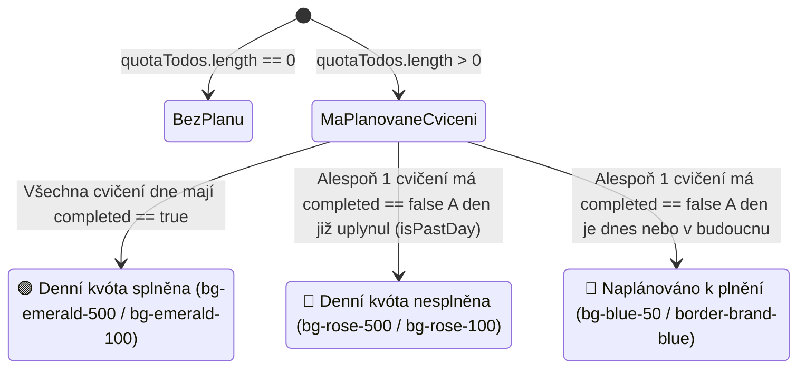

# Technický a architektonický výzkum: Plánování procvičování, rozvržení opakování a stavový kalendář pro PRO uživatele

> **Datum zpracování:** 8. listopadu 2026  
> **Projekt:** ProEdu (Vzdělávací platforma)  
> **Cíl:** Detailně zmapovat současnou implementaci kalendáře, úkolů (`todos`) a procvičování v ProEdu oproti primárním zdrojům (zdrojový kód aplikace, `firestore.rules`, specifikace Firebase Firestore a `date-fns`) a navrhnout bezpečnou architekturu pro **plánování jednotlivých cvičení do kalendáře s volbou intervalu, počtu opakování podtémat, kontrolou PRO oprávnění a barevnou indikací splnění denní kvóty (zelené / červené pole)** v souladu s pravidly projektu ([`.agents/rules/proedu.md`](file:///C:/PROJEKTY/PRO%20EDU/APPKA/ProEdu/.agents/rules/proedu.md)).

---

## 1. Manažerské shrnutí (Executive Summary)

Zadání uživatele:
> *„Chtěl bych přidat možnost přidat si jednotlivá cvičení do svého kalendáře, bylo by také dobré nejdříve ukázat, jak si student chce procvičování rozvrhnout, například každý den nebo jiný interval, počet opakování jednotlivých podtémat. Veškeré takto uložené procvičování budou fungovat pouze pro PRO uživatele a bude se jim to propisovat do kalendáře, který je bude zobrazovat i s nadcházejícími událostmi, pokud student denní kvótu splní, zezelená mu pole, pokud ne, pole zčervená.“*

### Klíčové závěry výzkumu z primárních zdrojů v kódu:
1. **Existující základ kalendáře a kolekce `todos`:**  
   Komponenta [`QuickCalendar.tsx`](file:///C:/PROJEKTY/PRO%20EDU/APPKA/ProEdu/src/components/QuickCalendar.tsx#L81-L718) již přijímá pole `todos` z kolekce `todos` ve Firestore a vykresluje měsíční mřížku i pravý panel *„Nejbližší aktivita / Události dne“* ([`QuickCalendar.tsx`](file:///C:/PROJEKTY/PRO%20EDU/APPKA/ProEdu/src/components/QuickCalendar.tsx#L120-L191)). Kolekce `todos` v [`firestore.rules`](file:///C:/PROJEKTY/PRO%20EDU/APPKA/ProEdu/firestore.rules#L189-L200) již podporuje `type == 'practice'` a pole `referenceId` (pro uložení `subtopicId`), `dueDate` a `completed`.
2. **Kritické úzké hrdlo v načítání `todos` (`limit(50)` bez řazení):**  
   V [`StudentDashboard.tsx`](file:///C:/PROJEKTY/PRO%20EDU/APPKA/ProEdu/src/pages/StudentDashboard.tsx#L134-L138) se kolekce `todos` načítá dotazem `query(collection(db, 'todos'), where('studentId', '==', user.uid), limit(50))`. Pokud si PRO student naplánuje např. 10 podtémat s 5 opakováními (50+ položek), bez řazení podle `dueDate` nebo zvýšení limitu by se budoucí či minulé dny v kalendáři přestaly zobrazovat.
3. **Chybějící propojení mezi dokončením cvičení a kalendářem:**  
   Při dokončení cvičení v [`PracticeSession.tsx`](file:///C:/PROJEKTY/PRO%20EDU/APPKA/ProEdu/src/pages/PracticeSession.tsx#L269-L322) se volá `recordPracticeAttempt()` ([`practiceService.ts`](file:///C:/PROJEKTY/PRO%20EDU/APPKA/ProEdu/src/services/practiceService.ts#L1021-L1049)) a `recordPracticeSessionStreak()`, ale **nijak se neaktualizuje stav `completed: true` u naplánovaných položek v kolekci `todos`**. Pro automatické zezelenání dne v kalendáři je nutné při dokončení `PracticeSession` spárovat dnešní (případně nejstarší nesplněný) naplánovaný úkol pro dané `subtopicId` a označit jej jako splněný.
4. **Vynucení PRO (`isPremium`) na frontendu i v `firestore.rules`:**  
   Podle pravidel projektu ([`.agents/rules/proedu.md`](file:///C:/PROJEKTY/PRO%20EDU/APPKA/ProEdu/.agents/rules/proedu.md) – *Pravidla 2, 4, 17*) nestačí skrýt nebo zamknout tlačítko v UI pomocí `isPremium` z [`AuthContext.tsx`](file:///C:/PROJEKTY/PRO%20EDU/APPKA/ProEdu/src/context/AuthContext.tsx#L530). Vytváření naplánovaných procvičování (`type == 'practice'`) musí být v [`firestore.rules`](file:///C:/PROJEKTY/PRO%20EDU/APPKA/ProEdu/firestore.rules#L392-L402) podmíněno funkcí `isPremiumOrAdmin()`, která ověří roli uživatele (`premium`, `course`, `teacher`) přímo z jeho dokumentu `/users/$(request.auth.uid)` nebo custom claims.
5. **Vyhodnocení denní kvóty (Zelené vs. Červené pole v `QuickCalendar.tsx`):**  
   Buňky kalendáře v [`QuickCalendar.tsx`](file:///C:/PROJEKTY/PRO%20EDU/APPKA/ProEdu/src/components/QuickCalendar.tsx#L319-L381) momentálně vykreslují pouze malé tečky (`w-1.5 h-1.5 rounded-full`) pod číslem dne. Pro splnění požadavku *„pokud student denní kvótu splní, zezelená mu pole, pokud ne, pole zčervená“* lze stav buňky deterministicky odvodit z naplánovaných cvičení daného dne:
   - **Zelené pole (Splněno):** V daný den existuje alespoň 1 naplánované procvičování a **všechna** naplánovaná procvičování pro tento den mají `completed === true`.
   - **Červené pole (Nesplněno):** Den již uplynul (`isBefore(day, startOfToday())`) a v daný den existuje alespoň 1 naplánované procvičování s `completed === false`.
   - **Modré / Oranžové pole (Dnešní aktivní / Nadcházející plán):** Dnešní nebo budoucí den s naplánovaným procvičováním, které dosud čeká na splnění.

---

## 2. Audit současného stavu v kódu (Primární zdroje)

### 2.1 Kalendář `QuickCalendar.tsx` a zobrazování nadcházejících událostí

Komponenta [`src/components/QuickCalendar.tsx`](file:///C:/PROJEKTY/PRO%20EDU/APPKA/ProEdu/src/components/QuickCalendar.tsx) tvoří hlavní kalendářový prvek na nástěnce studenta ([`StudentDashboard.tsx`](file:///C:/PROJEKTY/PRO%20EDU/APPKA/ProEdu/src/pages/StudentDashboard.tsx#L355-L359)).

- **Vstupní props ([`QuickCalendar.tsx` ř. 40–44](file:///C:/PROJEKTY/PRO%20EDU/APPKA/ProEdu/src/components/QuickCalendar.tsx#L40-L44)):**
  ```typescript
  interface QuickCalendarProps {
    todos: TodoItem[];
    liveLessons?: LiveLesson[];
    onJoinLesson?: (lesson: LiveLesson) => void;
  }
  ```
  *(Pozn.: Na [řádku 27](file:///C:/PROJEKTY/PRO%20EDU/APPKA/ProEdu/src/components/QuickCalendar.tsx#L27) je zatím použito `type TodoItem = any;` – v [`src/types/index.ts`](file:///C:/PROJEKTY/PRO%20EDU/APPKA/ProEdu/src/types/index.ts) dosud neexistuje silně typované rozhraní `TodoItem`).*

- **Přiřazení úkolů ke konkrétnímu dni ([`QuickCalendar.tsx` ř. 100–105](file:///C:/PROJEKTY/PRO%20EDU/APPKA/ProEdu/src/components/QuickCalendar.tsx#L100-L105)):**
  ```typescript
  const getTodosForDay = (day: Date) => {
    return todos.filter(todo => {
      const d = safeToDate(todo.dueDate);
      return d ? isSameDay(d, day) : false;
    });
  };
  ```
  Funkce `safeToDate` ([`src/lib/utils.ts` ř. 8–36](file:///C:/PROJEKTY/PRO%20EDU/APPKA/ProEdu/src/lib/utils.ts#L8-L36)) bezpečně převádí Firestore `Timestamp`, `Date`, číslo nebo ISO string na instanci `Date` a `isSameDay` z knihovny `date-fns` ([`package.json` ř. 30](file:///C:/PROJEKTY/PRO%20EDU/APPKA/ProEdu/package.json#L30), verze `^4.1.0`) porovnává shodu kalendářního dne v lokální časové zóně.

- **Výpočet nadcházející aktivity (`nextActivity`, [`QuickCalendar.tsx` ř. 120–191](file:///C:/PROJEKTY/PRO%20EDU/APPKA/ProEdu/src/components/QuickCalendar.tsx#L120-L191)):**
  Kalendář již obsahuje logiku pro zobrazení nejbližší nadcházející události, pokud ve vybraný den nic není (`isShowingNextActivityFallback` na [řádku 282](file:///C:/PROJEKTY/PRO%20EDU/APPKA/ProEdu/src/components/QuickCalendar.tsx#L282)). Prochází `liveLessons` a nehotové `todos` (`!todo.completed && todo.dueDate`), kde `dueDate >= now - 15 min`, seřadí je vzestupně podle času a zobrazí nejbližší položku.
  - **Omezení současného pravého panelu:**
    1. Pokud má vybraný den události, zobrazí události vybraného dne, ale pod nimi již nezobrazuje přehled dalších nadcházejících dnů.
    2. Karta úkolu typu `practice` ([`QuickCalendar.tsx` ř. 526–560](file:///C:/PROJEKTY/PRO%20EDU/APPKA/ProEdu/src/components/QuickCalendar.tsx#L526-L560) a [ř. 649–681](file:///C:/PROJEKTY/PRO%20EDU/APPKA/ProEdu/src/components/QuickCalendar.tsx#L649-L681)) je pouze statický `<div>` bez tlačítka **„Procvičit nyní“** a bez prokliku na `/practice/session/${todo.referenceId}`!

- **Současné vykreslení buněk kalendáře ([`QuickCalendar.tsx` ř. 319–381](file:///C:/PROJEKTY/PRO%20EDU/APPKA/ProEdu/src/components/QuickCalendar.tsx#L319-L381)):**
  Pozadí buňky rozlišuje pouze 3 stavy:
  - Vybraný den (`isSelected`): `bg-brand-blue border-brand-blue text-white`
  - Dnešní den (`isToday(day)`): `bg-blue-50/50 border-brand-blue/20 text-brand-blue`
  - Ostatní dny: `bg-white border-gray-50 text-gray-600`
  Události jsou indikovány pouze 1 až 3 malými tečkami (`w-1.5 h-1.5 rounded-full`) pod číslem dne ([ř. 368–376](file:///C:/PROJEKTY/PRO%20EDU/APPKA/ProEdu/src/components/QuickCalendar.tsx#L368-L376)). Samotné pole dne při splnění či nesplnění kvóty barvu nemění.

---

### 2.2 Odběr `todos` v `StudentDashboard.tsx` a indexy ve Firestore

V [`src/pages/StudentDashboard.tsx` (ř. 132–149)](file:///C:/PROJEKTY/PRO%20EDU/APPKA/ProEdu/src/pages/StudentDashboard.tsx#L132-L149) probíhá real-time odběr kolekce `todos`:

```typescript
useEffect(() => {
  if (!user?.uid) return;
  const qTodos = query(
    collection(db, 'todos'),
    where('studentId', '==', user.uid),
    limit(50)
  );
  const unsub = onSnapshot(qTodos, (snap) => {
    setTodos(snap.docs.map(doc => ({ id: doc.id, ...doc.data() })));
  });
  return () => unsub();
}, [user?.uid]);
```

#### Zjištěné technické limity:
1. **Limit 50 dokumentů bez řazení:**  
   Pokud dotaz neobsahuje `orderBy`, Firestore vrací dokumenty v pořadí podle ID dokumentu (`__name__`), nikoliv podle `dueDate`. Jakmile si student naplánuje např. 15 podtémat po 4 opakováních (= 60 dokumentů v `todos`), `limit(50)` ořízne náhodnou část rozvrhu.
2. **Řešení dotazu:**  
   Zvýšit limit např. na `limit(300)` (což při cenovém modelu Firestore a velikosti dokumentu ~250 B představuje zanedbatelný přenos ~75 KB při zachování real-time odezvy) nebo filtrovat podle časového okna aktivního školního roku. Při použití pouze `where('studentId', '==', user.uid)` s `limit(300)` a řazením v paměti klientovi **není potřeba vytvářet nový složený index** ve [`firestore.indexes.json`](file:///C:/PROJEKTY/PRO%20EDU/APPKA/ProEdu/firestore.indexes.json#L1-L36), čímž odpadá riziko chyby `FAILED_PRECONDITION: The query requires an index` při nasazení.

---

### 2.3 Katalog procvičování (`Practice.tsx`) a kontrola PRO účtu (`AuthContext.tsx`)

V [`src/context/AuthContext.tsx` (ř. 529–531)](file:///C:/PROJEKTY/PRO%20EDU/APPKA/ProEdu/src/context/AuthContext.tsx#L529-L531) je příznak `isPremium` definován následovně:
```typescript
const isTeacher = profile?.role === 'teacher';
const isPremium = profile?.role === 'premium' || profile?.role === 'course' || profile?.role === 'teacher';
const isCourseUser = profile?.role === 'course' || profile?.role === 'teacher';
```

V [`src/pages/Practice.tsx`](file:///C:/PROJEKTY/PRO%20EDU/APPKA/ProEdu/src/pages/Practice.tsx) se načítají témata (`getTopics(activeSubject)`) a podtémata (`getSubtopics(undefined, activeSubject)`).
- U každého podtématu jsou aktuálně vykreslena 2 tlačítka ([`Practice.tsx` ř. 350–392](file:///C:/PROJEKTY/PRO%20EDU/APPKA/ProEdu/src/pages/Practice.tsx#L350-L392)):
  1. **„Studovat“** – chráněno přes `isStudyLocked = !isPremium`. Pokud uživatel není přihlášen, otevře `openAuthModal()`; pokud je přihlášen jako `free` nebo `student`, otevře `UnifiedPaywallModal` ([`Practice.tsx` ř. 301–310](file:///C:/PROJEKTY/PRO%20EDU/APPKA/ProEdu/src/pages/Practice.tsx#L301-L310)).
  2. **„Procvičovat“** – naviguje na `/practice/session/${subtopic.id}`.
- Stejný vzor kontroly `isPremium` + `UnifiedPaywallModal` lze přímo využít pro:
  - Tlačítko **„Do kalendáře“** u jednotlivého podtématu,
  - Hlavní tlačítko **„Naplánovat rozvrh procvičování (PRO)“** v hlavičce [`Practice.tsx`](file:///C:/PROJEKTY/PRO%20EDU/APPKA/ProEdu/src/pages/Practice.tsx#L85-L101) i u hlavního tématu (`topic`) nebo v [`QuickCalendar.tsx`](file:///C:/PROJEKTY/PRO%20EDU/APPKA/ProEdu/src/components/QuickCalendar.tsx).

---

### 2.4 Průběh a dokončení procvičování (`PracticeSession.tsx` & `practiceService.ts`)

V [`src/pages/PracticeSession.tsx` (ř. 269–322)](file:///C:/PROJEKTY/PRO%20EDU/APPKA/ProEdu/src/pages/PracticeSession.tsx#L269-L322) funkce `handleFinishPractice`:
1. Nastaví `setIsCompleted(true)`.
2. Spočítá `correctCount`, `total` a `percentage`.
3. Pro přihlášeného uživatele zavolá `recordPracticeAttempt(...)` ([`src/services/practiceService.ts` ř. 1021–1049](file:///C:/PROJEKTY/PRO%20EDU/APPKA/ProEdu/src/services/practiceService.ts#L1021-L1049)), která zapíše výsledek do kolekce `tests` s polem `topic: attempt.subtopicId` a JSON popisem v `description`.
4. Pokud student zodpověděl alespoň 1 otázku (`Object.keys(answersMap).length > 0`), zavolá `recordPracticeSessionStreak()`.

> [!IMPORTANT]
> **Zjištění:** V `handleFinishPractice` dnes chybí volání, které by vyhledalo naplánované cvičení v kolekci `todos` pro dané `subtopic.id` a označilo jej za splněné (`completed: true`, `completedAt: Timestamp.now()`).

---

### 2.5 Současná pravidla v `firestore.rules` pro kolekci `todos`

V [`firestore.rules` (ř. 189–200 a 392–402)](file:///C:/PROJEKTY/PRO%20EDU/APPKA/ProEdu/firestore.rules#L189-L200) je kolekce `todos` zabezpečena takto:

```javascript
function isValidTodo(data) {
  return data.studentId is string && data.studentId.size() <= 128 &&
         data.title is string && data.title.size() <= 256 &&
         data.type is string && (data.type == 'practice' || data.type == 'test' || data.type == 'material' || data.type == 'custom' || data.type == 'course_lesson' || data.type == 'course_material' || data.type == 'course_practice') &&
         data.completed is bool &&
         data.addedBy is string && data.addedBy.size() <= 128 &&
         data.createdAt is timestamp &&
         (!('dueDate' in data) || data.dueDate == null || data.dueDate is timestamp) &&
         (!('completedAt' in data) || data.completedAt == null || data.completedAt is timestamp) &&
         (!('assignedTestId' in data) || data.assignedTestId == null || data.assignedTestId is string) &&
         (!('referenceId' in data) || data.referenceId == null || data.referenceId is string);
}

match /todos/{todoId} {
  allow read: if isAuthenticated() && (isOwner(resource.data.studentId) || isAdmin());
  allow create: if isAuthenticated() && (isOwner(request.resource.data.studentId) || isAdmin()) && isValidTodo(request.resource.data);
  allow update: if isAuthenticated() && (
    (isOwner(resource.data.studentId) &&
      request.resource.data.diff(resource.data).affectedKeys().hasOnly(['title', 'dueDate', 'completed', 'completedAt']) &&
      isValidTodo(request.resource.data)) ||
    (isAdmin() && keepsImmutableFields() && isValidTodo(request.resource.data))
  );
  allow delete: if isAuthenticated() && (isOwner(resource.data.studentId) || isAdmin());
}
```

#### Bezpečnostní analýza `firestore.rules` vůči zadání:
1. **Chybějící kontrola PRO role při vytváření `type == 'practice'`:**  
   Aktuálně může libovolný přihlášený uživatel (`isAuthenticated()`) s rolí `free` zavolat z konzole `addDoc(collection(db, 'todos'), { type: 'practice', ... })`. Podle **Pravidla 2 a 17** v [`.agents/rules/proedu.md`](file:///C:/PROJEKTY/PRO%20EDU/APPKA/ProEdu/.agents/rules/proedu.md) musí `firestore.rules` kontrolovat, že pokud `request.resource.data.type == 'practice'` a zápis provádí sám student (`!isAdmin()`), musí mít uživatel roli `premium`, `course` nebo `teacher`.
2. **Partial-safe updates (`Pravidlo 15`):**  
   Pravidlo `request.resource.data.diff(resource.data).affectedKeys().hasOnly(['title', 'dueDate', 'completed', 'completedAt'])` již příkladně implementuje partial-safe update! Student nemůže změnit `studentId`, `type`, `referenceId` ani `createdAt`, ale může bezpečně zavolat `updateDoc(todoRef, { completed: true, completedAt: Timestamp.now() })`.

---

## 3. Architektonický návrh datového modelu

### 3.1 Srovnání variant uložení ve Firestore

| Kritérium | Varianta A: Rozšířené dokumenty v kolekci `todos` (Doporučeno) | Varianta B: Samostatná kolekce `practicePlans` + generované `todos` | Varianta C: Pouze jeden dokument `practicePlans` s vnořeným polem dnů |
| :--- | :--- | :--- | :--- |
| **Princip** | Každé naplánované cvičení v konkrétní den je 1 dokument v kolekci `todos` s `type: 'practice'`, `referenceId: subtopicId` a volitelnými metadaty plánu (`planId`, `repetitionIndex`, `totalRepetitions`, `subjectId`). | Hlavička plánu se uloží do `practicePlans/{planId}` a jednotlivé výskyty do `todos/{todoId}`. | Všechny dny a cvičení jsou uloženy v jediném poli `items: [...]` uvnitř dokumentu. |
| **Kompatibilita s `QuickCalendar.tsx`** | **100% nativní** – `QuickCalendar` i Google Calendar sync již čtou přímo `todos`. | Vysoká, ale vyžaduje synchronizaci dvou kolekcí při mazání/úpravách. | Nízká – vyžaduje přepsání `QuickCalendar` i Google Calendar synchronizace. |
| **Partial-safe update při splnění** | **Velmi snadné a atomické** – `updateDoc(doc(db, 'todos', id), { completed: true, completedAt })`. | Stejné jako Varianta A. | Obtížné v `firestore.rules` – aktualizace prvku v poli vyžaduje přepis celého pole. |
| **Limity Firestore** | Až **500 zápisů v jedné atomické dávce** (`writeBatch`). | Spotřebuje 1 zápis navíc na hlavičku plánu. | Riziko překročení 1 MB limitu dokumentu a složitá validace polí v rules. |

> [!TIP]
> **Doporučené řešení (Varianta A):**  
> Využít stávající kolekci `todos` jako jediný zdroj pravdy pro kalendářové položky a obohatit ji o volitelná, v `firestore.rules` striktně validovaná metadata (`subjectId`, `topicId`, `planId`, `repetitionIndex`, `totalRepetitions`). Tím je zajištěna okamžitá kompatibilita s `QuickCalendar.tsx`, s exportem do Google Kalendáře ([`calendarService.ts`](file:///C:/PROJEKTY/PRO%20EDU/APPKA/ProEdu/src/services/calendarService.ts#L243-L268)) a s partial-safe updaty.

---

### 3.2 Návrh TypeScript rozhraní (`src/types/index.ts`)

```typescript
export type TodoType =
  | 'practice'
  | 'test'
  | 'material'
  | 'custom'
  | 'course_lesson'
  | 'course_material'
  | 'course_practice';

export interface TodoItem {
  id: string;
  studentId: string;               // UID vlastníka (imutabilní)
  title: string;                   // např. "Procvičování: Lineární rovnice (1/3)"
  type: TodoType;                  // pro naplánované procvičování vždy 'practice'
  completed: boolean;              // true po dokončení PracticeSession
  addedBy: string;                 // UID studenta nebo učitele (imutabilní)
  createdAt: Timestamp;            // Čas vytvoření (imutabilní)
  dueDate?: Timestamp | null;      // Naplánované datum a čas (např. daný den v 16:00)
  completedAt?: Timestamp | null;  // Čas splnění
  assignedTestId?: string | null;
  referenceId?: string | null;     // ID podtématu (subtopicId) nebo lekce
  // --- Rozšířená metadata pro plánovač procvičování (PRO) ---
  subjectId?: string | null;       // 'Matematika' | 'Čeština' (max 128 znaků)
  topicId?: string | null;         // ID nadřazeného tématu (max 128 znaků)
  planId?: string | null;          // Společné ID dávky rozvrhu (pro snadné smazání/úpravu celého plánu)
  repetitionIndex?: number | null; // Pořadové číslo opakování daného podtématu (např. 1)
  totalRepetitions?: number | null;// Celkový počet naplánovaných opakování daného podtématu (např. 3)
}
```

---

## 4. Algoritmus rozvržení procvičování (Scheduling & Preview)

Uživatel požaduje:
> *„...bylo by také dobré nejdříve ukázat, jak si student chce procvičování rozvrhnout, například každý den nebo jiný interval, počet opakování jednotlivých podtémat.“*

### 4.1 Vstupní parametry průvodce (Plánovacího modalu)

Student může otevřít průvodce **„Naplánovat procvičování do kalendáře“** buď:
1. **U konkrétního podtématu** (tlačítko s ikonou kalendáře vedle *Studovat* a *Procvičovat* v [`Practice.tsx`](file:///C:/PROJEKTY/PRO%20EDU/APPKA/ProEdu/src/pages/Practice.tsx#L350-L392) nebo v [`StudentDashboard.tsx`](file:///C:/PROJEKTY/PRO%20EDU/APPKA/ProEdu/src/pages/StudentDashboard.tsx#L529-L569)) – vybrané podtéma je v průvodci automaticky předzaškrtnuté, student si může přikliknout i další podtémata.
2. **Hromadně pro celé téma / předmět** (tlačítko *„Rozvrhnout procvičování do kalendáře“* v [`Practice.tsx`](file:///C:/PROJEKTY/PRO%20EDU/APPKA/ProEdu/src/pages/Practice.tsx) nebo přímo v [`QuickCalendar.tsx`](file:///C:/PROJEKTY/PRO%20EDU/APPKA/ProEdu/src/components/QuickCalendar.tsx)).

#### Konfigurační možnosti rozvrhu:
1. **Výběr podtémat a počet opakování (`repetitionsPerSubtopic`):**
   - Globální rychlá volba počtu opakování pro vybraná podtémata: `1×`, `2×`, `3×`, `5×` (s možností individuálně upravit počet opakování $R_i \in \langle 1, 10 \rangle$ u každého vybraného podtématu zvlášť).
   - Pořadí řazení:
     - **Střídavě (Prokládané učení / Interleaving):** Podtémata A, B, C se v kalendáři vystřídají (`A1 -> B1 -> C1 -> A2 -> B2 -> C2`). Výzkumy kognitivní psychologie potvrzují, že prokládané opakování (*interleaved practice*) vede k výrazně vyšší retenci než blokové opakování téhož tématu za sebou.
     - **Postupně (Sekvenčně):** Nejprve všechna opakování podtématu A, poté B (`A1 -> A2 -> B1 -> B2`).
2. **Datum zahájení (`startDate`):**
   - Výchozí: **Dnes** (nebo **Zítra**), s možností výběru libovolného počátečního dne.
3. **Interval procvičování (`scheduleMode`):**
   - `daily`: **Každý den** (krok `+1 den`).
   - `every_other_day`: **Obden / Každý 2. den** (krok `+2 dny`).
   - `custom_interval`: **Vlastní interval** – každých $N$ dní ($N \in \langle 2, 14 \rangle$, pomocí `addDays(currentDate, N)` z `date-fns`).
   - `weekdays`: **Vybrané dny v týdnu** – např. pouze *Pondělí, Středa, Pátek* nebo *Úterý, Čtvrtek* (kontrola přes `getDay(date)` z `date-fns`).
4. **Denní kvóta (`dailyQuota` – počet cvičení v jeden aktivní den):**
   - Výchozí: **1 cvičení za den** (lze zvolit `1`, `2` nebo `3` cvičení na jeden naplánovaný den).

---

### 4.2 Deterministický algoritmus generování náhledu (Preview před uložením)

Před samotným zápisem do Firestore průvodce v reálném čase pomocí `useMemo` vypočítá pole `ScheduledPreviewDay[]` a **ukáže studentovi vizuální časovou osu / kalendářový náhled**, kde přesně vidí:
- Kolik celkem cvičení (sezení) se naplánuje (např. *„Celkem 12 cvičení rozvržených do 12 dnů“*),
- Datum posledního cvičení (např. *„Plán dokončíš 20. listopadu 2026“*),
- Seznam konkrétních dnů a podtémat, která v daný den připadnou.

```typescript
import { addDays, startOfDay, setHours, setMinutes, getDay } from 'date-fns';

export type ScheduleIntervalMode = 'daily' | 'every_other_day' | 'custom_interval' | 'weekdays';

export interface SubtopicScheduleInput {
  subtopic: PracticeSubtopic;
  repetitions: number; // 1 až 10
}

export interface ScheduleConfig {
  startDate: Date;
  mode: ScheduleIntervalMode;
  customIntervalDays: number; // 2 až 14 (pro 'custom_interval')
  selectedWeekdays: number[]; // 1 = Po, 2 = Út, ..., 6 = So, 0 = Ne (pro 'weekdays')
  dailyQuota: number;         // 1 až 5 cvičení za den
  ordering: 'interleaved' | 'sequential';
  preferredHour: number;      // výchozí např. 16 (16:00)
}

export interface GeneratedScheduleItem {
  subtopic: PracticeSubtopic;
  repetitionIndex: number;
  totalRepetitions: number;
  dueDate: Date;
}

export function generatePracticeSchedule(
  items: SubtopicScheduleInput[],
  config: ScheduleConfig
): GeneratedScheduleItem[] {
  // 1. Sestavíme frontu všech cvičení podle zvoleného řazení (interleaved vs. sequential)
  const queue: { subtopic: PracticeSubtopic; repetitionIndex: number; totalRepetitions: number }[] = [];

  if (config.ordering === 'interleaved') {
    const maxReps = Math.max(0, ...items.map(i => i.repetitions));
    for (let rep = 1; rep <= maxReps; rep++) {
      for (const item of items) {
        if (rep <= item.repetitions) {
          queue.push({
            subtopic: item.subtopic,
            repetitionIndex: rep,
            totalRepetitions: item.repetitions,
          });
        }
      }
    }
  } else {
    for (const item of items) {
      for (let rep = 1; rep <= item.repetitions; rep++) {
        queue.push({
          subtopic: item.subtopic,
          repetitionIndex: rep,
          totalRepetitions: item.repetitions,
        });
      }
    }
  }

  if (queue.length === 0) return [];

  // 2. Přiřadíme položky z fronty do kalendářních dnů podle zvoleného intervalu a denní kvóty
  const result: GeneratedScheduleItem[] = [];
  let cursorDate = startOfDay(config.startDate);
  let queueIndex = 0;
  const quota = Math.max(1, Math.min(5, config.dailyQuota || 1));
  const stepDays =
    config.mode === 'daily'
      ? 1
      : config.mode === 'every_other_day'
        ? 2
        : Math.max(1, config.customIntervalDays || 2);

  // Bezpečnostní pojistka proti nekonečnému cyklu (např. prázdné selectedWeekdays)
  let safetyCounter = 0;
  while (queueIndex < queue.length && safetyCounter < 1000) {
    safetyCounter++;

    const isDayValid =
      config.mode !== 'weekdays' ||
      (config.selectedWeekdays.length > 0 && config.selectedWeekdays.includes(getDay(cursorDate)));

    if (isDayValid) {
      for (let q = 0; q < quota && queueIndex < queue.length; q++) {
        const entry = queue[queueIndex++];
        const scheduledDateTime = setMinutes(setHours(cursorDate, config.preferredHour ?? 16), 0);
        result.push({
          ...entry,
          dueDate: scheduledDateTime,
        });
      }
      cursorDate = addDays(cursorDate, config.mode === 'weekdays' ? 1 : stepDays);
    } else {
      cursorDate = addDays(cursorDate, 1);
    }
  }

  return result;
}
```

### 4.3 Atomický dávkový zápis do Firestore (`writeBatch`)

*Primární zdroj:* [Firebase Firestore Documentation – Batched writes](https://firebase.google.com/docs/firestore/manage-data/transactions#batched-writes)  
Firestore umožňuje v jedné instanci `writeBatch(db)` provést až **500 operací**. V praxi má studijní plán typicky 5 až 100 položek. Zápis proto proběhne v jedné dávce (s automatickým dělením po 450 položkách pro 100% bezpečnost, stejně jako v [`practiceService.ts` ř. 161–174](file:///C:/PROJEKTY/PRO%20EDU/APPKA/ProEdu/src/services/practiceService.ts#L161-L174)).

---

## 5. Automatické vyhodnocení denní kvóty a barvení polí v `QuickCalendar.tsx`

Uživatel požaduje:
> *„...bude se jim to propisovat do kalendáře, který je bude zobrazovat i s nadcházejícími událostmi, pokud student denní kvótu splní, zezelená mu pole, pokud ne, pole zčervená.“*

### 5.1 Stavový automat (State Machine) pro buňku dne v `QuickCalendar.tsx`

Pro každý vykreslovaný den `day` v měsíční mřížce ([`QuickCalendar.tsx` ř. 319–381](file:///C:/PROJEKTY/PRO%20EDU/APPKA/ProEdu/src/components/QuickCalendar.tsx#L319-L381)) vyfiltrujeme naplánované úkoly procvičování:

```typescript
const dayTodos = getTodosForDay(day);
// Denní kvóta se počítá z naplánovaných procvičování (případně všech úkolů daného dne)
const quotaTodos = dayTodos.filter(t => t.type === 'practice');
const hasQuota = quotaTodos.length > 0;
const completedQuotaCount = quotaTodos.filter(t => t.completed).length;
const isQuotaMet = hasQuota && completedQuotaCount === quotaTodos.length;
const isPastDay = isBefore(startOfDay(day), startOfDay(new Date()));
const isQuotaMissed = hasQuota && !isQuotaMet && isPastDay;
const isQuotaPendingTodayOrFuture = hasQuota && !isQuotaMet && !isPastDay;
```



### 5.2 Vizuální podoba buněk v `QuickCalendar.tsx`

| Stav dne | Podmínka | Tailwind CSS styl buňky (nevybraná) | Tailwind CSS styl buňky (vybraná `isSelected`) | Indikátor / Tooltip |
| :--- | :--- | :--- | :--- | :--- |
| **🟢 Kvóta splněna (Zelené pole)** | `isQuotaMet === true` | `bg-emerald-100/90 border-emerald-400 text-emerald-950 hover:bg-emerald-200/80 shadow-2xs` | `bg-emerald-600 border-emerald-700 text-white shadow-md shadow-emerald-200 ring-2 ring-emerald-300` | Zelená fajfka / tečka (`bg-emerald-600`), tooltip: *„Denní kvóta splněna (X/X)“* |
| **🔴 Kvóta nesplněna (Červené pole)** | `isQuotaMissed === true` | `bg-rose-100/90 border-rose-400 text-rose-950 hover:bg-rose-200/80 shadow-2xs` | `bg-rose-600 border-rose-700 text-white shadow-md shadow-rose-200 ring-2 ring-rose-300` | Červená tečka (`bg-rose-600`), tooltip: *„Nesplněná denní kvóta (X/Y)“* |
| **🔵 Dnešní / Nadcházející kvóta** | `isQuotaPendingTodayOrFuture === true` | `bg-amber-50/80 border-amber-300 text-amber-950 hover:bg-amber-100/60` (nebo modrý akcent) | `bg-brand-blue border-brand-blue text-white shadow-md` | Modrá/oranžová tečka, počet zbývajících úloh |
| **⚪ Běžný den bez kvóty** | `hasQuota === false` | Stávající styl (`bg-white border-gray-50 text-gray-600`) | Stávající styl (`bg-brand-blue text-white`) | Beze změny |

> [!NOTE]
> **Okamžité zezelenání ještě týž den:**  
> Všimněte si, že podmínka `isQuotaMet` **nezávisí** na tom, zda den již skončil. Jakmile student v dnešní den (nebo s předstihem) splní všechna cvičení naplánovaná na daný den (`completedQuotaCount === quotaTodos.length`), pole mu **okamžitě zezelená** jako pozitivní zpětná vazba! Naopak **zčervená** tehdy, pokud den skončil (`isPastDay`) a denní kvóta nebyla splněna (případně lze v detailu dne zobrazit i tlačítko *„Splnit dodatečně“*, které po dodatečném procvičení překlopí `completed: true` a pole zezelená, nebo lze přísně vyhodnocovat `completedAt <= endOfDay(dueDate)` – doporučujeme umožnit dodatečné splnění nebo nastavit jasný odznak).

---

### 5.3 Automatické propisování splnění z `PracticeSession.tsx`

Když student dokončí procvičování v [`src/pages/PracticeSession.tsx`](file:///C:/PROJEKTY/PRO%20EDU/APPKA/ProEdu/src/pages/PracticeSession.tsx#L269-L322) (`handleFinishPractice`):
1. Zkontroluje se, zda student skutečně odpověděl na otázky (`Object.keys(answersMap).length > 0`).
2. Zavolá se nová funkce `completeScheduledPracticeTodo(user.uid, subtopic.id)` v `calendarService.ts` (nebo `practiceService.ts`).
3. Jak `completeScheduledPracticeTodo` vybere správný záznam v `todos`:
   - Dotáže se na nehotové úkoly studenta pro dané podtéma:
     `where('studentId', '==', studentId)` (nebo filtruje z načtených `todos` studenta s `type === 'practice' && referenceId === subtopicId && !completed`).
   - **Priorita 1:** Úkol naplánovaný na **dnešní den** (`isSameDay(dueDate, new Date())`).
   - **Priorita 2:** Pokud na dnešek žádný není, vybere **nejstarší zmeškaný úkol** (`dueDate < now`) pro toto podtéma, případně **nejbližší nadcházející úkol**, aby si student mohl splnit kvótu i o den dříve.
   - Aktualizuje dokument přes `updateDoc(doc(db, 'todos', targetTodo.id), { completed: true, completedAt: Timestamp.now() })`.
   - Zobrazí motivační notifikaci (`toast.success`): *„✅ Splněno v kalendáři! Denní kvóta: X/Y hotovo.“*

---

### 5.4 Zobrazení nadcházejících událostí v `QuickCalendar.tsx`

V pravém sloupci [`QuickCalendar.tsx`](file:///C:/PROJEKTY/PRO%20EDU/APPKA/ProEdu/src/components/QuickCalendar.tsx#L387-L715):
1. **Stav vybraného dne (horní část panelu):**
   - Zobrazuje přehledný ukazatel denní kvóty pro vybraný den, např.:
     - 🟢 **Denní kvóta splněna (2 / 2 cvičení)**
     - 🔴 **Denní kvóta nesplněna (0 / 2 cvičení)**
     - ⏳ **Dnešní plán: zbývá 1 z 2 cvičení**
   - U každé položky typu `practice` s `referenceId` zobrazí přímé akční tlačítko **„Procvičit“** (nebo **„Zopakovat“**, pokud je `completed === true`), které studenta přesměruje přímo na `/practice/session/${todo.referenceId}`.
2. **Sekce „Nadcházející naplánovaná cvičení“ (spodní / přepínatelná část panelu):**
   - I když si student prohlíží dnešní den, pod seznamem dnešních úkolů (nebo v záložce *„Nadcházející“*) uvidí chronologický seznam nejbližších budoucích naplánovaných procvičování (např. na dalších 7 dní), aby měl vždy přehled, co ho čeká v dalších dnech.

---

## 6. Bezpečnostní architektura a Firestore Security Rules

V souladu s [`.agents/rules/proedu.md`](file:///C:/PROJEKTY/PRO%20EDU/APPKA/ProEdu/.agents/rules/proedu.md):
- **Pravidlo 1 & 2:** Bezpečnost již v první verzi; Firestore je jediný zdroj pravdy.
- **Pravidlo 3 & 7:** Document-level ownership (`studentId == request.auth.uid`) a ochrana imutabilních polí (`studentId`, `createdAt`, `addedBy`, `type`, `referenceId`).
- **Pravidlo 4 & 17:** Role nikdy neodvozována z e-mailu na frontendu; PRO omezení vynuceno jak v UI, tak přímo ve `firestore.rules`.
- **Pravidlo 8:** Striktní validace datového tvaru a délkových limitů všech nových polí v `isValidTodo(data)`.
- **Pravidlo 15:** Partial-safe updates pro `updateDoc`.

### 6.1 Návrh úpravy `firestore.rules`

Do [`firestore.rules`](file:///C:/PROJEKTY/PRO%20EDU/APPKA/ProEdu/firestore.rules) se doplní pomocná funkce `isPremiumOrAdmin()` a rozšíří se `isValidTodo(data)` i pravidlo `match /todos/{todoId}`:

```javascript
// Kontrola, zda má přihlášený uživatel aktivní PRO oprávnění (premium, course nebo teacher)
function isPremiumOrAdmin() {
  return isAuthenticated() && (
    isAdmin() ||
    ('role' in request.auth.token && request.auth.token.role in ['premium', 'course', 'teacher']) ||
    (exists(/databases/$(database)/documents/users/$(request.auth.uid)) &&
     get(/databases/$(database)/documents/users/$(request.auth.uid)).data.role in ['premium', 'course', 'teacher'])
  );
}

function isValidTodo(data) {
  return data.studentId is string && data.studentId.size() <= 128 &&
         data.title is string && data.title.size() > 0 && data.title.size() <= 256 &&
         data.type is string && (data.type == 'practice' || data.type == 'test' || data.type == 'material' || data.type == 'custom' || data.type == 'course_lesson' || data.type == 'course_material' || data.type == 'course_practice') &&
         data.completed is bool &&
         data.addedBy is string && data.addedBy.size() <= 128 &&
         data.createdAt is timestamp &&
         (!('dueDate' in data) || data.dueDate == null || data.dueDate is timestamp) &&
         (!('completedAt' in data) || data.completedAt == null || data.completedAt is timestamp) &&
         (!('assignedTestId' in data) || data.assignedTestId == null || (data.assignedTestId is string && data.assignedTestId.size() <= 128)) &&
         (!('referenceId' in data) || data.referenceId == null || (data.referenceId is string && data.referenceId.size() <= 128)) &&
         (!('subjectId' in data) || data.subjectId == null || (data.subjectId is string && data.subjectId.size() <= 128)) &&
         (!('topicId' in data) || data.topicId == null || (data.topicId is string && data.topicId.size() <= 128)) &&
         (!('planId' in data) || data.planId == null || (data.planId is string && data.planId.size() <= 128)) &&
         (!('repetitionIndex' in data) || data.repetitionIndex == null || (data.repetitionIndex is int && data.repetitionIndex >= 1 && data.repetitionIndex <= 50)) &&
         (!('totalRepetitions' in data) || data.totalRepetitions == null || (data.totalRepetitions is int && data.totalRepetitions >= 1 && data.totalRepetitions <= 50));
}

match /todos/{todoId} {
  allow read: if isAuthenticated() && (isOwner(resource.data.studentId) || isAdmin());

  // Vytvoření: Vlastník nebo admin; pokud jde o naplánované procvičování (type == 'practice'),
  // student MUSÍ mít PRO účet (isPremiumOrAdmin()).
  allow create: if isAuthenticated() &&
    (isOwner(request.resource.data.studentId) || isAdmin()) &&
    request.resource.data.addedBy == request.auth.uid &&
    (request.resource.data.type != 'practice' || isPremiumOrAdmin()) &&
    isValidTodo(request.resource.data);

  // Partial-safe update: Vlastník smí měnit jen povolená stavová pole,
  // u procvičování opět vyžadována PRO role.
  allow update: if isAuthenticated() && (
    (isOwner(resource.data.studentId) &&
      (resource.data.type != 'practice' || isPremiumOrAdmin()) &&
      request.resource.data.diff(resource.data).affectedKeys().hasOnly(['title', 'dueDate', 'completed', 'completedAt']) &&
      isValidTodo(request.resource.data)) ||
    (isAdmin() && keepsImmutableFields() && isValidTodo(request.resource.data))
  );

  allow delete: if isAuthenticated() && (isOwner(resource.data.studentId) || isAdmin());
}
```

### 6.2 Bezpečnostní checklist dle `.agents/rules/proedu.md` (Pravidlo 18)

| Контроlní bod | Řešení v návrhu |
| :--- | :--- |
| **Kdo data čte?** | Pouze vlastník (`resource.data.studentId == request.auth.uid`) a učitel (`isAdmin()`). Žádné broad reads. |
| **Kdo data zapisuje?** | Pouze přihlášený vlastník (`studentId == request.auth.uid` a `addedBy == request.auth.uid`) s aktivní PRO rolí (`isPremiumOrAdmin()`), případně učitel (`isAdmin()`). |
| **Lze zneužít cizí UID?** | Ne – při `create` je vyžadováno `isOwner(request.resource.data.studentId)` a `addedBy == request.auth.uid`. |
| **Nejdou měnit privilegovaná nebo imutabilní pole?** | Ne – při `update` vlastník smí upravit výhradně `['title', 'dueDate', 'completed', 'completedAt']`. Pole `studentId`, `addedBy`, `createdAt`, `type`, `referenceId`, `planId` jsou pro studenta neměnná. |
| **Odpovídají rules chování UI?** | Ano – Free uživatel v UI uvidí zámek s označením `PRO` a po kliknutí se mu otevře `UnifiedPaywallModal`. Pokud by se pokusil obejít UI přímým voláním Firestore SDK, `firestore.rules` zápis odmítnou díky `isPremiumOrAdmin()`. |

---

## 7. Doporučený plán implementace (Implementační Roadmapa)

### Fáze 1: Datové typy, Firestore Rules a Služba pro plánování (`calendarService.ts`)
1. Rozšířit [`src/types/index.ts`](file:///C:/PROJEKTY/PRO%20EDU/APPKA/ProEdu/src/types/index.ts) o rozhraní `TodoItem`, `ScheduleConfig` a `GeneratedScheduleItem`.
2. Upravit [`firestore.rules`](file:///C:/PROJEKTY/PRO%20EDU/APPKA/ProEdu/firestore.rules) – přidat `isPremiumOrAdmin()` a rozšířit `isValidTodo(data)` o volitelná pole `subjectId`, `topicId`, `planId`, `repetitionIndex`, `totalRepetitions`.
3. Do [`src/services/calendarService.ts`](file:///C:/PROJEKTY/PRO%20EDU/APPKA/ProEdu/src/services/calendarService.ts) přidat funkce:
   - `generatePracticeSchedule(...)` – čistá funkce pro výpočet náhledu rozvrhu,
   - `savePracticeScheduleToCalendar(studentId, generatedItems)` – atomický dávkový zápis přes `writeBatch(db)` do kolekce `todos`,
   - `completeScheduledPracticeTodo(studentId, subtopicId)` – automatické označení dnešního/nejstaršího naplánovaného úkolu daného podtématu jako `completed: true` při dokončení `PracticeSession`,
   - `deleteScheduledPracticeTodo(todoId)` / `clearStudentPracticeSchedule(studentId, planId?)` – možnost smazat naplánovanou položku nebo celý plán.

### Fáze 2: Průvodce rozvržením procvičování (`PracticeScheduleModal.tsx`)
1. Vytvořit komponentu `src/components/PracticeScheduleModal.tsx`:
   - **Krok 1 (Konfigurace):** Výběr podtémat (předvyplněné podtéma nebo výběr více podtémat z předmětu), nastavení počtu opakování u podtémat (`1×` až `10×`), volba intervalu (*Každý den*, *Obden*, *Vlastní interval N dní*, *Vybrané dny v týdnu Po–Ne*), denní kvóta a datum začátku.
   - **Krok 2 (Živý náhled rozvrhu před uložením):** Přehledná časová osa dnů ukazující, které podtéma a které opakování (např. *1/3*) připadne na který den, celkový počet cvičení a datum dokončení plánu.
   - **Uložení:** Zápis do Firestore a volitelná synchronizace do Google Kalendáře.
2. Přidat tlačítka **„Do kalendáře (PRO)“** do [`src/pages/Practice.tsx`](file:///C:/PROJEKTY/PRO%20EDU/APPKA/ProEdu/src/pages/Practice.tsx) (k jednotlivým podtématům i jako hlavní tlačítko *„Naplánovat procvičování“*) a do [`src/pages/StudentDashboard.tsx`](file:///C:/PROJEKTY/PRO%20EDU/APPKA/ProEdu/src/pages/StudentDashboard.tsx). Pro ne-PRO uživatele tlačítko vyvolá `UnifiedPaywallModal`.

### Fáze 3: Stavový kalendář (`QuickCalendar.tsx`) a propojení s `PracticeSession.tsx`
1. V [`src/pages/StudentDashboard.tsx`](file:///C:/PROJEKTY/PRO%20EDU/APPKA/ProEdu/src/pages/StudentDashboard.tsx#L134-L138) navýšit limit dotazu `todos` z `limit(50)` na `limit(300)`.
2. V [`src/components/QuickCalendar.tsx`](file:///C:/PROJEKTY/PRO%20EDU/APPKA/ProEdu/src/components/QuickCalendar.tsx) implementovat:
   - **Zelené pole dne** při splnění denní kvóty (`isQuotaMet`),
   - **Červené pole dne** při nesplnění denní kvóty v uplynulých dnech (`isQuotaMissed`),
   - **Zvýraznění nadcházejících naplánovaných dnů** a sekci nadcházejících událostí v pravém panelu s přímým tlačítkem **„Spustit procvičování“** (`/practice/session/${todo.referenceId}`) a možností smazat položku z plánu.
   - Pokud uživatel není PRO (`!isPremium`), naplánované procvičování v kalendáři je uzamčeno pro PRO účty.
3. V [`src/pages/PracticeSession.tsx`](file:///C:/PROJEKTY/PRO%20EDU/APPKA/ProEdu/src/pages/PracticeSession.tsx#L269-L322) ve funkci `handleFinishPractice` zavolat `completeScheduledPracticeTodo(user.uid, subtopic.id)`, aby se dokončené cvičení okamžitě propsalo do kalendáře a při splnění denní kvóty pole v kalendáři zezelenalo.

---

## 8. Souhrnné citace a primární zdroje

1. **Zdrojový kód ProEdu – Kalendář a synchronizace:**
   - [`src/components/QuickCalendar.tsx` (řádky 40–718)](file:///C:/PROJEKTY/PRO%20EDU/APPKA/ProEdu/src/components/QuickCalendar.tsx#L40-L718)
   - [`src/services/calendarService.ts` (řádky 107–140, 242–268)](file:///C:/PROJEKTY/PRO%20EDU/APPKA/ProEdu/src/services/calendarService.ts#L107-L140)
   - [`src/pages/StudentDashboard.tsx` (řádky 85–150, 352–360)](file:///C:/PROJEKTY/PRO%20EDU/APPKA/ProEdu/src/pages/StudentDashboard.tsx#L85-L150)
2. **Zdrojový kód ProEdu – Procvičování a ověřování PRO role:**
   - [`src/pages/Practice.tsx` (řádky 30–422)](file:///C:/PROJEKTY/PRO%20EDU/APPKA/ProEdu/src/pages/Practice.tsx#L30-L422)
   - [`src/pages/PracticeSession.tsx` (řádky 269–322)](file:///C:/PROJEKTY/PRO%20EDU/APPKA/ProEdu/src/pages/PracticeSession.tsx#L269-L322)
   - [`src/services/practiceService.ts` (řádky 157–177, 1021–1049)](file:///C:/PROJEKTY/PRO%20EDU/APPKA/ProEdu/src/services/practiceService.ts#L1021-L1049)
   - [`src/context/AuthContext.tsx` (řádky 529–531)](file:///C:/PROJEKTY/PRO%20EDU/APPKA/ProEdu/src/context/AuthContext.tsx#L529-L531)
3. **Zdrojový kód ProEdu – Bezpečnostní pravidla a datové typy:**
   - [`.agents/rules/proedu.md` (Pravidla 1–20)](file:///C:/PROJEKTY/PRO%20EDU/APPKA/ProEdu/.agents/rules/proedu.md)
   - [`firestore.rules` (řádky 15–40, 189–200, 392–402)](file:///C:/PROJEKTY/PRO%20EDU/APPKA/ProEdu/firestore.rules#L189-L200)
   - [`firestore.indexes.json` (řádky 1–36)](file:///C:/PROJEKTY/PRO%20EDU/APPKA/ProEdu/firestore.indexes.json#L1-L36)
   - [`src/types/index.ts` (řádky 1–234)](file:///C:/PROJEKTY/PRO%20EDU/APPKA/ProEdu/src/types/index.ts#L1-L234)
4. **Oficiální dokumentace Firebase Firestore & `date-fns`:**
   - [Cloud Firestore Security Rules – Conditions & `diff().affectedKeys()`](https://firebase.google.com/docs/firestore/security/rules-conditions)
   - [Cloud Firestore – Batched Writes (limit 500 operací)](https://firebase.google.com/docs/firestore/manage-data/transactions#batched-writes)
   - [`date-fns` v4 Documentation (`eachDayOfInterval`, `addDays`, `isSameDay`, `isBefore`, `startOfDay`)](https://date-fns.org/)


---

## 9. Odsouhlasená specifikace z Design Interview (`/grill-me`)

Následujících 8 architektonických a UX rozhodnutí bylo potvrzeno uživatelem:

1. **Q1 – Odkud a v jakém rozsahu se plánuje:**
   - Tlačítko **„Naplánovat / Do kalendáře“** bude dostupné:
     - u **jednotlivých podtémat** (v Katalogu procvičování [`Practice.tsx`](file:///C:/PROJEKTY/PRO%20EDU/APPKA/ProEdu/src/pages/Practice.tsx) i u doporučených cvičení na [`StudentDashboard.tsx`](file:///C:/PROJEKTY/PRO%20EDU/APPKA/ProEdu/src/pages/StudentDashboard.tsx)),
     - u **celého hlavního tématu** (přímo na hlavičce tématu v [`Practice.tsx`](file:///C:/PROJEKTY/PRO%20EDU/APPKA/ProEdu/src/pages/Practice.tsx), což předvybere všechna podtémata daného tématu),
     - přímo z **Kalendáře** ([`QuickCalendar.tsx`](file:///C:/PROJEKTY/PRO%20EDU/APPKA/ProEdu/src/components/QuickCalendar.tsx)) s možností vybrat libovolná témata/podtémata v průvodci.
2. **Q2 – Parametry rozvrhu v modalu:**
   - Výběr intervalu: **Každý den**, **Každé X dny (Obden apod.)**, nebo **Vybrané dny v týdnu (Po–Ne)**.
   - Počet opakování jednotlivých podtémat: rychlé předvolby (**1×, 3×, 5×, Celý týden = 7×**) i individuální úprava počtu opakování u každého podtématu.
   - Denní dávka (kvóta): kolik cvičení za den (výchozí 1) + živý náhled rozvrhu před uložením.
3. **Q3 – Pořadí řazení při plánování celého tématu (více podtémat):**
   - Přepínač pořadí:
     1. **„Po blocích“ (výchozí)** – nejdříve procvičovat jedno podtéma po zvolený počet opakování/celý týden v kuse a pak přejít na další podtéma.
     2. **„Střídavě“** – podtémata A → B → C točit dokola.
4. **Q4 – Barvení políček dnů v kalendáři (Zelená / Červená):**
   - **Zelené pole:** Jakýkoliv den (včetně dneška), ve kterém student splnil 100 % naplánované denní kvóty.
   - **Červené pole:** Uplynulý den (včera a dříve), ve kterém zůstalo alespoň jedno naplánované cvičení nesplněné.
   - **Dnešní dosud nesplněný den:** Modré/oranžové zvýraznění *„Dnes v plánu“* (zčervená až po půlnoci, pokud kvótu nesplní).
   - **Budoucí naplánované dny:** Jemné podbarvení s tečkou události.
5. **Q5 – Vyhodnocení splnění denní kvóty:**
   - **Automaticky po skutečném dokončení cvičení (`PracticeSession`)** daného podtématu (bez možnosti podvádět ručním odškrtnutím v kalendáři). Primárně se označí jako splněné dnešní naplánované cvičení tohoto podtématu (případně nejbližší nesplněné).
6. **Q6 – Omezení pro PRO uživatele (Paywall UX):**
   - Free uživatel si může otevřít plánovací modal a nanečisto si rozvrh naklikat (vidí náhled svého plánu), ale při kliknutí na **„Uložit do kalendáře“** se otevře `UnifiedPaywallModal` (PRO).
   - V samotném kalendáři i v `firestore.rules` fungují uložená procvičování a zelené/červené kvóty výhradně pro PRO uživatele (`isPremium`).
7. **Q7 – Pravý panel kalendáře a nadcházející události:**
   - V pravém panelu [`QuickCalendar.tsx`](file:///C:/PROJEKTY/PRO%20EDU/APPKA/ProEdu/src/components/QuickCalendar.tsx) zobrazit:
     1. **Události vybraného dne** s ukazatelem denní kvóty (např. *„Dnešní kvóta: 1/2 splněno“*), přímým tlačítkem **„Procvičit“** a možností smazat položku nebo celý plán.
     2. Sekci **„Nadcházející události“** pod tím (nejbližší další naplánovaná cvičení a online lekce v nadcházejících dnech).
8. **Q8 – Začátek plánu a souběh s existujícím rozvrhem:**
   - Výchozí začátek **„Od dneška“** (s rychlou volbou **„Od zítřka“** nebo vlastní datum) s výchozím časem `16:00` (volitelně upravitelným).
   - Pokud má student na dané dny již naplánovaná jiná cvičení, nabídnout volbu: **„Přidat k existujícím dnům“** nebo **„Navázat až po skončení stávajícího plánu“**.
